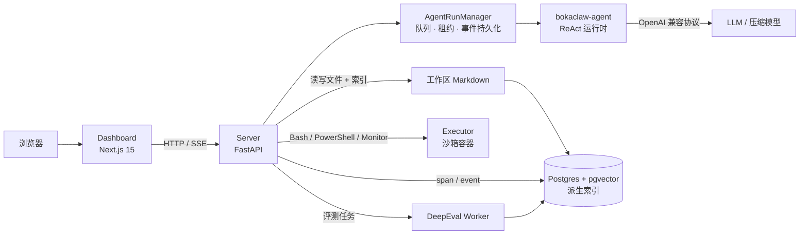

# BokaClaw

> 自托管的 AI Agent 工作台：持久记忆、ReAct 运行时、沙箱工具、链路追踪与离线评测，运行在你自己的基础设施上。

BokaClaw 是一个自托管的 AI Agent 工作台：工作区 Markdown 是记忆的权威存储，Postgres 只承载可重建的检索索引与业务数据。Next.js 控制台负责交互与运营，FastAPI 服务端负责鉴权、会话、执行与观测，`bokaclaw-agent` 负责可嵌入的 ReAct 循环。

项目当前处于快速演进阶段，接口与配置项仍可能调整；对外发布的 SDK 为 `bokaclaw-agent`。

---

## 能力概览

| 模块 | 能力 |
|---|---|
| **持久记忆** | 工作区 Markdown（`USER.md` / `MEMORY.md` / 每日情节）为权威存储；Postgres 全文+向量索引可重建；支持 `user_id` 作用域、来源标记、历史审计与自动情节捕获 |
| **Agent 运行时** | `bokaclaw-agent`：OpenAI 兼容模型的 ReAct 循环，支持 `run()`、`stream()`、`arun()`、协作式取消、同步/异步工具 |
| **多轮会话** | 服务端持久化会话与消息；SSE 增量输出；断线重连、事件回放与 `after_seq` 游标 |
| **工具生态** | 文件读写、Glob/Grep、网页搜索与抓取、PowerShell/Bash、PPTX 生成；工具结果按预算回填模型 |
| **沙箱执行** | Shell 工具可委派给独立 executor 容器：只读根文件系统、非 root、无外网、仅挂载工作区 |
| **子代理** | 子 Agent 作为普通工具被调用，拥有独立上下文与工具白名单，结果结构化回传，父上下文只保留结论 |
| **上下文治理** | Token 预算压缩、滚动摘要、事实账本、步数提示、无进展检测与强制收尾 |
| **可观测性** | `agent / llm / tool / memory` 四类 span、完整事件流、Token 与成本统计、请求审计日志，Dashboard 可下钻 |
| **离线评测** | 基于 DeepEval 的 golden case 评测：循环检测、任务完成度、步骤效率、工具正确性、答案相关性 |
| **多租户与安全** | JWT 登录、`X-API-Key`、首启向导、API Key 管理、按 IP 限流、密钥脱敏、安全响应头 |

---

## 架构



职责边界：

- **Dashboard 只和 Server 通信**，从不直接调用模型，也不持有模型密钥。
- **Server 是唯一的写入方**：会话、消息、run、span、评测结果都由服务端落库。
- **`bokaclaw-agent` 是进程内库**，不负责排队、重试或跨重启续跑；这些由 Server 的 `AgentRunManager` 承担。
- **执行与连接解耦**：关闭 SSE 不会取消 run；重连可通过 `GET /agent/runs/{id}/events?after_seq=N` 继续消费。

---

## 仓库结构

| 目录 | 说明 |
|---|---|
| `server/` | FastAPI 服务端：鉴权、记忆 API、Agent 执行、会话、span、评测、Docker 编排 |
| `dashboard/` | Next.js 15 控制台：Agent 对话、Trace、Eval、Memories、Requests、Entities、配置与密钥 |
| `agent-loop/` | 独立 Python SDK `bokaclaw-agent`：ReAct 循环、工具、子代理、上下文压缩、会话存储 |
| `tests/` | 服务端 Agent、鉴权、Trace、评测等产品测试 |
| `server/app/eval/` | DeepEval 评测适配、指标、golden 数据与后台 worker |
| `docs/` | 架构与设计文档（记忆格式、Agent 运行时、Dashboard 契约、评测等） |
| `deepeval/` | DeepEval 4.3.3 源码参考副本，供评测实现对照 |

---

## 快速开始

### 环境要求

- Docker 24+ 与 Docker Compose v2
- Python 3.10+（运行 SDK、测试与评测）
- Node.js 18+、pnpm 10+（本地开发 Dashboard）
- 可选：`hatch`（管理 Python 环境）

### 一键启动（推荐）

```bash
cd server
cp .env.example .env
```

至少填写：

```dotenv
POSTGRES_PASSWORD=<强随机密码>
JWT_SECRET=<openssl rand -base64 48>
OPENAI_API_KEY=<你的模型与 Embedding Key>
```

然后启动并完成首次初始化：

```bash
make bootstrap
```

该命令会：

1. 启动 Postgres（pgvector）、API 与 Dashboard；
2. 等待 API 与 Dashboard 就绪；
3. 创建第一个管理员账号；
4. 生成第一个 API Key。

> 终端 `=== Ready ===` 区块中的密码与 API Key 只打印一次，请立即保存；API Key 无法再次恢复。

也可以覆盖默认生成的凭据：

```bash
make bootstrap EMAIL=admin@company.com PASSWORD='strong-password' NAME='Admin'
```

### 浏览器向导

如果不使用 `make bootstrap`，可以自行启动后打开向导：

```bash
cd server
make up
```

访问 <http://localhost:3000>，按向导完成管理员注册与模型配置。

### 访问地址

| 服务 | 地址 |
|---|---|
| Dashboard | <http://localhost:3000> |
| REST API | <http://localhost:8888> |
| OpenAPI 文档 | <http://localhost:8888/docs> |
| Postgres（宿主机） | `localhost:8432` |

### 带沙箱执行器的四容器栈

默认 Compose 栈不包含 Shell executor。仓库内提供了独立脚本，额外启动只读根文件系统、无外网、仅挂载工作区的 `bokaclaw-executor`：

```bash
.claude/skills/bokaclaw-docker-stack/scripts/build-images.sh
.claude/skills/bokaclaw-docker-stack/scripts/start-stack.sh
```

重建镜像后让容器使用新镜像：

```bash
RECREATE=1 .claude/skills/bokaclaw-docker-stack/scripts/start-stack.sh
```

该栈会把 `server/.env` 中的 `AGENT_EXECUTOR_URL` 指向 `http://bokaclaw-executor:8099`。

### 单容器部署

`server/Dockerfile.all-in-one` 把 API、Dashboard 与 PostgreSQL 打进一个镜像，内置本地 fastembed 中文 Embedding 模型，适合单机演示或轻量部署：

```bash
docker build -f server/Dockerfile.all-in-one -t bokaclaw-all-in-one:test .
docker run -d --name bokaclaw \
  -p 3000:3000 -p 8000:8000 \
  -e POSTGRES_PASSWORD='<strong-password>' \
  -e JWT_SECRET="$(openssl rand -base64 48)" \
  -e OPENAI_API_KEY='<your-key>' \
  -v bokaclaw-data:/var/lib/postgresql/data \
  bokaclaw-all-in-one:test
```

### 常用运维命令

```bash
cd server

make down                    # 停止栈
make clean                   # 停止并删除数据卷（不可恢复）
make health                  # 检查 API / Dashboard / Postgres
make logs                    # 跟踪日志
make reset-admin-password EMAIL=admin@example.com PASSWORD='new-password'
make prune-logs              # 清理 30 天前的请求日志
```

---

## 核心配置

完整变量见 [`server/.env.example`](server/.env.example) 与 [`server/README.md`](server/README.md)。

### 基础

| 变量 | 说明 |
|---|---|
| `POSTGRES_PASSWORD` | 必填，Compose 缺少该值会拒绝启动 |
| `JWT_SECRET` | 启用鉴权时必填，建议 `openssl rand -base64 48` |
| `OPENAI_API_KEY` | 默认 LLM 与 Embedding 的密钥 |
| `MEMORY_BACKEND` | 固定为 `markdown`（工作区 Markdown 权威存储） |
| `AGENT_MEMORY_ROOT` | 记忆工作区根目录，默认 `/app/memory` |
| `AGENT_MEMORY_RECALL` | 是否启用每轮记忆召回，默认 `true` |
| `AGENT_MEMORY_CAPTURE` | 是否在轮末追加情节，默认 `true` |
| `MEMORY_DEFAULT_LLM_PROVIDER` | `openai` / `anthropic` / `gemini` / `deepseek` |
| `MEMORY_DEFAULT_LLM_MODEL` | 默认 `gpt-5-mini` |
| `MEMORY_DEFAULT_EMBEDDER_PROVIDER` | `openai` / `gemini` / `fastembed` |
| `MEMORY_DEFAULT_EMBEDDER_MODEL` | 默认 `text-embedding-3-small` |
| `AUTH_DISABLED` | 仅限本地开发，生产环境保持 `false` |
| `BOKACLAW_TELEMETRY` | 匿名遥测开关，`false` 可退出 |

### Agent

| 变量 | 默认 | 说明 |
|---|---|---|
| `AGENT_MODEL` | 复用 LLM 配置 | 覆盖 Agent 使用的模型 |
| `AGENT_API_KEY` / `AGENT_BASE_URL` | 复用 LLM 配置 | 接入 Qwen、vLLM、Ollama、OpenRouter 等兼容端点 |
| `AGENT_MAX_ITERATIONS` | `10` | 单轮 ReAct 最大步数 |
| `AGENT_FINAL_ANSWER_ON_MAX_ITERATIONS` | `true` | 步数耗尽时再做一次无工具请求，尽力作答 |
| `AGENT_CONTEXT_MAX_TOKENS` | `32000` | 模型视图的 Token 预算 |
| `AGENT_CONTEXT_COMPRESSION` | `summary` | `summary` 摘要压缩 / `truncate` 仅截断 |
| `AGENT_COMPRESSION_MODEL` | `AGENT_MODEL` | 压缩摘要专用模型，可指向更便宜的模型 |
| `AGENT_FACT_LEDGER` | `true` | 保留 run 内事实账本，避免压缩后遗忘 |
| `AGENT_PROGRESS_GUARD` | `true` | 检测无新证据的工具调用，nudge 后强制收尾 |
| `AGENT_SUBAGENTS_ENABLED` | `false` | 注册 `explore` / `research_agent` 子代理 |
| `AGENT_DEV_TOOLS` | `true` | 注册文件、搜索、抓取、PPTX 等开发工具 |
| `AGENT_TOOLS_ALLOW_SHELL` | `false` | 注册 `Bash` / `PowerShell` / `Monitor` |
| `AGENT_EXECUTOR_URL` | — | 设置后 Shell 工具委派给沙箱 executor |
| `AGENT_WORKSPACE_ROOT` | `/app/workspace` | 文件工具可访问的唯一根目录 |
| `AGENT_SUBAGENT_MAX_CALLS_PER_RUN` | `4` | 每次父 run 允许的子代理调用次数 |

> 生产环境不要直接开启进程内 Shell。保留 `AGENT_EXECUTOR_URL` 指向隔离容器，才能获得文件系统与网络的边界。

---

## 使用 Dashboard

登录后可用的页面：

| 页面 | 用途 |
|---|---|
| **Agent** | 多轮对话、流式输出、停止生成、上下文用量与 Token 成本、工具调用展开、子代理嵌套展示 |
| **Requests** | API 调用审计：方法、路径、状态码、耗时、请求 ID |
| **Trace** | 按 run 查看 `agent / llm / tool / memory` span，下钻查看输入输出、耗时、错误与子代理层级 |
| **Eval** | 管理 golden case，发起评测，查看指标、通过率、成本与对应的 Agent run |
| **Memories** | 浏览、搜索、过滤、删除记忆；查看记忆历史 |
| **Entities** | 汇总所有 `user_id` / `agent_id` / `run_id`，支持级联删除 |
| **Configuration** | 运行时覆盖 LLM 与 Embedder，持久化后重启仍生效 |
| **API Keys** | 创建、标注、吊销用户级 API Key |
| **Settings** | 账号资料与密码 |

侧边栏中的 Categories、Webhooks、Analytics、Export 标记为 `PRO`，属于云功能占位，当前自托管栈不提供对应后端能力。

---

## REST API

除健康检查与文档外，默认都需要鉴权：`Authorization: Bearer <JWT>`、`X-API-Key: <key>`，或旧版 `ADMIN_API_KEY`。

| 分组 | 端点 |
|---|---|
| 鉴权 | `POST /auth/register`、`POST /auth/login`、`POST /auth/refresh`、`GET/PATCH /auth/me`、`POST /auth/change-password`、`GET /auth/setup-status` |
| API Key | `GET/POST /api-keys`、`DELETE /api-keys/{key_id}` |
| 记忆 | `POST/GET /memories`、`GET/PUT/DELETE /memories/{id}`、`GET /memories/{id}/history`、`POST /search`、`POST /reset` |
| 实体 | `GET /entities`、`DELETE /entities/{type}/{id}` |
| Agent | `POST /agent`、`GET /agent/runs/{id}`、`GET /agent/runs/{id}/events`、`POST /agent/runs/{id}/cancel` |
| 会话 | `GET/POST /conversations`、`GET/PUT/DELETE /conversations/{id}`、`GET /conversations/{id}/messages` |
| 观测 | `GET /requests`、`GET /traces`、`GET /traces/{span_pk}` |
| 评测 | `POST/GET /evals`、`GET /evals/{id}`、`POST /evals/{id}/cancel`、`GET/POST /evals/goldens`、`GET/PUT/DELETE /evals/goldens/{case_id}` |
| 配置 | `GET/POST /configure`、`GET /configure/providers`、`POST /generate-instructions` |

### 调用 Agent（SSE）

```bash
curl -N -X POST http://localhost:8888/agent \
  -H "X-API-Key: $ADMIN_API_KEY" \
  -H "Content-Type: application/json" \
  -H "Accept: text/event-stream" \
  -d '{
    "message": "总结一下我保存的发布计划，并列出风险",
    "stream": true
  }'
```

典型事件顺序：

```text
meta → memory.recall? → (tool.call → tool.result)*
     → message.delta* → message.completed → done → memory.save?
```

失败、取消或中断时不会发送 `message.completed`，而是：

```text
悬挂工具补发 tool.result(status="aborted") → error → done
```

`done` 不是成功信号，必须读取其中的 `status`。`meta` 最先出现，`done` 最后出现；每个持久化事件都带单调递增的 `id`，可用于重连去重。

### 调用 Agent（一次性 JSON）

去掉 `"stream": true` 即可在 run 完成后返回完整助手消息。

---

## Agent Runtime SDK

`agent-loop/` 可独立安装和嵌入任意 Python 服务：

```bash
pip install bokaclaw-agent                # 仅内存会话
pip install "bokaclaw-agent[postgres]"    # 增加 psycopg3 + 连接池
```

```python
import os

from bokaclaw_agent import AgentConfig, AgentRuntime, ModelConfig, tool


@tool
def get_weather(city: str) -> str:
    """Return the current weather for a city.

    Args:
        city: The city to look up.
    """
    return f"{city}: sunny, 25C"


runtime = AgentRuntime(
    AgentConfig(
        name="weather-agent",
        system_prompt="Use tools when they help. Answer concisely.",
        model=ModelConfig(
            model="deepseek-chat",
            api_key=os.environ["DEEPSEEK_API_KEY"],
            base_url="https://api.deepseek.com/v1",
        ),
    ),
    tools=[get_weather],
)

result = runtime.run("What's the weather in Beijing?", session_id="user-42")
print(result.content)
```

主要入口：

| 方法 | 行为 |
|---|---|
| `run(input, session_id=...)` | 阻塞执行一轮 ReAct，返回 `RunResult` |
| `stream(input, session_id=...)` | 逐段 yield 文本增量，生成器耗尽时返回 `RunResult` |
| `arun(...)` | `run()` 的异步包装 |

运行时还支持：

- `@tool` 自动从类型注解与 docstring 生成 JSON Schema，参数先经 Pydantic 校验；
- 工具失败默认以 `{"error": ...}` 回填给模型，可按需改为抛出；
- `cancel_event` 在安全检查点协作式取消，并落库为 `cancelled`；
- `InMemorySessionStore` 或 `PostgresSessionStore` 持久化会话；
- 子代理：独立 system prompt、上下文窗口与工具白名单，父级只接收结构化结果；
- 上下文压缩、事实账本、步数提示、无进展守卫；
- `on_event` 事件回调，覆盖模型请求、工具调用、压缩、子代理与运行结束。

完整 API、子代理任务包格式、持久化表结构与 HTTP executor 契约见 [`agent-loop/README.md`](agent-loop/README.md)。

---

## 开发

### 服务端

服务端约定使用 Docker 运行，不提供“直接 uvicorn 启动”的路径。

```bash
cd server
docker compose up -d --build
docker compose logs -f server
```

数据库迁移在容器启动时执行：

```bash
docker compose exec server alembic upgrade head
```

测试（在具备服务端依赖的 Python 环境中，从仓库根目录运行）：

```bash
pytest tests/ server/tests/
```

### Agent SDK

```bash
cd agent-loop
hatch env create
hatch run lint
hatch run format-check
hatch run test
```

- Ruff line length **120**，isort `profile = black`；
- 单元测试不访问网络，使用 `FakeProvider` 与 `InMemorySessionStore`；
- 真实 Postgres 测试由 `BOKACLAW_AGENT_TEST_DSN` 控制，标记为 `integration`。

### Dashboard

```bash
cd dashboard
pnpm install
pnpm dev          # http://localhost:3000
pnpm typecheck
pnpm build
pnpm lint         # prettier --check .
```

仅使用 pnpm；API 调用统一走 `src/utils/api.ts` 与 `src/utils/api-endpoints.ts`，不要把 token 写入 `localStorage`。

### 评测

评测代码位于 `server/app/eval/`，独立依赖见 `server/eval-requirements.txt`。根目录的 `eval` hatch 环境把仓库内 `deepeval` 作为源码依赖：

```bash
hatch run eval:test
```

---

## 安全模型

- **默认开启鉴权**：Dashboard 使用 JWT，程序化访问使用 `X-API-Key`；`AUTH_DISABLED=true` 只用于本地开发。
- **工作区约束**：所有文件工具通过 `_resolve()` 解析路径，拒绝 `..` 与符号链接逃逸。
- **Shell 隔离**：executor 容器只读根文件系统、非 root、丢弃全部 capability、仅内网可达、仅挂载工作区；子进程使用净化后的环境变量。
- **SSRF 防护**：`WebFetch` / `WebSearch` 默认禁止访问 localhost 与私有网段，可通过 `AGENT_WEB_FETCH_ALLOW_PRIVATE` 显式放开。
- **敏感信息脱敏**：span 写入前按规则过滤 `sk-*`、`Bearer`、`api_key`、`password`、`token` 等字段。
- **限流**：Agent 接口默认 30 次/分钟/IP；鉴权接口同样受限。
- **安全响应头**：Dashboard 设置 `X-Frame-Options: DENY`、`frame-ancestors 'none'`、`nosniff` 与严格 Referrer Policy。
- **遥测可关闭**：`BOKACLAW_TELEMETRY=false`。

---

## 文档索引

| 主题 | 文档 |
|---|---|
| Agent SDK 使用与 API | [`agent-loop/README.md`](agent-loop/README.md) |
| Agent SDK 架构与分层 | [`docs/agent-loop/architecture.md`](docs/agent-loop/architecture.md) |
| 运行时行为与终止条件 | [`docs/agent-loop/runtime-behavior.md`](docs/agent-loop/runtime-behavior.md) |
| 子代理编排设计 | [`docs/agent-loop/subagent-orchestration-design-v2.md`](docs/agent-loop/subagent-orchestration-design-v2.md) |
| 执行与连接解耦 | [`docs/agent-loop/agent-execution-decoupling.md`](docs/agent-loop/agent-execution-decoupling.md) |
| Dashboard ↔ Server 契约 | [`docs/dashboard/agent-chat-design.md`](docs/dashboard/agent-chat-design.md) |
| DeepEval 评测原理 | [`docs/eval/deepeval-architecture.md`](docs/eval/deepeval-architecture.md) |
| Span 评测设计 | [`docs/eval/agent-span-evaluation.md`](docs/eval/agent-span-evaluation.md) |
| 构建问题记录 | [`docs/building-problem-record/problem-record.md`](docs/building-problem-record/problem-record.md) |
| 服务端运维与配置 | [`server/README.md`](server/README.md) |

---

## 贡献

- 提交信息遵循 [Conventional Commits](https://www.conventionalcommits.org/)（`feat:`、`fix:`、`docs:`、`refactor:`、`test:`）。
- 改动前先阅读目标目录下的 `AGENTS.md`；不同包的 linter、行宽与测试命令不同。
- 修改公共 API 时同步更新对应 README 与 `docs/`。
- 不要提交 `.env`、API Key 或任何凭据。
- 提交前运行受影响包的 lint 与测试。

行为准则见 [`CODE_OF_CONDUCT.md`](CODE_OF_CONDUCT.md)，安全问题请按 [`SECURITY.md`](SECURITY.md) 私下报告。

---

## License

Apache-2.0，见 [`LICENSE`](LICENSE)。

BokaClaw 的早期版本基于 [Mem0](https://github.com/mem0ai/mem0) 构建，感谢其 Apache-2.0 许可与贡献；当前运行时已移除 Mem0 依赖，记忆改为工作区 Markdown 权威存储。
