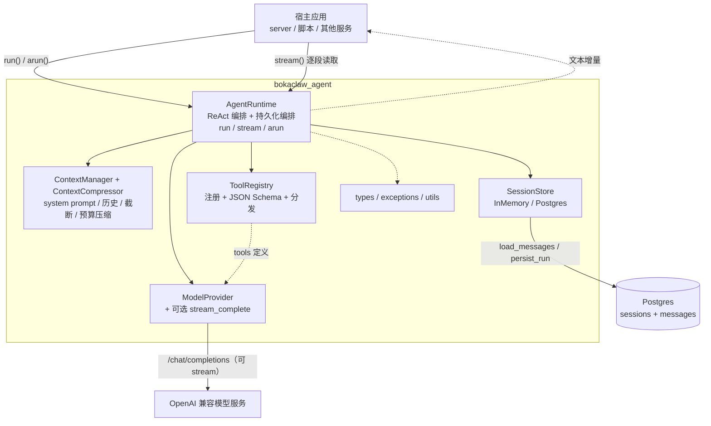
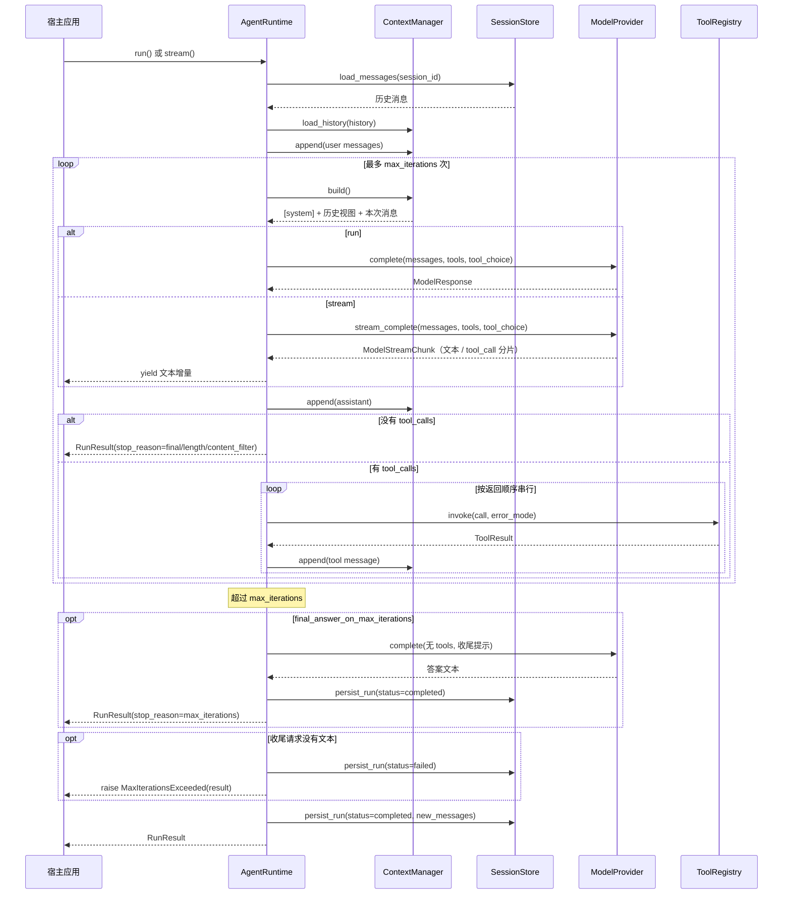
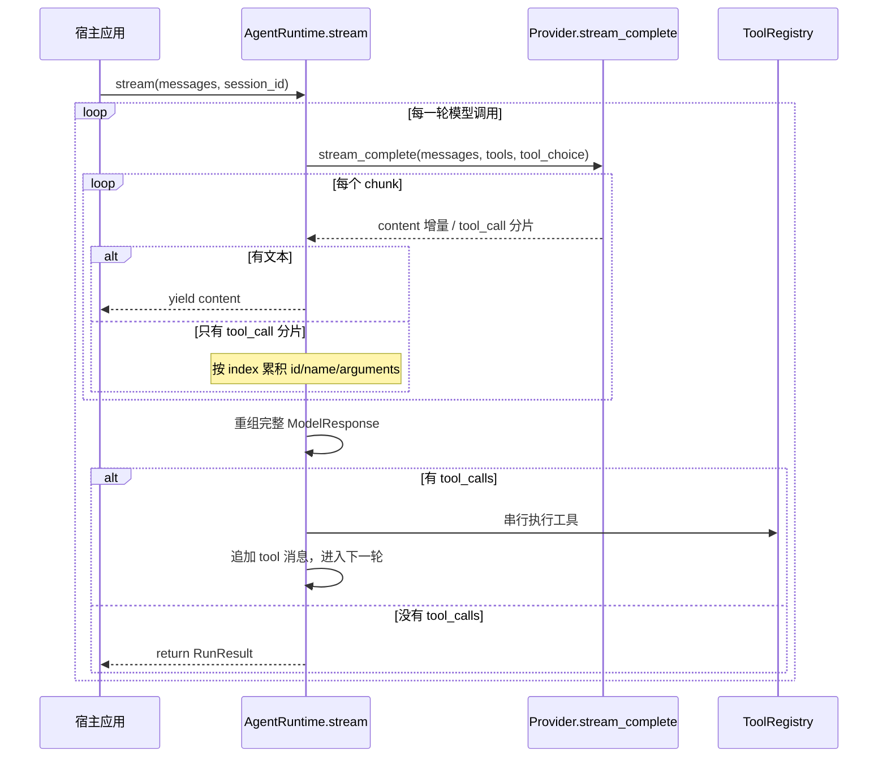

# BokaClaw AgentRuntime SDK 架构设计

> 状态：已实现（v1）
>
> 适用范围：`agent-loop/` 包（发行名 `bokaclaw-agent`，import 名 `bokaclaw_agent`）
>
> 目标读者：SDK 维护者、`server/` 集成开发者、需要嵌入 Agent 能力的业务方

本文描述 SDK 的整体分层、核心组件、一次 ReAct 运行的完整链路、持久化模型和扩展点。使用方式与 API 示例见 [`agent-loop/README.md`](../../agent-loop/README.md)；Dashboard 侧的前后端契约见 [`docs/dashboard/agent-chat-design.md`](../dashboard/agent-chat-design.md)。

---

## 1. 定位

`bokaclaw-agent` 是一个可独立发布、可嵌入任意 Python 服务的轻量 Agent 运行时，v1 负责四件事：

1. **ReAct 循环**：把消息和工具定义发给模型，执行模型返回的 `tool_calls`，把结果回填为 `role="tool"` 消息，直到模型给出最终答案。
2. **流式输出**：`stream()` 在最终答案生成过程中逐段转发文本增量；工具调用分片在内部重组后才执行。
3. **上下文管理**：一次 run 内的消息保存在内存；恢复会话时加载历史，并按配置裁剪发送给模型的视图。
4. **会话持久化**：run 结束后把本次新增消息写入 Postgres（或内存），支持同一 `session_id` 继续对话。

入口有三个：`run()`（阻塞返回完整结果）、`stream()`（同步生成器，边生成边 yield 文本）、`arun()`（`run()` 的异步包装）。三者都接受可选的 `cancel_event: threading.Event`，在安全检查点协作式停止；命中时抛出 `RunCancelled`，并把本轮持久化为 `cancelled`。

SDK 是**进程内库**，不是后台执行器。`server/` 的 `AgentRunManager` 负责 run 的创建、排队、领取、事件持久化、订阅与重启回收；SDK 只负责一轮 ReAct 执行并向调用方发出事件。执行与连接解耦的完整契约见 [`agent-execution-decoupling.md`](agent-execution-decoupling.md)，HTTP/SSE 契约以 [`../server/agent-execution-decoupling.md`](../server/agent-execution-decoupling.md) 为准。

明确的非目标（v1）：

- 跨轮持久化摘要（滚动摘要只存在于一次 run 内）
- 并行工具执行
- 边收流边执行工具调用（必须等 tool_call 分片重组完成）
- MCP 工具发现、内置网络搜索
- 工具级权限与 OS 沙箱（由宿主应用决定）
- run 生命周期管理、后台队列、租约、跨重启续跑
- SSE 订阅、事件回放与 `after_seq` 游标
- 抢占式取消或工具级中断

---

## 2. 分层架构



设计要点：

- **Runtime 是唯一的编排者**：Context、Registry、Provider、Store 都不互相调用，便于单独替换和测试。
- **模型层与存储层都是 Protocol**：宿主可以注入任意实现；默认实现只依赖 `openai` 和可选的 `psycopg`。流式能力是模型层的**可选协议**，不实现时自动退化。
- **同步核心 + 异步/流式外壳**：`_execute()` 是唯一的 ReAct 实现，`run()` 与 `stream()` 只是以不同方式驱动它；`arun()` 用 `asyncio.to_thread` 包一层。所有异步工具/Provider 都通过 `resolve_awaitable` 统一解析。
- **持久化与业务存储解耦**：SDK 的 Postgres 表只服务于独立使用场景。`server/` 集成时由服务端自己的 `conversations` 表负责持久化，SDK 不写库（见第 12 节）。

---

## 3. 目录结构

```text
agent-loop/
├── pyproject.toml                  # hatchling 构建，postgres/test/dev extras
├── README.md                       # 安装、用法、HTTP 下游契约
├── AGENTS.md                       # 本包 lint/test 约定
├── examples/quickstart.py
├── src/bokaclaw_agent/
│   ├── __init__.py                 # 公开导出
│   ├── core/
│   │   ├── __init__.py
│   │   ├── config.py               # AgentConfig / ModelConfig
│   │   ├── types.py                # ToolCall / ModelResponse / RunResult / AgentEvent ...
│   │   ├── exceptions.py           # AgentError 及子类
│   │   └── utils.py                # resolve_awaitable / parse_tool_arguments
│   ├── agent/
│   │   ├── __init__.py
│   │   ├── runtime.py              # AgentRuntime：ReAct 循环与持久化编排
│   │   ├── context.py              # 消息规范化 + 上下文视图 + token 估算
│   │   └── compression.py          # ContextCompressor：预算压缩与滚动摘要
│   ├── tools/
│   │   ├── __init__.py             # 公开导出 Tool / ToolRegistry / tool
│   │   └── registry.py             # Tool / ToolRegistry / @tool / schema 生成
│   ├── providers/
│   │   ├── base.py                 # ModelProvider Protocol
│   │   └── openai_compatible.py    # OpenAI Chat Completions 适配器
│   └── sessions/
│       ├── base.py                 # SessionStore Protocol / SessionRecord / title
│       ├── memory.py               # InMemorySessionStore
│       └── postgres.py             # PostgresConfig / PostgresSessionStore / DDL
└── tests/
```

依赖关系是单向的：

```text
                    ┌──────────────┐
                    │ agent.runtime│
                    └──────┬───────┘
        ┌──────────────┬───┴───────────┬──────────────┐
        ▼              ▼               ▼              ▼
 agent.context    tools/          providers/      sessions/
 agent.compression
        │              │               │              │
        └──────────────┴───────┬───────┴──────────────┘
                               ▼
                    core/ (config, types, exceptions, utils)
```

`core/` 是叶子层，不依赖其他子包；`agent/` 只依赖 `core/`、`tools/`、`providers/`、`sessions/`。`__init__.py` 只做公开导出，子包内部的模块路径（如 `agent/runtime.py`）不是稳定 API，宿主应优先使用 `from bokaclaw_agent import ...`。
`__init__.py` 只做公开导出；导入包时不会连接数据库，`psycopg` 仅在实例化 `PostgresSessionStore` 时懒加载。

---

## 4. 核心组件

### 4.1 AgentRuntime（`agent/runtime.py`）

Runtime 持有四个可替换的协作者：`AgentConfig`、`ModelProvider`、`ToolRegistry`、可选的 `SessionStore`。

```python
AgentRuntime(
    config: AgentConfig,
    *,
    tools: Iterable[Tool | Callable] = (),
    provider: ModelProvider | None = None,
    store: SessionStore | None = None,
    on_event: Callable[[AgentEvent], Any] | None = None,
)
```

| 成员 | 作用 |
|---|---|
| `run(input, *, session_id=None, user_id=None, metadata=None, cancel_event=None, **model_kwargs)` | 执行一次完整的 ReAct 回合，返回 `RunResult`；`cancel_event` 命中时抛 `RunCancelled` |
| `stream(...)` | 同一回合的流式版本：逐段 `yield` 文本增量，生成器耗尽时返回 `RunResult`；接受 `cancel_event` |
| `arun(...)` | `run()` 的异步包装，内部 `asyncio.to_thread`；`cancel_event` 原样转发；不提供流式版本 |
| `register_tool(tool)` | 运行期追加工具 |
| `get_session / list_sessions / delete_session` | 会话管理；未配置 store 时返回空/空操作 |
| `close / aclose` | 关闭 store 持有的连接池 |

两个入口共享 `_execute()`（`agent/runtime.py:161`）：

```python
def run(...):
    turn = self._execute(..., stream=False, ...)
    while True:
        try:
            next(turn)
        except StopIteration as stop:
            return stop.value          # 生成器的返回值就是 RunResult

def stream(...):
    turn = self._execute(..., stream=True, ...)
    while True:
        try:
            delta = next(turn)
        except StopIteration as stop:
            return stop.value
        yield delta                    # 只有文本增量会被 yield
```

因此持久化、工具执行、轮数控制只有一份实现。`stream()` 在耗尽前被关闭（消费者 `break` 或显式 `close()`）时，本轮不会持久化，已执行的工具结果也不会写库；宿主应消费到 `StopIteration`/`return` 才能得到完整会话。

取消检查点有四个：每次 ReAct 迭代前、模型响应后/执行本次工具前、每个工具调用前、每个工具调用后。流式 chunk 循环内部**不检查**，因此取消要等当前模型响应完整结束；正在执行的工具也不能被抢占。命中时 `_cancel_run()` 会 abort 尚未执行的工具（发出 `status="aborted"` 的 `tool_result`）、构造 `stop_reason="cancelled"` 的部分 `RunResult`、尽力持久化会话为 `cancelled`、发出 `run_ended`，再抛出 `RunCancelled`；取消路径不发 `error` 事件。细节见 [`agent-execution-decoupling.md`](agent-execution-decoupling.md) 第 4 节。

未注入 `provider` 时，必须提供 `config.model`，Runtime 会构造默认的 `OpenAICompatibleProvider`；两者都没有则在构造阶段抛 `ConfigurationError`。

### 4.2 模型层（`providers/`）

`ModelProvider` 是一个 `runtime_checkable` Protocol：

```python
def complete(
    messages: list[dict],
    *,
    tools: list[dict] | None = None,
    tool_choice: str | dict | None = "auto",
    **kwargs,
) -> ModelResponse: ...
```

流式能力由可选的 `StreamingModelProvider` 协议描述：

```python
def stream_complete(
    messages: list[dict],
    *,
    tools: list[dict] | None = None,
    tool_choice: str | dict | None = "auto",
    **kwargs,
) -> Iterator[ModelStreamChunk]: ...
```

只实现 `complete()` 的 Provider 仍然可用：`_stream_complete()` 会回退到一次 `complete()`，把完整答案包装成单个 `ModelStreamChunk`。这保证了自定义 Provider 不必被迫支持流式。

`OpenAICompatibleProvider` 是唯一内置实现，同时实现两个协议，面向所有 OpenAI Chat Completions 兼容服务（OpenAI、DeepSeek、Qwen 兼容模式、vLLM、Ollama 等）。`_build_params()` 由 `complete()` 和 `stream_complete()` 共用，后者额外设置 `stream=True`。

关键行为：

- **保留 `tool_call.id`**：这是 ReAct 回填的前提。`ToolCall` 同时保存解析后的 `arguments` 和原始 `raw_arguments`，回写 assistant 消息时优先使用原始字符串，避免 JSON 重新序列化带来的差异。
- **坏 JSON 不崩溃**：`function.arguments` 解析失败时保留原文，并设置 `ToolCall.arguments_error`；工具层会把错误作为工具结果返回给模型。
- **流式分片解析**：每个 chunk 转成 `ModelStreamChunk`；`delta.content` 直接转发，`delta.tool_calls[]` 按 `index` 保存 `id`、`name`、`arguments` 片段。空 chunk（keep-alive）会被丢弃；usage 可能出现在末尾一个没有 choices 的 chunk 中，仍会保留。
- **兼容旧式 `function_call`**：生成 `call_<uuid4hex>` 作为 id。
- **统一错误**：SDK/网络异常包装为 `ModelError`；无 choice 也抛 `ModelError`。
- **usage 归一化**：只保留 `prompt_tokens`、`completion_tokens`、`total_tokens`。
- **配置默认值**：`api_key` 缺省读 `OPENAI_API_KEY`，`base_url` 缺省读 `OPENAI_BASE_URL`，再回退官方地址；`temperature`、`max_tokens` 仅在设置时下发。

Provider 可以返回 awaitable，Runtime 的 `_complete()` 会通过 `resolve_awaitable` 解析，并把 dict 形式的结果校验为 `ModelResponse`。流式 Provider 的 chunk 也允许是 dict，由 `_stream_complete()` 校验为 `ModelStreamChunk`。

### 4.3 工具层（`tools/registry.py`）

```python
@tool
def get_weather(city: str, days: int = 1) -> str:
    """Return the weather forecast for a city.

    Args:
        city: City name.
        days: Number of days to forecast.
    """
```

工具由三部分组成：

| 部分 | 实现 |
|---|---|
| Schema 生成 | 用 `inspect.signature` + `typing.get_type_hints` 收集参数，`pydantic.create_model` 生成参数模型，再 `model_json_schema()` |
| 描述提取 | docstring 首段作为工具描述；Google 风格 `Args:` / `Arguments:` / `Parameters:` 段落的参数说明写入 schema property |
| 调用校验 | 调用前用生成的模型做类型转换与校验，再把字段展开为 kwargs |

生成规则与限制：

- 支持基础类型、`Optional`、`Literal`、`Enum`、Pydantic `BaseModel`、列表/字典等可由 Pydantic 建模的注解。
- 无注解的参数按 `str` 处理。
- 拒绝 `*args` / `**kwargs`、下划线开头或 Pydantic 保留名的参数。
- 工具名限 `[A-Za-z0-9_-]{1,64}`；重名注册抛 `ToolSchemaError`。
- 对于定义在函数内部（测试、notebook、工厂函数）的类型，`_caller_locals()` 会在装饰时抓取调用方局部变量，保证前向注解可解析。

返回值序列化规则：`str` 原样；Pydantic 模型 `model_dump_json()`；`None` → `"null"`；`bytes` 尝试 UTF-8 解码；其他对象 `json.dumps(..., default=str)`。

错误模式由 `AgentConfig.tool_error_mode` 控制：

| 模式 | 未知工具 / 参数错误 / 工具异常 |
|---|---|
| `return`（默认） | 转成 `ToolResult(is_error=True)`，内容为 `{"error": "..."}`，继续循环 |
| `raise` | 抛 `ToolNotFoundError` / `ToolArgumentError` / `ToolExecutionError`，由 Runtime 走失败持久化 |

`ToolRegistry` 按名称索引工具，`specs()` 输出 OpenAI `tools` 数组，`invoke()` 负责把 `ToolCall` 转成 `ToolResult`。

### 4.4 上下文层（`agent/context.py` / `agent/compression.py`）

`ContextManager` 把「历史」和「本次 run 新增」分开保存：

```text
build() = [system?] + truncate(history) + current
```

- **system prompt 不持久化**：每次 `build()` 重新插入。恢复会话不会重复，修改提示词立即生效。
- **`max_history_messages` 只裁剪历史视图**：本次 run 的消息和最终持久化的消息始终完整。
- **裁剪对齐边界**：优先从最近的第 `N` 条里找 `role="user"` 作为起点；找不到则找没有 `tool_calls` 的 assistant；仍找不到就只发 system。这样不会产生孤立的 `role="tool"` 消息。
- **工具结果裁剪只改视图**：`tool_result_max_chars` 在 `build()` 内对 `role="tool"` 消息做头尾截断（返回拷贝，不改 `_history` / `_current`），所以恢复会话时加载的历史工具结果同样受控；`new_messages`、`RunResult.tool_results` 与 SessionStore 写入始终是完整原文。
- `normalize_input()` 接受字符串或 OpenAI wire-format 消息列表；未知结构直接报错。

token 估算不引入 tokenizer：`estimate_tokens()` 使用 `ceil(ascii_chars * 0.4 + non_ascii_chars)`，`estimate_message_tokens()` 再计入 `tool_calls` JSON 与 4 个结构开销。

#### 预算压缩（`agent/compression.py`）

`AgentConfig.context_max_tokens` 开启后，runtime 每次迭代在 `build()` 之后、发出 `model_request` 之前调用 `ContextCompressor.compress()`：

```text
build() ──▶ compress(messages, tools_tokens) ──▶ model_request
```

- 预算先扣除 tools schema 的估算；未超预算直接返回原文，不产生额外模型调用。
- 切点从尾部向前累积 `context_keep_recent_tokens`（默认预算一半），再前移到合法边界（`user`，或带 `tool_calls` 的 `assistant`，因为它的结果紧随其后）。最近一条 `user` 消息会被钉住保留，长工具循环不会丢失任务指令。
- `summary` 模式把切点之前的消息连同上一次摘要折叠成滚动摘要，合并进唯一的 system 消息。摘要调用使用 `provider.complete(..., tools=None, tool_choice=None, temperature=0, max_tokens=1024)`，**不复用**会强制携带 tools 的 `_complete()`；usage 合并进本次 run。摘要失败（异常、空内容、内容过少）只记录 warning 并回退裁剪，不中断 run。
- `truncate` 模式直接丢弃切点之前的消息，并在 system 末尾追加省略说明。
- 压缩后仍超预算时，`_fit_budget()` 对最大的非 system 消息做头尾截断（只改视图），不会拆散 tool_call 与其结果。
- 每次真正改写视图都会发出 `context_compressed` 事件，位置在该轮 `model_request` 之前。`ContextCompressor` 的滚动摘要只存在于一次 run 内，不写入 SessionStore。

消息构造规则：

- assistant 消息保留 `content`（可为 `null`）和 `tool_calls`，`function.arguments` 使用 `raw_arguments` 原串。
- tool 消息只包含 `role`、`tool_call_id`、`content`；**故意不带 `name`**，因为 OpenAI 的 tool 消息 schema 不定义该字段，严格的兼容服务会拒绝未知字段。

### 4.5 持久化层（`sessions/`）

`SessionStore` Protocol 定义六个方法：`ensure_schema`、`get_session`、`load_messages`、`persist_run`、`list_sessions`、`delete_session`、`close`。

两个实现：

| 实现 | 特点 |
|---|---|
| `InMemorySessionStore` | 进程内、`RLock` 保护、返回深拷贝；适合测试和短生命周期 Agent |
| `PostgresSessionStore` | psycopg3 连接池 + 原生 SQL；与 mem0 共用数据库；可配置表前缀 |

`PostgresConfig` 的关键点：

- `dsn` 优先级最高；否则读取 `BOKACLAW_AGENT_POSTGRES_DSN` / `POSTGRES_DSN`，再回退 `POSTGRES_HOST` / `POSTGRES_PORT` / `POSTGRES_DB` / `POSTGRES_USER` / `POSTGRES_PASSWORD`。
- 默认库为 `postgres`（与 mem0 的 `memories` 表同库），默认表前缀 `bokaclaw_agent`。
- `table_prefix` 必须匹配 `^[a-z_][a-z0-9_]*$`，防止 SQL 注入。
- `pool` 可注入，便于测试或与宿主共享连接池；只有自建池才会在 `close()` 时关闭。

### 4.6 类型、异常与工具函数

`core/types.py` 中的核心模型：

| 类型 | 用途 |
|---|---|
| `ToolCall` | 模型请求的工具调用（id、name、arguments、raw_arguments、arguments_error） |
| `ModelResponse` | 归一化后的模型输出（content、tool_calls、finish_reason、usage） |
| `ModelStreamChunk` | 流式 Provider 的单个增量（content、tool_calls、finish_reason、usage） |
| `ToolCallDelta` | 流式 tool call 的一个分片（index、id、name、arguments 片段） |
| `ToolResult` | 回填给模型的工具结果（tool_call_id、name、content、is_error） |
| `RunResult` | 一次 run 的完整结果（session_id、content、stop_reason、new_messages、tool_results、iterations、usage）；`stop_reason` 含 `cancelled` |
| `AgentEvent` / `EventType` | 生命周期事件与枚举；`AgentEvent.seq` 是 run 内从 1 开始的序号 |

异常层级：

```text
AgentError
├── ConfigurationError
├── ModelError
├── ToolError
│   ├── ToolSchemaError
│   ├── ToolNotFoundError
│   ├── ToolArgumentError
│   └── ToolExecutionError
├── MaxIterationsExceeded      # 携带 result
├── RunCancelled               # 携带 result；不是 error 事件
└── SessionStoreError
    ├── PersistenceError
    └── SessionNotFoundError
```

`utils.parse_tool_arguments()` 把 Provider 的原始参数统一成 `(dict, raw, error)`：dict 原样保留、JSON 字符串解析、坏 JSON 返回空对象与错误文本，供 `ToolCall.arguments_error` 使用。

`utils.resolve_awaitable()` 是同步核心与异步扩展之间的桥：值不是 awaitable 时原样返回；是 awaitable 时用 `asyncio.run()` 执行。若调用方已处于事件循环中，会抛出带指引的 `RuntimeError`（应改用 `arun()`）。

---

## 5. 一次 run 的时序

`run()` 与 `stream()` 共用同一条链路，区别只在模型调用与结果返回方式。



编号说明：

1. `session_id` 缺省时生成 `uuid4().hex`；未知 id 视为新会话，不报错。
2. 历史从 store 加载；输入消息规范化后同时进入上下文和 `new_messages`。
3. 每轮先 `build()` 出模型视图，再调用 Provider；assistant 消息（含 `tool_calls`）立即进入上下文和 `new_messages`。
4. 无 `tool_calls` 时按 `finish_reason` 映射结束原因：`stop`/`None` → `final`，`length` → `length`，`content_filter` → `content_filter`。
5. 有 `tool_calls` 时**串行**执行，每个调用都追加一条匹配 `tool_call_id` 的 tool 消息；工具异常按 `tool_error_mode` 处理。
6. 循环耗尽仍没有最终答案时，先发一次**不带工具**的收尾请求（`final_answer_on_max_iterations=True`，默认开启）；有文本则追加 assistant 消息、以 `completed` 持久化并返回 `stop_reason="max_iterations"`，否则写入 `failed` 并抛 `MaxIterationsExceeded`（异常上带 `result`）。收尾请求的提示语只存在于该次请求视图，不写入会话。
7. 成功结束只调用一次 `persist_run`，写入本次新增消息和 `completed` 状态。
8. 若 `cancel_event` 在任一安全检查点已设置，走取消分支而不是正常结束：abort 待执行工具、持久化 `cancelled`、发出 `run_ended(stop_reason="cancelled")`、抛 `RunCancelled`。取消分支不写 `error` 事件，也不返回 `RunResult`；部分结果在异常对象上。

### 5.1 流式模式（`stream()`）



要点：

- **只有最终答案的文本会 yield**。模型如果先返回 `tool_calls`，那一轮没有可展示的文本；工具执行完后进入下一轮，下一轮的文本才继续转发。
- **tool_call 分片必须先重组**。`_stream_response()` 按 `index` 累加 `name` 和 `arguments` 字符串，全部 chunk 结束后再用 `parse_tool_arguments()` 解析，然后交给 `ToolRegistry` 执行。
- **usage 跨轮累加**。每个 chunk 的 usage 都并入本次 run 的总计。
- **无流式能力的 Provider 自动降级**。`_stream_complete()` 检测不到 `stream_complete` 时调用一次 `complete()`，把整段答案作为单个 chunk 发出；调用方代码不需要分支。
- **提前关闭等于放弃本轮**。生成器被 `close()` 时不会执行最后的 `persist_run()`，已完成的工具结果也不会落库；需要持久化就必须消费到 `StopIteration`。这与 `cancel_event` 不同：取消会走 `_cancel_run()` 并持久化 `cancelled`。
- **取消不在 chunk 循环内生效**。`stream()` 要等当前模型响应完整结束后才检查 `cancel_event`；长模型流或长工具调用会延迟取消。

---

## 6. 消息格式

SDK 内部始终使用 OpenAI wire format，持久化也保存同一结构，因此恢复后可直接拼回请求：

```json
[
  {"role": "system", "content": "You are BokaClaw's assistant."},
  {"role": "user", "content": "What's the weather in Beijing?"},
  {
    "role": "assistant",
    "content": null,
    "tool_calls": [
      {
        "id": "call_abc",
        "type": "function",
        "function": {"name": "get_weather", "arguments": "{\"city\": \"Beijing\"}"}
      }
    ]
  },
  {"role": "tool", "tool_call_id": "call_abc", "content": "Beijing: sunny"}
]
```

约束：

- `tool_call.id` 必须原样保留并回填，否则模型无法把结果和调用对应起来。
- assistant 消息允许 `content=null`，但只要有 `tool_calls` 就是合法消息。
- tool 消息不带 `name`，名称信息保留在 `ToolResult` 中；持久化表的 `name` 列留给宿主自行补充的消息，Runtime 生成的 tool 消息不会填该列。
- `arguments` 以原始 JSON 字符串回写，避免重新序列化改变内容。

---

## 7. 持久化模型

### 7.1 表结构

`PostgresSessionStore` 用 `CREATE TABLE IF NOT EXISTS` 管理两张表（表名前缀可配置）：

```sql
CREATE TABLE IF NOT EXISTS bokaclaw_agent_sessions (
    id          TEXT PRIMARY KEY,
    agent_name  TEXT NOT NULL,
    user_id     TEXT,
    title       TEXT,
    metadata    JSONB NOT NULL DEFAULT '{}'::jsonb,
    status      TEXT NOT NULL DEFAULT 'active'
                CHECK (status IN ('active','completed','failed','cancelled')),
    error       TEXT,
    created_at  TIMESTAMPTZ NOT NULL DEFAULT now(),
    updated_at  TIMESTAMPTZ NOT NULL DEFAULT now()
);

CREATE INDEX IF NOT EXISTS bokaclaw_agent_sessions_user_idx
    ON bokaclaw_agent_sessions (user_id, updated_at DESC);

CREATE TABLE IF NOT EXISTS bokaclaw_agent_messages (
    id           BIGINT GENERATED ALWAYS AS IDENTITY PRIMARY KEY,
    session_id   TEXT NOT NULL
                 REFERENCES bokaclaw_agent_sessions(id) ON DELETE CASCADE,
    seq          BIGINT NOT NULL,
    role         TEXT NOT NULL CHECK (role IN ('system','user','assistant','tool')),
    content      TEXT,
    tool_calls   JSONB,
    tool_call_id TEXT,
    name         TEXT,
    metadata     JSONB NOT NULL DEFAULT '{}'::jsonb,
    created_at   TIMESTAMPTZ NOT NULL DEFAULT now(),
    UNIQUE (session_id, seq)
);
```

设计说明：

- **不引入迁移框架**：SDK 要能直接嵌进已有数据库，因此只做幂等建表；需要精细 schema 管理的部署可设置 `auto_create_schema=false` 自行建表。
- **并发建表安全**：`ensure_schema()` 在事务内取 `pg_advisory_xact_lock`，多进程同时启动不会互相抢建。
- **旧表状态约束升级**：`ensure_schema()` 调用 `_ensure_status_check()`，从 `pg_constraint` 读取实际的 `status` CHECK；若不含 `cancelled`，删除并按固定定义重建。升级幂等，不改动其它列与历史数据。
- **消息顺序**：`UNIQUE (session_id, seq)` 自带索引，`load_messages` 按 `seq` 排序恢复。
- **级联删除**：删除 session 自动删除消息。
- **JSONB 字段**：`tool_calls` 直接存 wire format 数组，恢复时无需转换。

### 7.2 写入语义

`persist_run()` 是「会话 upsert + 追加新消息」：

1. 在一个事务内先 upsert session 行：
   - `agent_name`、`status`、`error`、`updated_at` 覆盖；
   - `user_id` 只在本次非空时覆盖；
   - `title` 只在首次生成（取首条 user 消息，截断 80 字符）；
   - `metadata` 做 JSONB 浅合并，保留旧键。
2. 取 `MAX(seq)`，本次消息从 `next_seq + 1` 开始连续编号。
3. 批量插入消息；任何非法角色直接抛 `PersistenceError`。

因此**一次 run 只写一次库**，历史消息不会重复写入。成功路径的持久化失败会转入失败处理；取消、超轮数和异常路径的持久化是 best-effort（失败只记日志，不掩盖原始原因）。

### 7.3 会话状态

| 状态 | 触发条件 |
|---|---|
| `completed` | ReAct 正常结束（包括 `length` / `content_filter`） |
| `failed` | 超过 `max_iterations`，或 run 过程中抛异常 |
| `cancelled` | `cancel_event` 在安全检查点命中，抛出 `RunCancelled` |
| `active` | 表默认值；SDK 自身不写入该状态，供宿主标记「进行中」 |

失败与取消路径都会先补齐未完成的 `tool_calls`：为每个 pending call 追加一条内容为 `{"error": "run aborted: ..."}` 的 tool 消息，并发出 `status="aborted"` 的 `tool_result` 事件，保证恢复后的会话在 OpenAI 协议下仍然合法。

---

## 8. 错误处理

| 场景 | 行为 |
|---|---|
| 模型请求失败 / 返回结构非法 | `ModelError`；run 走失败持久化后原样抛出 |
| 流式 Provider 中途失败 / chunk 类型非法 | `ModelError`；与普通请求相同，走失败持久化 |
| 未知工具 | `return` 模式回填错误结果；`raise` 模式抛 `ToolNotFoundError` |
| 工具参数不合法 | 同上，对应 `ToolArgumentError` |
| 工具执行抛异常 | 同上，对应 `ToolExecutionError` |
| 超过最大轮数 | 先发一次不带工具的收尾请求；有答案则 `completed` + `stop_reason="max_iterations"`，否则持久化 `failed`，抛 `MaxIterationsExceeded`（带 `result`） |
| `cancel_event` 命中 | abort 待执行工具，持久化 `cancelled`，发 `run_ended`，抛 `RunCancelled`；不发 `error` 事件 |
| 成功路径持久化失败 | 触发失败处理（尽力再写一次 failed），最终抛 `PersistenceError` |
| 失败路径持久化失败 | 只记日志，不覆盖原始异常 |
| 事件回调抛异常 | 只记日志，不影响 run |
| 在事件循环内调用同步 `run()` 且遇到异步工具 | `RuntimeError`，提示改用 `arun()` |

原则：**失败不能破坏会话可恢复性，也不能掩盖根因。**

---

## 9. 事件与可观测性

`on_event` 是可选回调，事件按生命周期发出：

| 事件 | 时机 | 主要数据 |
|---|---|---|
| `run_started` | run 开始 | `input` |
| `model_request` | 每次模型调用前 | `messages`、`tools` |
| `model_response` | 每次模型返回后 | `content`、`tool_calls`、`finish_reason` |
| `tool_call` | 执行工具前 | `tool_call_id`、`name`、`arguments`、`raw_arguments`、`arguments_error`、`status="running"` |
| `tool_result` | 工具返回/abort 后 | `tool_call_id`、`name`、`content`（已按 `tool_result_max_chars` 裁剪）、`truncated`、`original_chars`、`is_error`、`status`（`completed/failed/aborted`） |
| `context_compressed` | 模型视图被压缩/裁剪后、对应 `model_request` 之前 | `before_tokens`、`after_tokens`、`dropped_messages`、`summarized`、`fallback` |
| `run_ended` | 正常结束、超轮数或取消 | `stop_reason`（含 `cancelled`） |
| `error` | 非取消异常 | `error`、`type` |

`AgentEvent` 还携带 `seq`：从 1 开始、每个 run 重置、严格按发出顺序递增。即使没有注册 `on_event`，序号也会递增；`seq` 是 runtime 实例状态，共享同一实例并发执行会交错。服务端不复用 SDK `seq`，而是由 `RunEventWriter` 重新编号。

回调可以是同步函数，也可以返回 awaitable；回调异常只记录日志。

流式文本**不经过事件回调**：`stream()` 直接把增量 `yield` 给调用方；`model_response` 事件在 chunk 重组完成后发出，携带完整文本和 tool_calls。这样事件仍然是「生命周期」粒度，而不是逐 token 的日志。

---

## 10. 并发与异步模型

- **同步核心**：`_execute()` 是同步生成器，内部不共享可变状态（每次 run 新建 `ContextManager` 和局部列表）；`run()` 只是把它迭代到结束。
- **流式生成器**：`stream()` 也是同步生成器。异步宿主应在工作线程中消费它，再通过线程安全队列桥接到事件循环（`server/` 即采用这种方式）。
- **异步外壳**：`arun()` 用 `asyncio.to_thread` 把整个 `run()` 放到工作线程，因此可以在异步框架中安全使用，也能解析异步工具；`arun()` 不支持流式。
- **异步工具**：`Tool.invoke()` 用 `resolve_awaitable()` 执行；在已有事件循环中调用同步 `run()` 会得到明确报错，而不是死锁。
- **Provider 异步**：`complete()` 返回 awaitable 时同样由 `_complete()` 解析；`stream_complete()` 目前按同步迭代器消费，异步实现应由宿主在线程中调用。
- **存储线程安全**：
  - `InMemorySessionStore` 用 `RLock` 保护。
  - `PostgresSessionStore` 使用连接池；每个事务独立连接。
  - 同一 `session_id` 的并发 run 由 session 行锁串行化写入，但**语义顺序不保证**，应避免并发写同一会话。
- **不同会话**：可以并行 run；每次 run 独立上下文。
- **取消模型**：`cancel_event` 是 `threading.Event`，由调用方设置；SDK 在四个安全检查点读取，不抢占正在进行的模型请求或工具。取消的延迟等于当前阻塞单元；流式 chunk 循环内部不检查。`stream()` 被提前 `close()` 是“放弃”，不是取消，不会持久化。
- **事件序号**：`_event_seq` 是 runtime 实例字段，每个 `_execute` 重置为 0。并发复用同一实例会导致事件交错；并发场景应每个 run 新建 runtime（服务端如此）。

---

## 11. 扩展点

| 扩展点 | 方式 |
|---|---|
| 自定义模型后端 | 实现 `ModelProvider.complete()`，构造时传 `provider=`；可同步或异步 |
| 自定义流式后端 | 额外实现 `stream_complete() -> Iterator[ModelStreamChunk]`；不实现则自动退化为单 chunk |
| 复用官方客户端 | `OpenAICompatibleProvider(config, client=...)` 注入已配置的 `openai.OpenAI` |
| 自定义持久化 | 实现 `SessionStore` 协议（Redis、SQLite、业务库均可） |
| 共享连接池 | `PostgresSessionStore(config, pool=...)` |
| 工具 | `@tool` 装饰器、显式 `Tool.from_callable(...)`、运行期 `register_tool()` |
| 可观测性 | `on_event` 回调；事件数据已包含请求消息、工具参数和结果 |
| 错误策略 | `AgentConfig.tool_error_mode` 在「回填给模型」与「直接失败」之间切换 |

---

## 12. 与 `server/` 的集成关系

`server/app/agent/runtime.py` 在**同一进程内**创建 SDK Runtime，但 SDK 不拥有 run 生命周期：

```text
dashboard ── POST /agent ──▶ server（鉴权 / 创建 agent_runs / 订阅 SSE）
                                │
                                ├─ AgentRunManager.submit(run_id)
                                │     └─ worker: stream_local_agent(payload, cancel_event, max_seconds)
                                │           ├─ build_runtime()
                                │           │     ├─ memory tools: search_memories / save_memory
                                │           │     └─ dev tools: Read / Write / Edit / ...
                                │           └─ runtime.stream(messages, session_id=conversation_id,
                                │                              cancel_event=...)
                                ├─ RunEventWriter: 分配 seq → agent_run_events → fanout
                                └─ 断连只移除订阅，worker 继续执行
```

关键差异：

- **服务端是会话与 run 的唯一事实来源**：Runtime 构造时**不传 `store`**，服务端从自己的 `conversations` / `conversation_messages` 表组装 `history`，再通过 `stream(messages, ...)` 传入。SDK 的 Postgres 表不会与业务表重复；助手消息由服务端在 run 终态时按预生成 id 落库。
- **`session_id` 仅用于事件标识**：传入 `conversation_id` 便于日志关联；没有 store 时不产生 SDK 侧持久化。
- **工具由服务端注入**：记忆工具按登录用户 UUID 限定作用域；开发者工具是否注册由 `AGENT_DEV_TOOLS`、`AGENT_TOOLS_ALLOW_SHELL` 控制。
- **同步生成器 → 异步 SSE 的桥接**：`stream_local_agent()` 在工作线程中消费 `runtime.stream()`，通过 `loop.call_soon_threadsafe` 把文本增量推入 `asyncio.Queue`，主协程再把每个增量转成服务端事件。工具调用轮没有文本，因此不会产生 `message.delta`；工具信息由 `on_event` 桥接为 `tool.call` / `tool.result`。
- **取消由服务端信号驱动**：manager 为每个 run 创建 `threading.Event`，通过 `stream_local_agent(cancel_event=...)` 传给 SDK；桥接层同时每 0.5 秒检查一次，命中即抛 `AgentLoopError("agent_cancelled")`。SDK 的 `RunCancelled` 也映射为同一错误码。取消是协作式的，不能中断正在进行的模型请求或工具。
- **超时与错误映射在服务端完成**：主协程按 `max_seconds` 控制整轮时限；`MaxIterationsExceeded` / `ConfigurationError` 等映射为服务端错误码（`agent_timeout`、`agent_not_configured`、`agent_upstream_error` 等）。
- **断连不等于取消**：后台模式下 SSE 断开只移除订阅，run 继续；只有显式 `POST /agent/runs/{id}/cancel` 才取消。`AGENT_RUN_BACKGROUND=false` 时才回到请求绑定路径，此时断连会停止本轮并写 `cancelled` 消息。
- **可选远程执行器**：设置 `AGENT_LOOP_URL` 时，server 改走 HTTP/SSE 外部执行器，不再进程内调用 SDK；SDK 自身的部署方式不受影响。远程取消也只在上游事件之间观察，不会传递给上游。

因此，SDK 的 `SessionStore` 面向「把 SDK 当独立 Agent 服务使用」的场景；把 SDK 嵌进已有业务系统时，宿主可以像 `server/` 一样自行管理会话并传入历史。完整的 run/订阅/取消契约见 [`agent-execution-decoupling.md`](agent-execution-decoupling.md) 与 [`../server/agent-execution-decoupling.md`](../server/agent-execution-decoupling.md)。

---

## 13. 设计权衡

| 决策 | 取舍 |
|---|---|
| 同步核心 + `to_thread` 异步外壳 | 实现简单、行为可预测；代价是异步 I/O 不是原生并发 |
| `tool_call.id` 与原始 `arguments` 原样保留 | 保证 ReAct 回填正确、兼容严格服务；代价是消息体积略大 |
| 工具串行执行 | 每个调用都有确定的结果消息，失败路径易恢复；代价是并行工具场景变慢 |
| system prompt 不持久化 | 支持跨 run 调整提示词、避免重复；代价是持久化历史不含 system |
| 裁剪/压缩只改模型视图 | 数据库保留完整对话、恢复后仍可用全文；代价是原会话越长，压缩时的摘要调用越多 |
| token 预算用字符近似估算 | 不引入 tokenizer 依赖、实现简单；代价是预算不是精确 token 数，需要留余量 |
| SDK 自带幂等 DDL | 无需迁移框架、可与 mem0 共库；代价是 schema 演进能力有限 |
| 失败时补齐 tool 消息 | 会话始终符合协议、可继续恢复；代价是数据库中出现合成的错误结果 |
| Postgres 依赖放在 `postgres` extra | 纯内存场景无需安装数据库驱动；代价是用户需显式安装 |
| 同步生成器流式 + 工作线程桥接 | 核心与 Provider 保持同步、实现简单；代价是异步宿主需要队列/线程桥接，取消只能协作式检查（不能抢占模型/工具） |
| tool_call 分片全部到齐后才执行 | 解析和校验逻辑与非流式完全一致；代价是不能边收参数边启动工具 |

---

## 14. v1 边界与后续方向

当前明确不做、但架构上已留出位置的能力：

- **边收流边执行工具调用**：当前必须等 tool_call 的 `arguments` 分片全部到齐、解析成功后才执行；要做增量执行，需要按 `index` 维护可解析状态。
- **跨轮持久化摘要**：当前滚动摘要（`ContextCompressor._summary`）只存在于一次 run 内；跨 run 复用需要把摘要写入 session metadata 并在恢复时读回。
- **并行工具执行**：`ToolRegistry.invoke()` 无状态，可并行化；需要保证结果顺序与 `tool_call_id` 对应。
- **工具权限与沙箱**：由宿主在注册工具时封装（`server/app/agent/dev_tools.py` 即是这一层）。
- **MCP / WebSearch / LSP**：属于工具生态，可按需注册为普通 Tool。
- **重试与退避策略**：目前依赖模型客户端自身的 `max_retries`。
- **可观测性指标**：事件流已具备，可桥接到 OpenTelemetry / 日志系统。
- **`RunHandle` / `CheckpointStore` / `resume`**：SDK 没有步级 checkpoint，也不支持中断后续跑；中断由服务端收尾，不恢复执行。
- **事件回放**：`on_event` 是推送式，没有按 `seq` 查询/重放的事件日志；持久化事件日志由服务端 `agent_run_events` 提供。
- **增量持久化**：SDK 只在 run 终态写一次会话；流式过程中的文本由服务端 `partial_content` 与事件表负责。
- **分布式协调**：SDK 是进程内库，不感知租约、多副本或跨进程取消。

---

## 15. 测试与验证

- 单元测试不联网：`FakeProvider` 脚本化模型响应，`InMemorySessionStore` 验证会话行为。
- 覆盖范围：
  - `test_tools.py`：schema 生成、docstring 解析、参数校验、同步/异步调用、错误模式
  - `test_provider_openai.py`：`tool_call.id` 保留、坏 JSON、旧式 `function_call`、usage 映射、流式 chunk 解析
  - `test_runtime.py` / `test_arun.py`：完整 ReAct 往返、多轮工具、最大轮数、异常持久化、事件顺序、`seq` 连续性
  - `test_cancel.py`：四个取消检查点、abort pending 工具、部分 `RunResult`、`cancelled` 持久化、最后事件为 `run_ended(stop_reason="cancelled")`、不发 `error`、`arun` 转发
  - `test_streaming.py`：文本增量顺序、tool_call 分片重组、无流式 Provider 的降级、无文本回合
  - `test_context.py`：system prompt、历史恢复、裁剪边界、持久化完整性、工具结果视图裁剪
  - `test_compression.py`：token 估算、头尾截断、摘要/裁剪模式、滚动摘要、摘要失败回退、预算硬约束、`context_compressed` 事件顺序与 usage 合并
  - `test_session_memory.py` / `test_session_postgres.py`：会话 CRUD、seq、metadata 合并、DDL 幂等；真实 Postgres 集成测试由 `BOKACLAW_AGENT_TEST_DSN` 开启
- 本地命令见 [`agent-loop/AGENTS.md`](../../agent-loop/AGENTS.md)：`ruff check`、`ruff format --check`、`pytest`。
