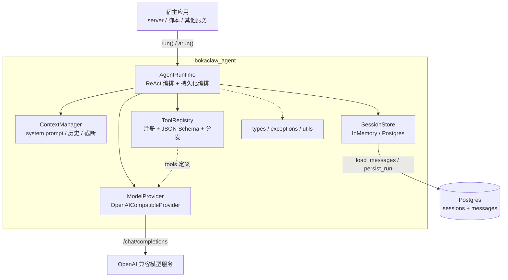
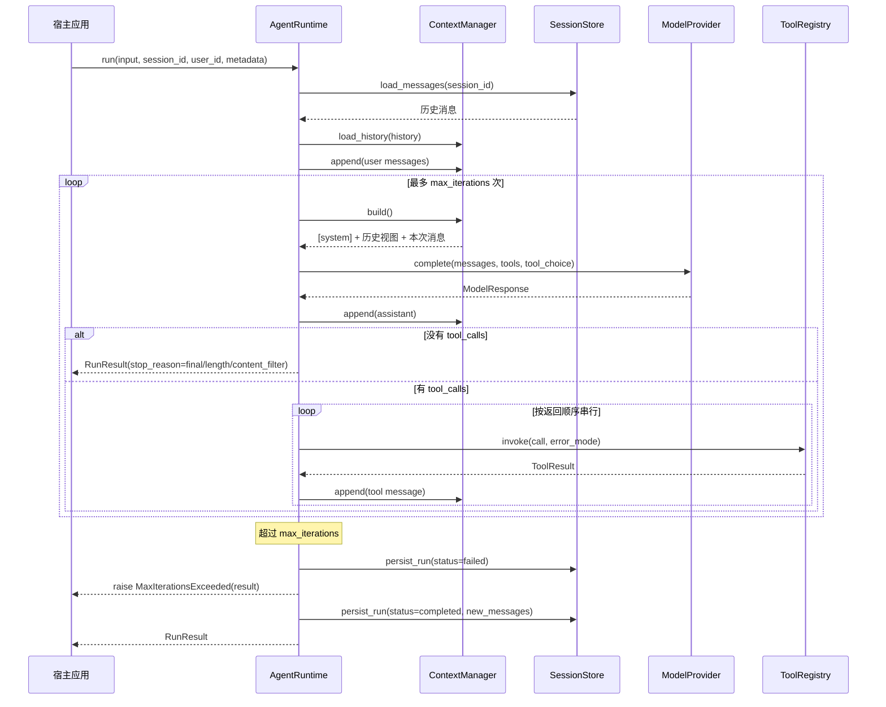

# BokaClaw AgentRuntime SDK 架构设计

> 状态：已实现（v1）
>
> 适用范围：`agent-loop/` 包（发行名 `bokaclaw-agent`，import 名 `bokaclaw_agent`）
>
> 目标读者：SDK 维护者、`server/` 集成开发者、需要嵌入 Agent 能力的业务方

本文描述 SDK 的整体分层、核心组件、一次 ReAct 运行的完整链路、持久化模型和扩展点。使用方式与 API 示例见 [`agent-loop/README.md`](../../agent-loop/README.md)；Dashboard 侧的前后端契约见 [`docs/dashboard/agent-chat-design.md`](../dashboard/agent-chat-design.md)。

---

## 1. 定位

`bokaclaw-agent` 是一个可独立发布、可嵌入任意 Python 服务的轻量 Agent 运行时，v1 只负责三件事：

1. **ReAct 循环**：把消息和工具定义发给模型，执行模型返回的 `tool_calls`，把结果回填为 `role="tool"` 消息，直到模型给出最终答案。
2. **上下文管理**：一次 run 内的消息保存在内存；恢复会话时加载历史，并按配置裁剪发送给模型的视图。
3. **会话持久化**：run 结束后把本次新增消息写入 Postgres（或内存），支持同一 `session_id` 继续对话。

明确的非目标（v1）：

- token 级流式输出（当前只在 run 结束后返回结果；server 层自行把最终答案包装成 SSE）
- token 计数、自动摘要、上下文压缩
- 并行工具执行
- MCP 工具发现、内置网络搜索
- 工具级权限与 OS 沙箱（由宿主应用决定）

---

## 2. 分层架构



设计要点：

- **Runtime 是唯一的编排者**：Context、Registry、Provider、Store 都不互相调用，便于单独替换和测试。
- **模型层与存储层都是 Protocol**：宿主可以注入任意实现；默认实现只依赖 `openai` 和可选的 `psycopg`。
- **同步核心 + 异步外壳**：`run()` 是同步实现，`arun()` 用 `asyncio.to_thread` 包一层；所有异步工具/Provider 都通过 `resolve_awaitable` 统一解析。
- **持久化与业务存储解耦**：SDK 的 Postgres 表只服务于独立使用场景。`server/` 集成时由服务端自己的 `conversations` 表负责持久化，SDK 不写库（见第 12 节）。

---

## 3. 目录结构

```text
agent-loop/
├── pyproject.toml                  # hatchling 构建，postgres/test/dev extras
├── README.md                       # 安装、用法、HTTP 下游契约
├── AGENTS.md                       # 本包 lint/test 约定
├── examples/quickstart.py
├── src/bokaclaw_agent/
│   ├── __init__.py                 # 公开导出
│   ├── config.py                   # AgentConfig / ModelConfig
│   ├── types.py                    # ToolCall / ModelResponse / RunResult / AgentEvent ...
│   ├── exceptions.py               # AgentError 及子类
│   ├── context.py                  # 消息规范化 + 上下文裁剪
│   ├── tools.py                    # Tool / ToolRegistry / @tool / schema 生成
│   ├── runtime.py                  # AgentRuntime：ReAct 循环与持久化编排
│   ├── utils.py                    # resolve_awaitable
│   ├── providers/
│   │   ├── base.py                 # ModelProvider Protocol
│   │   └── openai_compatible.py    # OpenAI Chat Completions 适配器
│   └── sessions/
│       ├── base.py                 # SessionStore Protocol / SessionRecord / title
│       ├── memory.py               # InMemorySessionStore
│       └── postgres.py             # PostgresConfig / PostgresSessionStore / DDL
└── tests/
```

依赖关系是单向的：

```text
config ──▶ types ◀── providers
   │          ▲
   ├──▶ runtime ──▶ context
   │          │
   │          ├──▶ tools ──▶ exceptions
   │          └──▶ sessions
   └──▶ exceptions
```

`__init__.py` 只做公开导出；导入包时不会连接数据库，`psycopg` 仅在实例化 `PostgresSessionStore` 时懒加载。

---

## 4. 核心组件

### 4.1 AgentRuntime（`runtime.py`）

Runtime 持有四个可替换的协作者：`AgentConfig`、`ModelProvider`、`ToolRegistry`、可选的 `SessionStore`。

```python
AgentRuntime(
    config: AgentConfig,
    *,
    tools: Iterable[Tool | Callable] = (),
    provider: ModelProvider | None = None,
    store: SessionStore | None = None,
    on_event: Callable[[AgentEvent], Any] | None = None,
)
```

| 成员 | 作用 |
|---|---|
| `run(input, *, session_id=None, user_id=None, metadata=None, **model_kwargs)` | 执行一次完整的 ReAct 回合 |
| `arun(...)` | `run()` 的异步包装，内部 `asyncio.to_thread` |
| `register_tool(tool)` | 运行期追加工具 |
| `get_session / list_sessions / delete_session` | 会话管理；未配置 store 时返回空/空操作 |
| `close / aclose` | 关闭 store 持有的连接池 |

未注入 `provider` 时，必须提供 `config.model`，Runtime 会构造默认的 `OpenAICompatibleProvider`；两者都没有则在构造阶段抛 `ConfigurationError`。

### 4.2 模型层（`providers/`）

`ModelProvider` 是一个 `runtime_checkable` Protocol：

```python
def complete(
    messages: list[dict],
    *,
    tools: list[dict] | None = None,
    tool_choice: str | dict | None = "auto",
    **kwargs,
) -> ModelResponse: ...
```

`OpenAICompatibleProvider` 是唯一内置实现，面向所有 OpenAI Chat Completions 兼容服务（OpenAI、DeepSeek、Qwen 兼容模式、vLLM、Ollama 等）。

关键行为：

- **保留 `tool_call.id`**：这是 ReAct 回填的前提。`ToolCall` 同时保存解析后的 `arguments` 和原始 `raw_arguments`，回写 assistant 消息时优先使用原始字符串，避免 JSON 重新序列化带来的差异。
- **坏 JSON 不崩溃**：`function.arguments` 解析失败时保留原文，并设置 `ToolCall.arguments_error`；工具层会把错误作为工具结果返回给模型。
- **兼容旧式 `function_call`**：生成 `call_<uuid4hex>` 作为 id。
- **统一错误**：SDK/网络异常包装为 `ModelError`；无 choice 也抛 `ModelError`。
- **usage 归一化**：只保留 `prompt_tokens`、`completion_tokens`、`total_tokens`。
- **配置默认值**：`api_key` 缺省读 `OPENAI_API_KEY`，`base_url` 缺省读 `OPENAI_BASE_URL`，再回退官方地址；`temperature`、`max_tokens` 仅在设置时下发。

Provider 可以返回 awaitable，Runtime 的 `_complete()` 会通过 `resolve_awaitable` 解析，并把 dict 形式的结果校验为 `ModelResponse`。

### 4.3 工具层（`tools.py`）

```python
@tool
def get_weather(city: str, days: int = 1) -> str:
    """Return the weather forecast for a city.

    Args:
        city: City name.
        days: Number of days to forecast.
    """
```

工具由三部分组成：

| 部分 | 实现 |
|---|---|
| Schema 生成 | 用 `inspect.signature` + `typing.get_type_hints` 收集参数，`pydantic.create_model` 生成参数模型，再 `model_json_schema()` |
| 描述提取 | docstring 首段作为工具描述；Google 风格 `Args:` / `Arguments:` / `Parameters:` 段落的参数说明写入 schema property |
| 调用校验 | 调用前用生成的模型做类型转换与校验，再把字段展开为 kwargs |

生成规则与限制：

- 支持基础类型、`Optional`、`Literal`、`Enum`、Pydantic `BaseModel`、列表/字典等可由 Pydantic 建模的注解。
- 无注解的参数按 `str` 处理。
- 拒绝 `*args` / `**kwargs`、下划线开头或 Pydantic 保留名的参数。
- 工具名限 `[A-Za-z0-9_-]{1,64}`；重名注册抛 `ToolSchemaError`。
- 对于定义在函数内部（测试、notebook、工厂函数）的类型，`_caller_locals()` 会在装饰时抓取调用方局部变量，保证前向注解可解析。

返回值序列化规则：`str` 原样；Pydantic 模型 `model_dump_json()`；`None` → `"null"`；`bytes` 尝试 UTF-8 解码；其他对象 `json.dumps(..., default=str)`。

错误模式由 `AgentConfig.tool_error_mode` 控制：

| 模式 | 未知工具 / 参数错误 / 工具异常 |
|---|---|
| `return`（默认） | 转成 `ToolResult(is_error=True)`，内容为 `{"error": "..."}`，继续循环 |
| `raise` | 抛 `ToolNotFoundError` / `ToolArgumentError` / `ToolExecutionError`，由 Runtime 走失败持久化 |

`ToolRegistry` 按名称索引工具，`specs()` 输出 OpenAI `tools` 数组，`invoke()` 负责把 `ToolCall` 转成 `ToolResult`。

### 4.4 上下文层（`context.py`）

`ContextManager` 把「历史」和「本次 run 新增」分开保存：

```text
build() = [system?] + truncate(history) + current
```

- **system prompt 不持久化**：每次 `build()` 重新插入。恢复会话不会重复，修改提示词立即生效。
- **`max_history_messages` 只裁剪历史视图**：本次 run 的消息和最终持久化的消息始终完整。
- **裁剪对齐边界**：优先从最近的第 `N` 条里找 `role="user"` 作为起点；找不到则找没有 `tool_calls` 的 assistant；仍找不到就只发 system。这样不会产生孤立的 `role="tool"` 消息。
- `normalize_input()` 接受字符串或 OpenAI wire-format 消息列表；未知结构直接报错。

消息构造规则：

- assistant 消息保留 `content`（可为 `null`）和 `tool_calls`，`function.arguments` 使用 `raw_arguments` 原串。
- tool 消息只包含 `role`、`tool_call_id`、`content`；**故意不带 `name`**，因为 OpenAI 的 tool 消息 schema 不定义该字段，严格的兼容服务会拒绝未知字段。

### 4.5 持久化层（`sessions/`）

`SessionStore` Protocol 定义六个方法：`ensure_schema`、`get_session`、`load_messages`、`persist_run`、`list_sessions`、`delete_session`、`close`。

两个实现：

| 实现 | 特点 |
|---|---|
| `InMemorySessionStore` | 进程内、`RLock` 保护、返回深拷贝；适合测试和短生命周期 Agent |
| `PostgresSessionStore` | psycopg3 连接池 + 原生 SQL；与 mem0 共用数据库；可配置表前缀 |

`PostgresConfig` 的关键点：

- `dsn` 优先级最高；否则读取 `BOKACLAW_AGENT_POSTGRES_DSN` / `POSTGRES_DSN`，再回退 `POSTGRES_HOST` / `POSTGRES_PORT` / `POSTGRES_DB` / `POSTGRES_USER` / `POSTGRES_PASSWORD`。
- 默认库为 `postgres`（与 mem0 的 `memories` 表同库），默认表前缀 `bokaclaw_agent`。
- `table_prefix` 必须匹配 `^[a-z_][a-z0-9_]*$`，防止 SQL 注入。
- `pool` 可注入，便于测试或与宿主共享连接池；只有自建池才会在 `close()` 时关闭。

### 4.6 类型、异常与工具函数

`types.py` 中的核心模型：

| 类型 | 用途 |
|---|---|
| `ToolCall` | 模型请求的工具调用（id、name、arguments、raw_arguments、arguments_error） |
| `ModelResponse` | 归一化后的模型输出（content、tool_calls、finish_reason、usage） |
| `ToolResult` | 回填给模型的工具结果（tool_call_id、name、content、is_error） |
| `RunResult` | 一次 run 的完整结果（session_id、content、stop_reason、new_messages、tool_results、iterations、usage） |
| `AgentEvent` / `EventType` | 生命周期事件与枚举 |

异常层级：

```text
AgentError
├── ConfigurationError
├── ModelError
├── ToolError
│   ├── ToolSchemaError
│   ├── ToolNotFoundError
│   ├── ToolArgumentError
│   └── ToolExecutionError
├── MaxIterationsExceeded      # 携带 result
└── SessionStoreError
    ├── PersistenceError
    └── SessionNotFoundError
```

`utils.resolve_awaitable()` 是同步核心与异步扩展之间的桥：值不是 awaitable 时原样返回；是 awaitable 时用 `asyncio.run()` 执行。若调用方已处于事件循环中，会抛出带指引的 `RuntimeError`（应改用 `arun()`）。

---

## 5. 一次 run 的时序



编号说明：

1. `session_id` 缺省时生成 `uuid4().hex`；未知 id 视为新会话，不报错。
2. 历史从 store 加载；输入消息规范化后同时进入上下文和 `new_messages`。
3. 每轮先 `build()` 出模型视图，再调用 Provider；assistant 消息（含 `tool_calls`）立即进入上下文和 `new_messages`。
4. 无 `tool_calls` 时按 `finish_reason` 映射结束原因：`stop`/`None` → `final`，`length` → `length`，`content_filter` → `content_filter`。
5. 有 `tool_calls` 时**串行**执行，每个调用都追加一条匹配 `tool_call_id` 的 tool 消息；工具异常按 `tool_error_mode` 处理。
6. 循环耗尽仍没有最终答案时，写入 `failed` 状态，并抛 `MaxIterationsExceeded`，异常上带 `result`。
7. 成功结束只调用一次 `persist_run`，写入本次新增消息和 `completed` 状态。

---

## 6. 消息格式

SDK 内部始终使用 OpenAI wire format，持久化也保存同一结构，因此恢复后可直接拼回请求：

```json
[
  {"role": "system", "content": "You are BokaClaw's assistant."},
  {"role": "user", "content": "What's the weather in Beijing?"},
  {
    "role": "assistant",
    "content": null,
    "tool_calls": [
      {
        "id": "call_abc",
        "type": "function",
        "function": {"name": "get_weather", "arguments": "{\"city\": \"Beijing\"}"}
      }
    ]
  },
  {"role": "tool", "tool_call_id": "call_abc", "content": "Beijing: sunny"}
]
```

约束：

- `tool_call.id` 必须原样保留并回填，否则模型无法把结果和调用对应起来。
- assistant 消息允许 `content=null`，但只要有 `tool_calls` 就是合法消息。
- tool 消息不带 `name`，名称信息保留在 `ToolResult` 中；持久化表的 `name` 列留给宿主自行补充的消息，Runtime 生成的 tool 消息不会填该列。
- `arguments` 以原始 JSON 字符串回写，避免重新序列化改变内容。

---

## 7. 持久化模型

### 7.1 表结构

`PostgresSessionStore` 用 `CREATE TABLE IF NOT EXISTS` 管理两张表（表名前缀可配置）：

```sql
CREATE TABLE IF NOT EXISTS bokaclaw_agent_sessions (
    id          TEXT PRIMARY KEY,
    agent_name  TEXT NOT NULL,
    user_id     TEXT,
    title       TEXT,
    metadata    JSONB NOT NULL DEFAULT '{}'::jsonb,
    status      TEXT NOT NULL DEFAULT 'active'
                CHECK (status IN ('active','completed','failed')),
    error       TEXT,
    created_at  TIMESTAMPTZ NOT NULL DEFAULT now(),
    updated_at  TIMESTAMPTZ NOT NULL DEFAULT now()
);

CREATE INDEX IF NOT EXISTS bokaclaw_agent_sessions_user_idx
    ON bokaclaw_agent_sessions (user_id, updated_at DESC);

CREATE TABLE IF NOT EXISTS bokaclaw_agent_messages (
    id           BIGINT GENERATED ALWAYS AS IDENTITY PRIMARY KEY,
    session_id   TEXT NOT NULL
                 REFERENCES bokaclaw_agent_sessions(id) ON DELETE CASCADE,
    seq          BIGINT NOT NULL,
    role         TEXT NOT NULL CHECK (role IN ('system','user','assistant','tool')),
    content      TEXT,
    tool_calls   JSONB,
    tool_call_id TEXT,
    name         TEXT,
    metadata     JSONB NOT NULL DEFAULT '{}'::jsonb,
    created_at   TIMESTAMPTZ NOT NULL DEFAULT now(),
    UNIQUE (session_id, seq)
);
```

设计说明：

- **不引入迁移框架**：SDK 要能直接嵌进已有数据库，因此只做幂等建表；需要精细 schema 管理的部署可设置 `auto_create_schema=false` 自行建表。
- **并发建表安全**：`ensure_schema()` 在事务内取 `pg_advisory_xact_lock`，多进程同时启动不会互相抢建。
- **消息顺序**：`UNIQUE (session_id, seq)` 自带索引，`load_messages` 按 `seq` 排序恢复。
- **级联删除**：删除 session 自动删除消息。
- **JSONB 字段**：`tool_calls` 直接存 wire format 数组，恢复时无需转换。

### 7.2 写入语义

`persist_run()` 是「会话 upsert + 追加新消息」：

1. 在一个事务内先 upsert session 行：
   - `agent_name`、`status`、`error`、`updated_at` 覆盖；
   - `user_id` 只在本次非空时覆盖；
   - `title` 只在首次生成（取首条 user 消息，截断 80 字符）；
   - `metadata` 做 JSONB 浅合并，保留旧键。
2. 取 `MAX(seq)`，本次消息从 `next_seq + 1` 开始连续编号。
3. 批量插入消息；任何非法角色直接抛 `PersistenceError`。

因此**一次 run 只写一次库**，历史消息不会重复写入。

### 7.3 会话状态

| 状态 | 触发条件 |
|---|---|
| `completed` | ReAct 正常结束（包括 `length` / `content_filter`） |
| `failed` | 超过 `max_iterations`，或 run 过程中抛异常 |
| `active` | 表默认值；SDK 自身不写入该状态，供宿主标记「进行中」 |

失败路径会先补齐未完成的 `tool_calls`：为每个 pending call 追加一条内容为 `{"error": "run aborted: ..."}` 的 tool 消息，保证恢复后的会话在 OpenAI 协议下仍然合法。

---

## 8. 错误处理

| 场景 | 行为 |
|---|---|
| 模型请求失败 / 返回结构非法 | `ModelError`；run 走失败持久化后原样抛出 |
| 未知工具 | `return` 模式回填错误结果；`raise` 模式抛 `ToolNotFoundError` |
| 工具参数不合法 | 同上，对应 `ToolArgumentError` |
| 工具执行抛异常 | 同上，对应 `ToolExecutionError` |
| 超过最大轮数 | 持久化 `failed`，抛 `MaxIterationsExceeded`，异常带 `result` |
| 成功路径持久化失败 | 触发失败处理（尽力再写一次 failed），最终抛 `PersistenceError` |
| 失败路径持久化失败 | 只记日志，不覆盖原始异常 |
| 事件回调抛异常 | 只记日志，不影响 run |
| 在事件循环内调用同步 `run()` 且遇到异步工具 | `RuntimeError`，提示改用 `arun()` |

原则：**失败不能破坏会话可恢复性，也不能掩盖根因。**

---

## 9. 事件与可观测性

`on_event` 是可选回调，事件按生命周期发出：

| 事件 | 时机 | 主要数据 |
|---|---|---|
| `run_started` | run 开始 | `input` |
| `model_request` | 每次模型调用前 | `messages`、`tools` |
| `model_response` | 每次模型返回后 | `content`、`tool_calls`、`finish_reason` |
| `tool_call` | 执行工具前 | `tool_call_id`、`name`、`arguments` |
| `tool_result` | 工具返回后 | `tool_call_id`、`name`、`content`、`is_error` |
| `run_ended` | 正常结束或超轮数 | `stop_reason` |
| `error` | 异常失败 | `error`、`type` |

回调可以是同步函数，也可以返回 awaitable；回调异常只记录日志。Runtime 本身不输出流式 token，宿主（如 `server/`）可在 `run()` 结束后自行转成 SSE。

---

## 10. 并发与异步模型

- **同步核心**：`run()` 内部全部是同步调用，线程内不共享可变状态（每次 run 新建 `ContextManager` 和局部列表）。
- **异步外壳**：`arun()` 用 `asyncio.to_thread` 把整个 run 放到工作线程，因此可以在异步框架中安全使用，也能解析异步工具。
- **异步工具**：`Tool.invoke()` 用 `resolve_awaitable()` 执行；在已有事件循环中调用同步 `run()` 会得到明确报错，而不是死锁。
- **Provider 异步**：`complete()` 返回 awaitable 时同样由 `_complete()` 解析。
- **存储线程安全**：
  - `InMemorySessionStore` 用 `RLock` 保护。
  - `PostgresSessionStore` 使用连接池；每个事务独立连接。
  - 同一 `session_id` 的并发 run 由 session 行锁串行化写入，但**语义顺序不保证**，应避免并发写同一会话。
- **不同会话**：可以并行 run；每次 run 独立上下文。

---

## 11. 扩展点

| 扩展点 | 方式 |
|---|---|
| 自定义模型后端 | 实现 `ModelProvider.complete()`，构造时传 `provider=`；可同步或异步 |
| 复用官方客户端 | `OpenAICompatibleProvider(config, client=...)` 注入已配置的 `openai.OpenAI` |
| 自定义持久化 | 实现 `SessionStore` 协议（Redis、SQLite、业务库均可） |
| 共享连接池 | `PostgresSessionStore(config, pool=...)` |
| 工具 | `@tool` 装饰器、显式 `Tool.from_callable(...)`、运行期 `register_tool()` |
| 可观测性 | `on_event` 回调；事件数据已包含请求消息、工具参数和结果 |
| 错误策略 | `AgentConfig.tool_error_mode` 在「回填给模型」与「直接失败」之间切换 |

---

## 12. 与 `server/` 的集成关系

`server/agent_runtime.py` 在**同一进程内**创建 SDK Runtime，但采用与独立使用不同的持久化策略：

```text
dashboard ── POST /agent ──▶ server（鉴权 / SSE / 会话存储）
                                │
                                ├─ agent_runtime.build_runtime()
                                │     ├─ memory tools: search_memories / save_memory
                                │     └─ dev tools: Read / Write / Edit / ...
                                └─ runtime.run(messages, session_id=conversation_id)
```

关键差异：

- **服务端是会话的唯一事实来源**：Runtime 构造时**不传 `store`**，服务端从自己的 `conversations` / `conversation_messages` 表组装 `history`，再通过 `run(messages, ...)` 传入。SDK 的 Postgres 表不会与业务表重复。
- **`session_id` 仅用于事件标识**：传入 `conversation_id` 便于日志关联；没有 store 时不产生 SDK 侧持久化。
- **工具由服务端注入**：记忆工具按登录用户 UUID 限定作用域；开发者工具是否注册由 `AGENT_DEV_TOOLS`、`AGENT_TOOLS_ALLOW_SHELL` 控制。
- **超时与错误映射在服务端完成**：`asyncio.wait_for` 控制整轮时限，`MaxIterationsExceeded` / `ConfigurationError` 等映射为 SSE 错误码（`agent_timeout`、`agent_not_configured`、`agent_upstream_error` 等）。
- **可选远程执行器**：设置 `AGENT_LOOP_URL` 时，server 改走 HTTP/SSE 外部执行器，不再进程内调用 SDK；SDK 自身的部署方式不受影响。

因此，SDK 的 `SessionStore` 面向「把 SDK 当独立 Agent 服务使用」的场景；把 SDK 嵌进已有业务系统时，宿主可以像 `server/` 一样自行管理会话并传入历史。

---

## 13. 设计权衡

| 决策 | 取舍 |
|---|---|
| 同步核心 + `to_thread` 异步外壳 | 实现简单、行为可预测；代价是异步 I/O 不是原生并发 |
| `tool_call.id` 与原始 `arguments` 原样保留 | 保证 ReAct 回填正确、兼容严格服务；代价是消息体积略大 |
| 工具串行执行 | 每个调用都有确定的结果消息，失败路径易恢复；代价是并行工具场景变慢 |
| system prompt 不持久化 | 支持跨 run 调整提示词、避免重复；代价是持久化历史不含 system |
| `max_history_messages` 只裁剪模型视图 | 数据库保留完整对话；代价是长会话请求仍可能超模型窗口 |
| SDK 自带幂等 DDL | 无需迁移框架、可与 mem0 共库；代价是 schema 演进能力有限 |
| 失败时补齐 tool 消息 | 会话始终符合协议、可继续恢复；代价是数据库中出现合成的错误结果 |
| Postgres 依赖放在 `postgres` extra | 纯内存场景无需安装数据库驱动；代价是用户需显式安装 |
| 不内置流式 token | v1 范围可控；代价是宿主需要自己实现流式呈现 |

---

## 14. v1 边界与后续方向

当前明确不做、但架构上已留出位置的能力：

- **token 级流式输出**：Provider 返回 `ModelResponse`，可扩展为 async iterator；Runtime 已有 `on_event`。
- **上下文压缩 / 自动摘要**：`ContextManager.build()` 是唯一模型视图入口，可替换为摘要策略。
- **并行工具执行**：`ToolRegistry.invoke()` 无状态，可并行化；需要保证结果顺序与 `tool_call_id` 对应。
- **工具权限与沙箱**：由宿主在注册工具时封装（`server/agent_dev_tools.py` 即是这一层）。
- **MCP / WebSearch / LSP**：属于工具生态，可按需注册为普通 Tool。
- **重试与退避策略**：目前依赖模型客户端自身的 `max_retries`。
- **可观测性指标**：事件流已具备，可桥接到 OpenTelemetry / 日志系统。

---

## 15. 测试与验证

- 单元测试不联网：`FakeProvider` 脚本化模型响应，`InMemorySessionStore` 验证会话行为。
- 覆盖范围：
  - `test_tools.py`：schema 生成、docstring 解析、参数校验、同步/异步调用、错误模式
  - `test_provider_openai.py`：`tool_call.id` 保留、坏 JSON、旧式 `function_call`、usage 映射
  - `test_runtime.py` / `test_arun.py`：完整 ReAct 往返、多轮工具、最大轮数、异常持久化、事件顺序
  - `test_context.py`：system prompt、历史恢复、裁剪边界、持久化完整性
  - `test_session_memory.py` / `test_session_postgres.py`：会话 CRUD、seq、metadata 合并、DDL 幂等；真实 Postgres 集成测试由 `BOKACLAW_AGENT_TEST_DSN` 开启
- 本地命令见 [`agent-loop/AGENTS.md`](../../agent-loop/AGENTS.md)：`ruff check`、`ruff format --check`、`pytest`。
