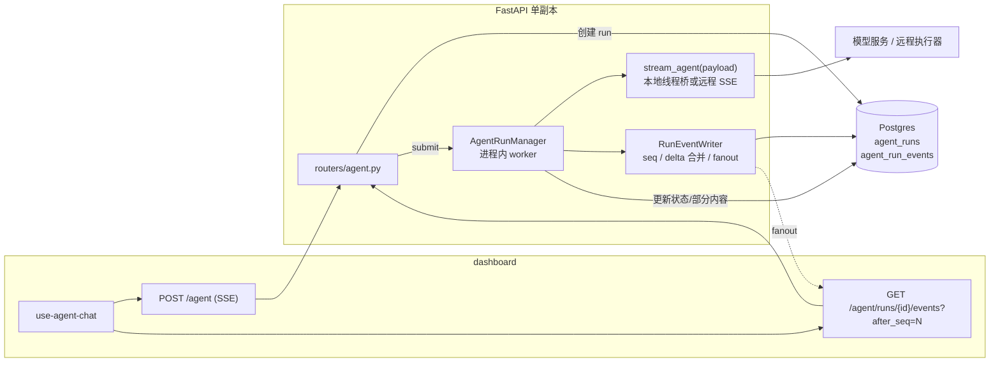

# Agent 执行与连接解耦设计

> 状态：已实现（Phase 1，2026-11-04）
>
> 适用范围：`server/` FastAPI 后端、`server/alembic/` 迁移、`dashboard/` 订阅端、`agent-loop/` SDK
>
> 目标读者：后端、前端、Agent 执行层开发者
>
> 契约地位：本文是三份设计文档中**唯一的契约权威来源**。前端与 SDK 文档只引用本文第 3 节，不各自维护一份契约。

## 1. 背景与目标

当前 `POST /agent` 把一次 Agent 执行的生命周期绑在 HTTP/SSE 连接上：

- `server/app/routers/agent.py` 在响应生成器内部创建 `pump()` 任务消费 `stream_agent()`；客户端断开（`request.is_disconnected()`）会把本轮标记为 `cancelled`，`finally` 取消 `pump()`。
- 助手消息只在完成、失败或断连时落库；进程崩溃会丢失整轮输出。
- 没有 run 表、事件游标、订阅接口或后台 worker；前端也没有重连逻辑，`AbortController.abort()` 同时承担"停止"与"离开页面"两种语义。
- 结果是：用户关页面、切网络、切会话都会杀死执行，长任务无法在后台继续。

本设计把"一次 Agent 执行"从"一次 HTTP 订阅"中拆出来：

1. **执行**由服务端进程内的后台 worker 持有，状态与事件写入 Postgres，连接断开不影响执行。
2. **订阅**是客户端可随时断开、随时续接的只读事件流，用 `after_seq` 断点续传。
3. **取消**是唯一的显式停止语义，由独立接口触发，与断连彻底分离。

### 1.1 本轮目标

- 新增 run/event 两张表与迁移 008。
- 新增进程内 `AgentRunManager`，在 FastAPI lifespan 中启动和回收。
- 新增 run 查询、事件订阅、取消三个接口，并扩展 `POST /agent` 与 `GET /conversations/{id}`。
- 定义可重放的 SSE 事件契约，包括序号、心跳、终态顺序。
- 服务重启时把仍处于 `running` 的 run 标记为 `interrupted`，不自动续跑。

### 1.2 已确认的决策

| 决策点 | 结论 |
| --- | --- |
| 执行承载 | 服务端进程内后台 worker + Postgres，不新增 Redis/Celery/独立服务 |
| 断连语义 | 断开连接只结束订阅，run 继续执行 |
| 停止语义 | 只有 Stop 按钮调用 `POST /agent/runs/{run_id}/cancel` 才取消 |
| 重启恢复 | 只把 `running` 标记为 `interrupted`，不自动续跑；步级 checkpoint 留到下一阶段 |
| 会话并发 | 一个会话同时最多一个活跃 run，由部分唯一索引兜底 |
| 部署假设 | 单 server 副本；多副本需要队列领取/租约，明确不在本期 |

## 2. 非目标与阶段划分

### 2.1 本期不做

- 步级 checkpoint 与跨重启自动续跑。
- 多副本 worker、外部队列、Redis。
- 上下文压缩、自动摘要、并行工具、长任务预算控制。
- 跨 run 的全局取消、管理员强制终止。
- 事件表按用户查询、审计导出。

### 2.2 阶段划分

| 阶段 | 内容 | 依赖 |
| --- | --- | --- |
| Phase 1（本文） | 执行与连接解耦、后台执行、事件重放、显式取消、重启标记 `interrupted` | 无 SDK 改动 |
| Phase 2 | SDK `RunHandle` / `CheckpointStore`、步级恢复、按 `seq` 回放 | 本文契约稳定后 |
| Phase 3 | 多副本 worker 与租约领取、队列服务、上下文压缩 | Phase 2 |

Phase 1 的执行层仍然是现有的 `stream_agent(payload)`，本地模式仍然是 `stream_local_agent()` 的线程桥。解耦发生在 `server/` 的 run 管理层，不改变模型调用与工具执行方式。

## 3. 术语与共享契约

本节是前端、后端、SDK 三份文档共同引用的契约。任何字段变更先改本文。

### 3.1 术语

| 术语 | 含义 |
| --- | --- |
| **run** | 一次 Agent 执行，从创建到终态。对外标识为 `run_id`，对应 `agent_runs.id` |
| **run 状态** | `queued \| running \| completed \| failed \| cancelled \| interrupted` |
| **事件** | run 生命周期中产生的一条可重放记录，写入 `agent_run_events` |
| **seq** | run 内单调递增的事件序号，从 1 开始；SSE 帧的 `id` 就是它 |
| **订阅** | 客户端通过 SSE 读取某 run 的事件；可断开、可带 `after_seq` 续接 |
| **cursor** | 客户端已消费到的 `seq`，即下次订阅的 `after_seq` |
| **活跃 run** | 状态为 `queued` 或 `running` 的 run |
| **client_run_id** | 旧请求字段 `run_id` 的值（mem0 记忆作用域），与执行 `run_id` 无关 |

命名冲突说明：现有 `AgentInvokeRequest.run_id` 是 mem0 的记忆作用域，会写进消息 metadata。新的执行标识复用 `run_id` 这个名字，因此：

- 请求中的旧字段继续按原名接受，内部存为 `agent_runs.client_run_id`，并原样放进执行器 payload 的 `run_id`。
- API、SSE、`agent_runs.id` 中的 `run_id` 一律指执行标识。
- 新增可选请求字段 `client_run_id`，与旧 `run_id` 二选一；同时出现时以 `client_run_id` 为准。旧字段标记为 deprecated，但本期不移除。

### 3.2 Run 状态机

```text
queued ──▶ running ──▶ completed
                  ├──▶ failed
                  ├──▶ cancelled
                  └──▶ interrupted   # 仅服务重启/租约回收
```

- `queued`：run 行已提交，等待 worker 领取。
- `running`：worker 已领取并开始执行，`started_at` 非空。
- `completed`：执行器正常结束，助手消息以 `completed` 落库。
- `failed`：执行器报错、超时或协议错误，助手消息以 `failed` 落库。
- `cancelled`：收到显式取消，助手消息以 `cancelled` 落库。
- `interrupted`：进程重启或心跳超时回收，助手消息以 `failed` 落库，metadata 写 `{"run_status": "interrupted", "error_code": "agent_interrupted"}`。
- 终态不可逆；重复取消或重复终态写入都按幂等处理。

### 3.3 消息状态映射

`conversation_messages.status` 的取值保持 `completed | cancelled | failed` 不变（现有 CHECK 约束不迁移）。

| run 终态 | 消息 status | 消息 metadata 追加 |
| --- | --- | --- |
| `completed` | `completed` | 执行器 metadata（usage、finish_reason 等） |
| `failed` | `failed` | `{"error_code": "<code>"}` |
| `cancelled` | `cancelled` | `{"error_code": "agent_cancelled"}` |
| `interrupted` | `failed` | `{"run_status": "interrupted", "error_code": "agent_interrupted"}` |

没有正文也没有工具轨迹的 run 不写助手消息，与现有 `_should_persist_reply` 的行为一致。

### 3.4 事件类型

持久化事件只有五种，写入 `agent_run_events`：

| 事件 | 何时产生 | 是否带 `id: <seq>` |
| --- | --- | --- |
| `message.delta` | 模型流式文本增量，按批次合并后写入 | 是 |
| `tool.call` | 模型请求一次工具调用 | 是 |
| `tool.result` | 工具调用结算（成功、失败或 aborted） | 是 |
| `message.completed` | 助手消息成功落库 | 是 |
| `error` | 失败、取消或中断的终态错误 | 是 |

非持久化事件由服务端合成：

| 事件 | 何时产生 | 是否带 `id` |
| --- | --- | --- |
| `meta` | 每次订阅开始时（包括重连） | 否 |
| `done` | 每个 run 的最后一个事件 | 否 |

所有事件的 payload 统一包含：

```json
{
  "run_id": "6f1c...",
  "conversation_id": "0b2a...",
  "seq": 7
}
```

说明：

- `seq` 在 payload 中重复出现，便于客户端在丢失 `id` 时仍能去重；以 SSE `id` 为准。
- `meta` 和 `done` 的 `seq` 分别是订阅起点与当前 `last_seq`，不是新事件。
- 现有 payload 字段全部保留，只增加上述字段。

### 3.5 事件 payload 契约

**`meta`**

```json
{
  "run_id": "6f1c...",
  "conversation_id": "0b2a...",
  "status": "running",
  "last_seq": 7,
  "assistant_message_id": "c9d3...",
  "conversation": { "...": "ConversationOut" },
  "user_message": { "...": "ConversationMessageOut" },
  "message": null,
  "cancel_requested_at": null
}
```

- `message` 仅在订阅时 run 已终态且助手消息已落库时返回完整 `ConversationMessageOut`，否则为 `null`。
- `last_seq` 是订阅建立时的最新序号；客户端应把 `after_seq` 之前的持久化帧与它对照，防止重复。

**`message.delta`**

```json
{
  "run_id": "6f1c...",
  "conversation_id": "0b2a...",
  "seq": 3,
  "message_id": "c9d3...",
  "delta": "已经找到三个相关文件，"
}
```

**`tool.call` / `tool.result`**

沿用现有字段（`message_id`、`tool_call_id`、`name`、`iteration`、`status`、`arguments`、`raw_arguments`、`arguments_error`、`started_at`、`content`、`is_error`、`duration_ms`、`finished_at`、`truncated`），增加 `run_id`、`conversation_id`、`seq`。

**`message.completed`**

```json
{
  "run_id": "6f1c...",
  "conversation_id": "0b2a...",
  "seq": 8,
  "message": { "...": "ConversationMessageOut" }
}
```

**`error`**

```json
{
  "run_id": "6f1c...",
  "conversation_id": "0b2a...",
  "seq": 9,
  "code": "agent_timeout",
  "detail": "Agent turn timed out.",
  "request_id": "req-...",
  "partial": true
}
```

`partial` 表示是否已有部分助手内容被保留（落库或可继续读取），前端据此决定是否保留气泡。

**`done`**

```json
{
  "run_id": "6f1c...",
  "conversation_id": "0b2a...",
  "seq": 9,
  "status": "failed"
}
```

### 3.6 终态顺序

每个 run 的持久化事件之后，事件序列必须满足：

| 终态 | 顺序 |
| --- | --- |
| 成功 | `message.delta*` / `tool.call` / `tool.result` → `message.completed` → `done` |
| 失败 | 历史事件 → `tool.result`（aborted，补齐未结算的工具）→ `error` → `done` |
| 取消 | 历史事件 → `tool.result`（aborted）→ `error(code=agent_cancelled)` → `done` |
| 中断 | 历史事件（可能缺失）→ `error(code=agent_interrupted)`（启动回收时追加）→ `done`（重连时合成） |

失败、取消、中断路径**不发** `message.completed`。前端不能把 `done` 当作成功信号，必须读取 `done.status`。

### 3.7 错误码

新增：

| 错误码 | HTTP | 场景 |
| --- | --- | --- |
| `agent_run_active` | 409 | 会话已有 `queued`/`running` run；body 带 `run_id` |
| `agent_run_not_found` | 404 | run 不存在、不属于当前用户、或已被清理 |
| `agent_events_expired` | 410 | `after_seq` 早于事件保留窗口，无法完整回放 |
| `agent_cancelled` | SSE `error` | run 被显式取消 |
| `agent_interrupted` | SSE `error` | run 被重启/租约回收 |

沿用：`agent_not_configured`（503）、`agent_unreachable`（502）、`agent_timeout`（504）、`agent_upstream_error`（502）、`agent_protocol_error`（502）、`conversation_deleted`（404）。

鉴权规则：所有 run 接口使用 `require_auth`，按 `agent_runs.created_by` 校验归属。不存在与他人 run 统一返回 404，避免探测。

## 4. 总体架构



关键变化：

- `POST /agent` 不再在请求协程里消费执行器。它创建 run、提交给 manager，然后把自己注册成第一个订阅者。
- 执行器输出先经 `RunEventWriter` 落库并分配 `seq`，再 fanout 给当前订阅者。订阅者断开只移除队列。
- 新增的 `GET .../events` 可以从任意 `after_seq` 重建同一段输出。
- 取消接口直接作用于 manager 里的 run task，与订阅无关。

### 4.1 请求生命周期

```text
POST /agent
  ├─ 鉴权、加载/创建会话、写 user message
  ├─ 插入 agent_runs(status=queued, request=payload 快照)
  ├─ manager.submit(run_id)
  └─ 返回 SSE：
       meta → (订阅该 run) → ... → done
```

### 4.2 断连生命周期

```text
客户端断开
  ├─ StreamingResponse 的生成器结束
  ├─ 订阅者从 fanout 集合移除
  └─ run task 不受影响，继续写事件
```

## 5. 数据模型与迁移 008

### 5.1 `agent_runs`

| 列 | 类型 | 说明 |
| --- | --- | --- |
| `id` | `UUID PK` | 对外 `run_id` |
| `conversation_id` | `UUID NOT NULL FK conversations ON DELETE CASCADE` | 所属会话 |
| `created_by` | `UUID NOT NULL FK users ON DELETE CASCADE` | 归属用户，接口鉴权用 |
| `user_message_id` | `UUID NULL FK conversation_messages ON DELETE SET NULL` | 本轮用户消息 |
| `assistant_message_id` | `UUID NULL` | 预生成的助手消息 id；终态时按此 id 落库。**不建外键**，见下方说明 |
| `request` | `JSONB NOT NULL DEFAULT '{}'` | 执行器 payload 快照，`queued` run 重启后据此重新提交 |
| `client_run_id` | `VARCHAR(255) NULL` | 旧请求 `run_id`（mem0 scope） |
| `agent_id` | `VARCHAR(255) NULL` | 会话/请求指定的 agent |
| `status` | `VARCHAR(20) NOT NULL DEFAULT 'queued'` | CHECK 六态 |
| `error_code` | `VARCHAR(64) NULL` | 终态错误码 |
| `error_detail` | `TEXT NULL` | 终态错误详情 |
| `partial_content` | `TEXT NOT NULL DEFAULT ''` | 已落库文本增量的拼接，崩溃后用于物化消息 |
| `partial_metadata` | `JSONB NOT NULL DEFAULT '{}'` | 工具轨迹、usage 等中间元数据 |
| `last_seq` | `BIGINT NOT NULL DEFAULT 0` | 已分配的最大事件序号 |
| `attempt` | `INT NOT NULL DEFAULT 1` | 预留；本期创建即 1，不自动重试 |
| `worker_id` | `TEXT NULL` | `hostname:pid`，回收判定与排查用 |
| `heartbeat_at` | `TIMESTAMPTZ NULL` | worker 心跳 |
| `cancel_requested_at` | `TIMESTAMPTZ NULL` | 取消请求时间，幂等与 UI 展示用 |
| `started_at` | `TIMESTAMPTZ NULL` | 领取时间 |
| `finished_at` | `TIMESTAMPTZ NULL` | 终态时间 |
| `created_at` / `updated_at` | `TIMESTAMPTZ NOT NULL DEFAULT now()` | 时间戳 |

约束与索引：

```sql
CREATE UNIQUE INDEX uq_agent_runs_active_conversation
    ON agent_runs (conversation_id)
    WHERE status IN ('queued', 'running');

CREATE INDEX ix_agent_runs_created_by_created
    ON agent_runs (created_by, created_at DESC);

CREATE INDEX ix_agent_runs_status_heartbeat
    ON agent_runs (status, heartbeat_at);
```

`request` 快照至少包含：

```json
{
  "conversation_id": "...",
  "message_id": "<user_message_id>",
  "message": "用户原文",
  "history": [{"role": "user", "content": "..."}],
  "user_id": "<created_by>",
  "agent_id": "...",
  "run_id": "<client_run_id>",
  "metadata": {}
}
```

没有 `request` 快照，`queued` run 在重启后无法重建执行器入参；这是本期必须持久化它的原因。

`assistant_message_id` 为什么没有外键：它在 run 创建时预生成，而对应的 `conversation_messages` 行要到终态才写入。Postgres 的外键在插入 `agent_runs` 时就会校验，若引用一个尚不存在的消息 id，创建 run 会直接失败。因此它按逻辑引用处理：终态落库前先检查该 id 是否已存在，写入时使用同一 id。`user_message_id` 对应的行在创建 run 前已写入，可以保留外键。

### 5.2 `agent_run_events`

| 列 | 类型 | 说明 |
| --- | --- | --- |
| `id` | `BIGINT GENERATED ALWAYS AS IDENTITY PK` | 物理主键，不对外 |
| `run_id` | `UUID NOT NULL FK agent_runs ON DELETE CASCADE` | 所属 run |
| `seq` | `BIGINT NOT NULL` | run 内单调递增，从 1 开始 |
| `event_type` | `VARCHAR(32) NOT NULL` | CHECK 五种持久化事件 |
| `payload` | `JSONB NOT NULL` | 事件 payload |
| `created_at` | `TIMESTAMPTZ NOT NULL DEFAULT now()` | 写入时间 |

```sql
CREATE TABLE agent_run_events (
    id BIGINT GENERATED ALWAYS AS IDENTITY PRIMARY KEY,
    run_id UUID NOT NULL REFERENCES agent_runs(id) ON DELETE CASCADE,
    seq BIGINT NOT NULL,
    event_type VARCHAR(32) NOT NULL,
    payload JSONB NOT NULL,
    created_at TIMESTAMPTZ NOT NULL DEFAULT now(),
    CONSTRAINT uq_agent_run_events_run_seq UNIQUE (run_id, seq),
    CONSTRAINT ck_agent_run_events_type CHECK (
        event_type IN ('message.delta', 'tool.call', 'tool.result', 'message.completed', 'error')
    )
);

CREATE INDEX ix_agent_run_events_run_seq ON agent_run_events (run_id, seq);
```

`meta` 与 `done` 不入库，避免为每次订阅写重复记录。

### 5.3 迁移 008

- 文件：`server/alembic/versions/008_create_agent_runs_and_events.py`
- `revision = "008"`，`down_revision = "007"`。
- `upgrade()`：建 `agent_runs`、部分唯一索引、两个普通索引；建 `agent_run_events`、唯一约束、CHECK、索引。
- `downgrade()`：按依赖顺序删索引和表。
- 迁移只加表，不改 `conversations` / `conversation_messages`，可安全先于应用发布执行。

### 5.4 保留与清理

| 数据 | 默认保留 | 清理方式 |
| --- | --- | --- |
| 终态 run 的事件 | 7 天 | 周期任务按 `finished_at < now() - interval` 删除 |
| run 行 | 30 天 | 周期任务删除；事件随 FK 级联 |
| 活跃 run | 不删 | 只允许通过终态或回收进入终态 |

清理任务建议放在 `server/scripts/prune_agent_runs.py`，由部署侧 cron/定时任务调用；不在请求路径里做。若部署环境没有 cron，可在 manager 内每小时执行一次，但必须加进程内锁，避免多副本重复（本期单副本）。清理必须先事件后 run，且只处理终态。

## 6. Run 生命周期与状态机

### 6.1 创建

`POST /agent` 的创建流程：

1. 加载或创建会话。如果是已有会话，先查活跃 run；命中则直接返回 409，**不写任何消息**。
2. 预生成 `user_message_id` 与 `assistant_message_id`。
3. 开启事务：先插入用户消息，再插入 `agent_runs(status='queued', request=payload, last_seq=0)`，提交。
4. 提交后 `manager.submit(run_id)`，保证 worker 一定能读到行。

用户消息与 run 行必须在同一事务中，且用户消息先插入（`user_message_id` 有外键）。如果 run 插入因部分唯一索引冲突失败，整个事务回滚，不会留下孤儿用户消息。现有 `_prepare_turn` 是两次独立 commit，不能原样复用；需要拆成"准备会话/历史"与"写消息 + run"两段，或让它接受外部 `Session` 并在调用方统一提交。

如果部分唯一索引冲突（并发发送），回滚并返回 409 `agent_run_active`，body 带现有活跃 `run_id`。409 的语义是"本次消息没有写入"，客户端不能把它当成已发送。

### 6.2 领取

worker 用条件更新领取，避免同一 run 被执行两次：

```sql
UPDATE agent_runs
SET status = 'running',
    started_at = now(),
    heartbeat_at = now(),
    worker_id = :worker_id,
    updated_at = now()
WHERE id = :run_id AND status = 'queued'
RETURNING *;
```

返回 0 行说明已被取消或领取，任务直接退出。

### 6.3 执行

- 读取 `request` 快照，调用现有 `stream_agent(payload, request_id)`。
- 逐事件映射到 `RunEventWriter`。
- 每个 run 一个独立 asyncio task；`AGENT_RUN_CONCURRENCY` 信号量限制同时执行数，超出的 run 保持 `queued`。
- 本地模式的执行层仍是 `stream_local_agent()`：SDK 在线程里跑，事件经 asyncio 队列回到事件循环。manager 不改变这层。

### 6.4 终态写入顺序

无论成功、失败还是取消，都按同一顺序收尾：

1. `writer.flush()`，把缓冲区里的 delta 落库。
2. 补齐未结算工具：为每个仍为 `running` 的工具写 `tool.result(status='aborted')`。
3. 组装最终 metadata，写入助手消息（预生成的 `assistant_message_id`，状态按 3.3 映射）。
4. 更新 `agent_runs`：`status`、`error_code`、`error_detail`、`partial_content`、`partial_metadata`、`finished_at`、`last_seq`。
5. 追加终态事件：成功写 `message.completed`，失败/取消/中断写 `error`。
6. fanout 一个合成的 `done`。
7. 从 in-flight 集合移除，释放信号量。

第 3 步先于第 4 步，保证"消息已落库但 run 仍 running"的崩溃窗口可以被启动回收识别并修复；反之则不会出现"run 已完成但消息缺失"。

终态写入必须幂等：如果该 run 已经存在同 code 的终态 `error`，或已经存在 `message.completed`，则不再追加第二条终态事件；状态更新使用条件更新（`WHERE status IN ('queued','running')`），影响 0 行说明另一条路径已先完成。

### 6.5 助手消息写入

- 使用预生成的 `assistant_message_id`，避免重连/回收时生成第二个 id。
- 写入前检查该 id 是否已存在；存在则不再插入（幂等）。
- 会话已被删除时 `_save_assistant` 返回 `None`；run 行也已被级联删除，收尾更新影响 0 行，任务静默结束并记录日志。
- 消息 metadata 至少包含 `tool_trace`（如果有）与执行器 metadata；`run_id` 旧字段（mem0 scope）的语义保持不变。

## 7. 执行管理器与并发控制

### 7.1 模块

新增 `server/app/agent/runner.py`：

| 组件 | 职责 |
| --- | --- |
| `AgentRunManager` | lifespan 启停、启动回收、submit、取消、in-flight 表、信号量 |
| `RunEventWriter` | seq 分配、delta 合并、事件落库、partial 更新、fanout |
| `RunSubscription` | 单个订阅者的有界队列与关闭标记 |
| `run_worker(run_id)` | 领取、消费执行器、收尾 |

### 7.2 在 FastAPI 中启停

`server/app/main.py` 当前没有 lifespan。新增：

```python
@asynccontextmanager
async def lifespan(app: FastAPI):
    manager = AgentRunManager(...)
    await manager.startup()
    app.state.agent_runs = manager
    try:
        yield
    finally:
        await manager.shutdown()

app = FastAPI(..., lifespan=lifespan)
```

`startup()` 在开始接受请求前完成，顺序：

1. 回收 `running`：把本进程不拥有的、或心跳超过 `AGENT_RUN_LEASE_SECONDS` 的 run 标记为 `interrupted`，并物化助手消息。
2. 重新提交所有 `queued` run（它们有 `request` 快照）。
3. 记录一条汇总日志（回收数、重提交数、耗时）。

`shutdown()`：

1. 拒绝新的 submit。
2. 取消所有 in-flight task，给一个短宽限期（例如 5 秒）让收尾逻辑写完事件与消息。
3. 仍未结束的 run 标记为 `interrupted`（尽力而为）；下次启动回收兜底。

### 7.3 并发与背压

- `AGENT_RUN_CONCURRENCY` 控制同时执行的 run 数；多出的 `queued` run 等待。
- 单副本下内存里维护 `dict[run_id, asyncio.Task]`，重复 submit 直接忽略。
- 每个订阅者一个 `asyncio.Queue(maxsize=256)`。队列满说明订阅者消费过慢：移除该订阅、关闭连接，由客户端带 cursor 重连，绝不阻塞执行。
- 一个 run 可以有多个订阅者（多标签、断线重连重叠），fanout 集合按订阅对象去重。

### 7.4 取消

`POST /agent/runs/{run_id}/cancel`：

1. 鉴权并按 `created_by` 查 run；不存在返回 404。
2. 已是终态：直接返回当前状态（幂等）。
3. `queued`：条件更新为 `cancelled`、写 `finished_at`，追加 `error(agent_cancelled)` 并 fanout `done`；没有助手消息可写。
4. `running`：写 `cancel_requested_at`（若为空）。优先通过 run 的取消回调设置 SDK 的 `cancel_event`，让执行器在下一个安全边界退出；SDK 不支持时再退回 `task.cancel()`。
5. worker 收到 `RunCancelled` 或 `CancelledError`，按 6.4 收尾，标记 `cancelled`，然后正常退出（不再向外抛）。

取消是协作式的：SDK 在工具执行期间不能被打断，因此取消生效点是最多一个模型请求或一次工具调用的边界。前端应显示"正在停止"，而不是立即变灰。

### 7.5 单副本假设

本期 manager 状态在进程内存，`agent_runs` 没有租约领取机制。因此：

- 只允许一个 server 副本处理 Agent 执行。不要用 `AGENT_RUN_BACKGROUND=false` 的副本来分担流量：那会绕过 run 表，回到请求绑定路径，破坏"一个会话一个活跃 run"的约束。
- 多副本会导致同一 `queued` run 被两个 worker 领取（条件更新只能保证一个成功，但另一个副本可能持有内存订阅）与事件 fanout 缺失。
- 多副本方案（`SELECT ... FOR UPDATE SKIP LOCKED` 领取 + 租约 + 跨副本事件轮询/通知）属于 Phase 3，不在本期。

## 8. 事件日志、订阅与重放

### 8.1 写入模型

`RunEventWriter` 串行化单个 run 的所有写入：

- 维护内存 `last_seq` 与 delta 缓冲。
- 每个持久化事件分配 `seq = last_seq + 1`，在同一个事务里插入 `agent_run_events` 并更新 `agent_runs.last_seq`。
- 写入成功后更新内存 `last_seq`，再 fanout。
- SQLAlchemy 同步调用统一用 `asyncio.to_thread`，不阻塞事件循环。

delta 合并：

- 收到 `AgentDelta` 时只追加到缓冲，不立即写库。
- 满足任一条件即 flush：距上次 flush ≥ `AGENT_RUN_DELTA_FLUSH_MS`（默认 150ms）、缓冲 ≥ `AGENT_RUN_DELTA_FLUSH_BYTES`（默认 4096 字节）。
- 任何非 delta 事件（工具、终态）写入前先 flush，保证事件顺序。
- 每次 flush 写**一条** `message.delta` 事件，`payload.delta` 是合并后的文本；同时把文本追加到 `agent_runs.partial_content`。
- 崩溃最多丢失最后一个未 flush 窗口（约 150ms 或 4KB）的文本，这是明确接受的代价。

### 8.2 订阅交接

`GET /agent/runs/{run_id}/events?after_seq=N` 的处理顺序：

1. 鉴权与归属校验。
2. 计算 cursor：查询参数优先，否则读 `Last-Event-ID`；负数返回 400。cursor 大于 `last_seq` 时钳制为 `last_seq`（没有事件可补，安全）。
3. 读取 run 与 `oldest_seq`（该 run 最小事件序号）。
4. 若 cursor < `oldest_seq - 1`，返回 410 `agent_events_expired`，body 带 `oldest_seq`、`last_seq`。
5. 在 per-run 锁内：注册订阅队列，读取当前 `last_seq` 与 run 状态；随后释放锁。
6. 在锁外查询 `seq > cursor` 的历史事件（查询期间新产生的事件已经进入队列，稍后按 seq 去重）。先发合成的 `meta`，再逐条发历史事件。
7. 若 run 已终态且历史已发完，发合成的 `done` 并关闭。
8. 否则进入实时循环：从队列取事件，丢弃 `seq <=` 已发送的最大 seq（处理"注册后、查询前"产生的重复），发送并更新 cursor。

"先注册队列再读库"保证交接期间产生的新事件不会丢；按 seq 去重保证不会重复。注册与读取 `last_seq`/状态在同一把 per-run `asyncio.Lock` 内，历史查询放在锁外，避免长回放阻塞事件写入。

### 8.3 SSE 帧格式

```text
event: meta
data: {"run_id":"...","status":"running","last_seq":4,...}

id: 5
event: message.delta
data: {"run_id":"...","seq":5,"message_id":"...","delta":"..."}

: ping

id: 6
event: message.completed
data: {"run_id":"...","seq":6,"message":{...}}

event: done
data: {"run_id":"...","status":"completed","last_seq":6}
```

- `id` 是十进制 `seq`，不带前缀。
- 心跳是 SSE 注释 `: ping`，每 15 秒一次；它不分配 seq、不入库。
- `meta` 与 `done` 没有 `id`，因为不可重放。
- 事件按 seq 严格递增发送；多订阅者各自看到同一顺序。

### 8.4 重连语义

- 客户端带 `after_seq=<最后收到的 id>` 重连，服务端只发更大的 seq。
- 重连会重新收到 `meta`，其中 `status` 是当前真实状态。客户端以 `meta` 校准本地状态。
- 如果 run 在断连期间已终态，重连先回放剩余事件，再补 `done`；若终态事件没有 `message.completed`（失败/取消/中断），客户端需要用 `meta.message` 或会话详情兜底。
- 事件已过期（410）时不能续接，客户端重新拉取会话详情，以落库消息为准。

### 8.5 慢订阅者

- 每个订阅队列 256 条。队列满时：从 fanout 集合移除、关闭该连接的生成器、记 warning。
- 不丢事件本身：事件已经落库，客户端重连用 cursor 补齐。
- 不因慢订阅者阻塞 writer 或其他订阅者。

## 9. HTTP API 契约

所有接口使用 `require_auth`。响应中的 `run_id` 一律是执行 run id。

### 9.1 `POST /agent`

兼容现有请求：

```json
{
  "conversation_id": "0b2a...",
  "message": "帮我整理这个仓库的测试失败原因",
  "agent_id": null,
  "run_id": "mem0-scope-value",
  "metadata": {},
  "stream": true
}
```

新增可选字段 `client_run_id`（见 3.1）。`stream=false` 时行为保持"等待终态并返回 JSON"，但内部同样经过 run manager：

- 成功：`200`，响应体沿用 `AgentInvokeResponse`，增加 `run_id`。
- 失败：沿用现有状态码映射（`agent_timeout` 504、`agent_not_configured` 503、其余 502），body 增加 `run_id`。
- 会话已有活跃 run：`409`：

```json
{
  "detail": "This conversation already has an active agent run.",
  "code": "agent_run_active",
  "run_id": "6f1c...",
  "request_id": "req-..."
}
```

409 表示本次消息**没有**写入：活跃 run 已存在，服务端在写用户消息前就拒绝，或用户消息与 run 在同一事务中回滚。客户端应保留用户输入，不要假装消息已发送。

`stream=true` 的 SSE 序列：

```text
event: meta
data: {"run_id":"6f1c...","status":"queued","last_seq":0,"assistant_message_id":"c9d3...", ...}

id: 1
event: message.delta
...

id: 4
event: message.completed
data: {"run_id":"6f1c...","seq":4,"message":{...}}

event: done
data: {"run_id":"6f1c...","status":"completed","last_seq":4}
```

`meta.status` 通常是 `queued` 或 `running`，取决于 worker 领取速度；如果执行极快，也可能直接是终态，此时 `meta.message` 非空。客户端统一按状态渲染，不要假设一定是 `queued`/`running`。

### 9.2 `GET /agent/runs/{run_id}`

状态快照，用于轮询兜底和页面恢复：

```json
{
  "id": "6f1c...",
  "conversation_id": "0b2a...",
  "status": "running",
  "error_code": null,
  "error_detail": null,
  "last_seq": 12,
  "partial_content": "已经找到三个相关文件，",
  "assistant_message_id": "c9d3...",
  "cancel_requested_at": null,
  "created_at": "2026-11-04T10:00:00Z",
  "started_at": "2026-11-04T10:00:01Z",
  "finished_at": null
}
```

- 不存在/他人 run：404 `agent_run_not_found`。
- `partial_content` 最多返回当前已落库的部分内容；它不是最终消息的替代品。
- 已过保留期的 run 也按 404 处理。

### 9.3 `GET /agent/runs/{run_id}/events?after_seq=N`

- 返回 `text/event-stream`。
- `after_seq` 排他：只返回 `seq > N`。
- 同时接受 `Last-Event-ID` 头；两者都存在时以 `after_seq` 为准。
- 未提供 cursor 时从 0 开始，即完整回放。
- 410 时返回 JSON 而非 SSE，便于客户端区分：

```json
{
  "detail": "Events for this run have been pruned.",
  "code": "agent_events_expired",
  "run_id": "6f1c...",
  "oldest_seq": 41,
  "last_seq": 57
}
```

- 404 同上。
- 长连接期间不要注入 `Depends(get_db)`；接口内部用短事务 `SessionLocal()`，避免连接被整个订阅周期占用。

### 9.4 `POST /agent/runs/{run_id}/cancel`

请求体为空。响应：

```json
{
  "run_id": "6f1c...",
  "status": "cancelled",
  "cancel_requested_at": "2026-11-04T10:03:00Z"
}
```

- `queued`：直接进入 `cancelled`。
- `running`：返回当前 `running` 与 `cancel_requested_at`，worker 随后收尾；客户端继续订阅到 `done`。
- 已终态：原样返回当前状态，幂等。
- 404 同上。

### 9.5 `GET /conversations/{id}`

在现有 `ConversationDetailOut` 上增加可选字段：

```json
{
  "id": "0b2a...",
  "...": "...",
  "messages": [],
  "active_run": {
    "id": "6f1c...",
    "status": "running",
    "last_seq": 12,
    "assistant_message_id": "c9d3...",
    "cancel_requested_at": null,
    "created_at": "2026-11-04T10:00:00Z"
  }
}
```

没有活跃 run 时为 `null` 或省略。前端据此在刷新后恢复订阅。

### 9.6 `DELETE /conversations/{id}`

会话有活跃 run 时返回 409 `agent_run_active`，避免执行中的 run 被级联删除后产生半写状态。前端应先取消或等待终态。若坚持删除，部署侧可以手工清理；本期不提供强制删除。

## 10. 取消、断连与服务重启

### 10.1 三种"结束"

| 动作 | 触发 | run 结果 | 订阅结果 |
| --- | --- | --- | --- |
| 断连 | 关页面、切网络、切会话、`AbortController` | 继续执行 | 本地结束；可重连 |
| 取消 | Stop 按钮调用 cancel 接口 | `cancelled` | 继续订阅到 `done` |
| 服务重启 | 进程退出/崩溃 | `interrupted` | 连接断开；重连看到终态 |

服务端无法区分"用户离开"与"网络抖动"，两者都只结束订阅。这是本设计的核心语义。

### 10.2 取消的边界

- `queued` 立即取消，不产生执行。
- `running` 在下一个协作点生效：模型请求返回后、工具调用前后。
- 正在进行的长工具调用不能被强制打断；SDK Phase 2 才提供工具级取消令牌。
- 取消与自然完成竞争时，以先写入终态的路径为准；另一条路径的条件更新影响 0 行，直接退出。

### 10.3 重启回收

`startup()` 对每个 `running` run：

1. 判断归属：`worker_id` 不是当前进程，或 `heartbeat_at` 早于 `now() - AGENT_RUN_LEASE_SECONDS`。单副本重启后所有旧 run 都满足。
2. 检查 `assistant_message_id` 是否已有终态消息：
   - 已有 `completed`：把 run 标记为 `completed`，补 `message.completed` 事件（若缺失），不重复写消息。
   - 已有 `failed` / `cancelled`：按消息状态标记对应 run，补 `error` 事件（若缺失）。
   - 没有消息：用 `partial_content` / `partial_metadata` 物化 `failed` 消息（内容为空且无工具轨迹则跳过），追加 `error(agent_interrupted)`（若尚未存在），把 run 标记为 `interrupted`。
3. 写 `finished_at`、`error_code`、`error_detail`，fanout 在本进程内没有订阅者，无需处理。
4. 不重新执行该 run；用户重试时创建新的 run。

`queued` run 没有开始执行，回收阶段直接重新提交；若 `request` 为空（旧数据或异常创建），标记为 `failed` 并写 `agent_protocol_error`。

### 10.4 优雅关闭

- `shutdown()` 先停止接受新 submit，再取消 in-flight task。
- 给收尾逻辑一个短宽限期；能写完的 run 正常进入 `completed`/`cancelled`/`failed`。
- 宽限期后仍为 `running` 的 run 由下次启动回收为 `interrupted`。
- 不在 shutdown 里做长时间数据库重试，避免容器被 SIGKILL。

## 11. 部分内容持久化与消息落库

### 11.1 为什么需要部分内容

当前实现只在请求结束时写助手消息，进程崩溃会丢失整轮输出。新设计把"可恢复的最小状态"提前落库：

- `partial_content`：已 flush 的文本增量拼接，用于崩溃后物化消息和状态接口展示。
- `partial_metadata`：工具轨迹、usage、finish_reason 等，随事件更新。
- `agent_run_events`：可回放的事件流，客户端不需要依赖内存。

### 11.2 更新时机

| 时机 | 更新 |
| --- | --- |
| delta flush | `partial_content` 追加文本，`last_seq` 前进 |
| `tool.call` | `partial_metadata.tool_trace` 写入 running 项 |
| `tool.result` | 更新对应项为 completed/failed/aborted |
| `AgentCompleted` | 合并 usage / finish_reason |
| 终态 | 写最终 metadata，落助手消息 |

`partial_metadata` 的 `tool_trace` 结构沿用 `server/app/agent/trace.py` 的 `ToolTrace.snapshot()`，前端已有 `normalizeToolTrace` 可以直接复用。

### 11.3 物化消息

终态写消息时：

```text
content  = partial_content（或执行器最终 content，二者应一致）
status   = 3.3 的映射
metadata = partial_metadata + 终态补充
id       = assistant_message_id
```

如果 `content` 为空但 `tool_trace` 非空，仍然落库（与现有 `_should_persist_reply` 一致），避免工具执行痕迹丢失。如果两者都为空，不落库，前端只看到错误。

## 12. 配置、运维与清理

### 12.1 新增环境变量

| 变量 | 默认 | 说明 |
| --- | --- | --- |
| `AGENT_RUN_BACKGROUND` | `true` | 总开关；`false` 时回退到现有"请求绑定"路径 |
| `AGENT_RUN_CONCURRENCY` | `2` | 同时执行的 run 数 |
| `AGENT_RUN_MAX_SECONDS` | `1800` | 后台 run 墙钟上限 |
| `AGENT_RUN_HEARTBEAT_SECONDS` | `10` | 心跳写入间隔 |
| `AGENT_RUN_LEASE_SECONDS` | `60` | 回收判定阈值，需大于 3 个心跳周期 |
| `AGENT_RUN_EVENT_RETENTION_DAYS` | `7` | 终态 run 事件保留天数 |
| `AGENT_RUN_RETENTION_DAYS` | `30` | run 行保留天数 |
| `AGENT_RUN_DELTA_FLUSH_MS` | `150` | delta 合并窗口 |
| `AGENT_RUN_DELTA_FLUSH_BYTES` | `4096` | delta 合并字节阈值 |

保留 `AGENT_LOOP_MAX_SECONDS=300` 作为远程执行器和旧路径的超时。后台模式下以 `AGENT_RUN_MAX_SECONDS` 为准：manager 把它作为本次执行的总超时，并传给本地执行层覆盖默认的 300 秒。`stream_agent` 需要接受可选的 `max_seconds` 覆盖，并让本地与远程两条路径都使用它；否则远程路径仍会被 `AGENT_LOOP_MAX_SECONDS=300` 的内层 `asyncio.timeout` 截断。两个值不要混用。

`AGENT_MAX_ITERATIONS`（默认 10）仍然限制单次 ReAct 步数。本期不提高默认值；长任务的步数预算属于后续阶段。

### 12.2 运维要点

- 迁移 008 先于应用发布执行；旧版本应用不读新表，可安全共存。
- 单副本部署，本期不要水平扩容。`AGENT_RUN_BACKGROUND=false` 会回退旧路径，不能用来做"只读副本"；多副本需要 Phase 3 的领取/租约机制。
- 事件表增长与 run 时长、delta 合并阈值相关。调大 flush 窗口能减少行数，但会增加崩溃丢失窗口。
- 监控 `agent_runs` 中长时间 `running` 的行、`queued` 堆积、事件表大小。
- 备份时 `agent_runs` / `agent_run_events` 与 `conversations` 一起备份；恢复后由启动回收修正状态。

### 12.3 清理

- 事件清理：`DELETE FROM agent_run_events WHERE run_id IN (SELECT id FROM agent_runs WHERE status IN (...) AND finished_at < cutoff)`。
- run 清理：`DELETE FROM agent_runs WHERE status IN (...) AND finished_at < cutoff`；事件随 FK 级联。
- 只清理终态，永不清理 `queued`/`running`。
- 清理与订阅并发时，订阅可能收到 410 或连接中断；客户端按 9.3 处理。

## 13. 可观测性与故障处理

### 13.1 日志

统一带 `run_id`、`conversation_id`、`request_id`：

- `agent run created`：status=queued，conversation_id，client_run_id。
- `agent run started`：worker_id，排队时长。
- `agent run finished`：status，duration，iterations，event_count，error_code。
- `agent run cancelled`：取消请求到实际结束的延迟。
- `agent run interrupted`：回收原因（startup/lease/shutdown），partial 长度。
- `agent subscribe` / `agent unsubscribe`：after_seq，原因（done/error/client/disconnect/overflow）。
- `agent event flush failed`：重试次数与最终结果。

### 13.2 指标（可选，本期以日志为主）

- 活跃 run 数、queued 数。
- run 时长直方图（按终态）。
- 每 run 事件数与 delta 合并率。
- 订阅者数量、队列溢出次数。
- 事件写入延迟、410 次数。

现有项目没有指标框架；如果引入，沿用 server 现有依赖，不新增独立服务。

### 13.3 故障处理表

| 故障 | 表现 | 处理 |
| --- | --- | --- |
| 模型/执行器报错 | `error(agent_upstream_error)` | 落 `failed` 消息，保留部分内容 |
| 执行器超时 | `error(agent_timeout)` | 同上；`AGENT_RUN_MAX_SECONDS` 生效 |
| 事件写库失败 | writer 重试 3 次后仍失败 | 记录错误，尽力标记 `failed`，断开订阅；客户端重连后按状态兜底 |
| 消息落库失败 | 终态更新失败 | run 保持 `running`，下次启动回收为 `interrupted` 并尝试再次物化 |
| 会话被删除 | 收尾更新 0 行 | 静默结束，记录 `conversation_deleted` |
| 订阅者过慢 | 队列满 | 断开该订阅，不阻塞 run |
| 客户端网络断开 | 生成器结束 | 只移除订阅，run 继续 |
| 进程崩溃 | 大量 `running` | 启动回收为 `interrupted`，物化部分内容 |
| 事件保留期已过 | 410 | 客户端重新拉会话详情 |

## 14. 兼容性、灰度与回滚

### 14.1 向后兼容

- `POST /agent` 的请求字段、SSE 事件名、payload 字段全部保留；新增字段是 additive。
- `stream=false` 的响应增加 `run_id`，现有客户端忽略即可。
- `GET /conversations/{id}` 增加 `active_run`，现有前端忽略即可。
- 新增接口在旧服务端不存在，前端必须做能力判断。
- 消息状态仍只有三个值，数据库 CHECK 不变。

### 14.2 前端能力判断

- 收到 `meta.run_id`：启用重连、Stop 走 cancel 接口。
- `meta` 没有 `run_id`（旧服务端或 `AGENT_RUN_BACKGROUND=false`）：保持现有行为，`AbortController` 即取消，不显示"后台继续"。
- `active_run` 字段不存在：不恢复订阅。

### 14.3 灰度

1. 发布迁移 008。
2. 发布服务端，`AGENT_RUN_BACKGROUND=false`，验证旧路径无回归。
3. 切换为 `true`，用一个测试账号验证创建、订阅、断连继续、重连、取消、重启回收。
4. 发布 dashboard 新版本；旧 dashboard 仍可工作（忽略新字段）。
5. 观察事件表增长与 `running` 堆积，再调整保留策略。

### 14.4 回滚

- 应用回滚：设 `AGENT_RUN_BACKGROUND=false`，旧路径恢复；新表保留不删。
- 数据库回滚：迁移 008 的 `downgrade()` 会删表，只能在确认没有需要保留的 run 记录时执行。
- 回滚后，未完成的后台 run 不再有 worker 消费；应先停服务、把 `queued`/`running` 标记为 `interrupted`，再回滚应用，避免留下永久活跃行。

## 15. 测试方案

### 15.1 后端单元测试

| 用例 | 断言 |
| --- | --- |
| 创建 run | `queued`、`request` 快照完整、`assistant_message_id` 已生成 |
| 并发创建 | 第二个请求 409 `agent_run_active`，body 带现有 run_id |
| 领取竞争 | 条件更新只有一个成功 |
| delta 合并 | 150ms/4KB 触发一次写入，`partial_content` 同步 |
| 事件顺序 | 工具事件前 flush delta；终态后无新事件 |
| 成功收尾 | `message.completed` → `done`，消息 completed |
| 失败收尾 | 未结算工具补 aborted，`error` → `done`，消息 failed |
| 取消 queued | 直接 cancelled，无执行 |
| 取消 running | 收尾 cancelled，`error(agent_cancelled)` |
| 取消幂等 | 重复调用返回同一状态 |
| cursor | 排他、负数 400、超过 last_seq 钳制 |
| 410 | cursor 早于 `oldest_seq - 1` |
| 慢订阅者 | 队列满断开，writer 不受影响 |
| 归属校验 | 他人 run 404 |
| 重启回收 | running → interrupted，部分内容物化，已有 completed 消息则不重复 |
| 队列恢复 | queued 重新提交，request 为空则 failed |
| 会话删除 | 活跃 run 时 409 |

### 15.2 后端集成测试

- 用 mock 执行器（`AGENT_LOOP_MOCK=true` 或注入假 `stream_agent`）跑完整 SSE。
- 断连后执行器继续，重连用 `after_seq` 拿到完整文本。
- 多订阅者看到相同 seq 序列。
- 取消后订阅能收到 `error` 与 `done`。
- 进程重启（重建 manager）后旧 run 为 `interrupted`，消息状态为 failed 且 metadata 正确。
- 事件清理后订阅返回 410。

### 15.3 前端验收（无测试框架）

- 发送、断网、恢复网络：气泡显示"重连中"，恢复后文本不重复、不缺段。
- 关标签页再打开：会话详情返回 `active_run`，自动恢复订阅。
- 切换会话再切回：run 继续，回来能续接。
- Stop：调用 cancel，显示"正在停止"，最终 `cancelled`。
- 两个标签同时发送：第二个收到 409，确认消息未写入、草稿保留，随后订阅现有 run。
- 刷新后 run 已终态：不订阅，直接显示落库消息。
- 410：提示"历史事件已过期"，重新加载会话。
- 401：刷新令牌后重试；失败则停止并提示。

## 16. 风险与后续阶段

| 风险 | 影响 | 缓解 |
| --- | --- | --- |
| 单副本限制 | 无法水平扩容 | 明确部署约束；Phase 3 做租约领取 |
| 无步级 checkpoint | 重启只保留部分文本，工具进度丢失 | Phase 2 `CheckpointStore` |
| 崩溃丢失最后 flush 窗口 | 最多约 150ms/4KB 文本 | 可调小窗口；前端重连以落库事件为准 |
| 事件表增长 | 存储与查询压力 | 合并 delta、7 天保留、定期清理 |
| 取消延迟 | 长工具无法立即打断 | UI 显示"正在停止"；Phase 2 工具取消令牌 |
| 写库频率 | 高并发时 Postgres 压力 | delta 合并、短事务、单副本限流 |
| 多标签重复订阅 | 连接数增加 | 有界队列；前端可做同源标签协调（非必需） |
| 长任务仍受步数/时长限制 | 无法真正无限运行 | 后续阶段调整 `AGENT_MAX_ITERATIONS` 与预算控制 |
| `request` 快照含用户原文 | 数据保留面扩大 | 与消息同库同权限；随 run 一起清理 |

后续阶段：

1. **Phase 2（SDK）**：`RunHandle`、`CheckpointStore`、工具级取消、按 `seq` 回放。详见 [`../agent-loop/agent-execution-decoupling.md`](../agent-loop/agent-execution-decoupling.md)。
2. **Phase 3（多副本）**：`FOR UPDATE SKIP LOCKED` 领取、租约续期、跨副本事件通知（轮询或 Postgres `LISTEN/NOTIFY`）。
3. **长任务能力**：上下文压缩、预算控制、步数动态调整。

前端实现细节见 [`../dashboard/agent-execution-decoupling.md`](../dashboard/agent-execution-decoupling.md)。
