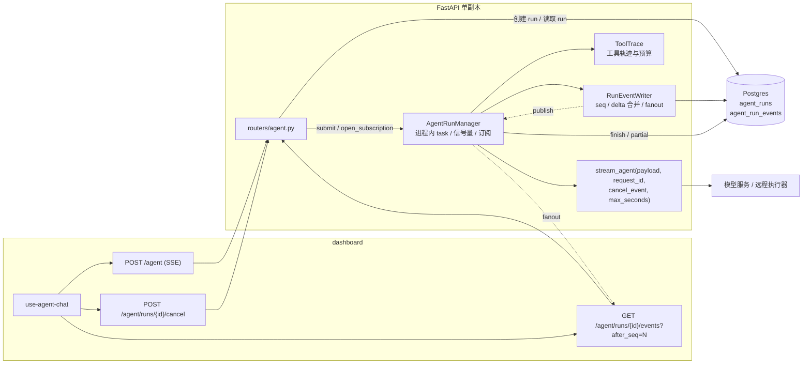

# Agent 执行与连接解耦设计（服务端）

> 状态：已实现（2026-11-04）
>
> 适用范围：`server/` FastAPI 后端、`server/alembic/` 迁移、`agent-loop/` SDK、`dashboard/` 订阅端
>
> 目标读者：后端、前端、Agent 执行层开发者
>
> 契约地位：本文是三份设计文档中**唯一的契约权威来源**。SDK 与前端文档只引用本文第 3、9 节，不各自维护一份契约。

## 1. 背景与目标

旧的 `POST /agent` 把一次 Agent 执行的生命周期绑在 HTTP/SSE 连接上：

- 响应生成器内部启动 `pump()` 消费 `stream_agent()`；客户端断开（`request.is_disconnected()`）会把本轮标记为 `cancelled` 并取消 `pump()`。
- 助手消息只在完成、失败或断连时落库；进程崩溃会丢失整轮输出。
- 没有 run 表、事件游标、订阅接口或后台 worker；前端也没有重连逻辑，`AbortController.abort()` 同时承担“停止”和“离开页面”两种语义。
- 结果是：关页面、切网络、切会话都会杀死执行，长任务无法在后台继续。

本设计把“一次 Agent 执行”从“一次 HTTP 订阅”中拆出来：

1. **执行**由服务端进程内的后台 worker 持有，状态与事件写入 Postgres，连接断开不影响执行。
2. **订阅**是客户端可随时断开、随时续接的只读事件流，用 `after_seq` 断点续传。
3. **取消**是唯一的显式停止语义，由独立接口触发，与断连彻底分离。

### 1.1 本轮目标

- 新增 `agent_runs` / `agent_run_events` 两张表与迁移 008。
- 新增进程内 `AgentRunManager`，在 FastAPI lifespan 中启动、回收和关闭。
- 新增 run 查询、事件订阅、取消三个接口，并扩展 `POST /agent`、`GET /conversations/{id}`、`DELETE /conversations/{id}`。
- 定义可重放的 SSE 事件契约，包括序号、心跳、终态顺序。
- SDK 增加协作式取消入口（`cancel_event`）、`RunCancelled` 与事件序号（`AgentEvent.seq`）。
- 服务重启时把仍处于 `running` 的 run 收尾为终态；不自动续跑。

### 1.2 已确认的决策

| 决策点 | 结论 |
| --- | --- |
| 执行承载 | 服务端进程内后台 worker + Postgres，不新增 Redis/Celery/独立服务 |
| 断连语义 | 断开连接只结束订阅，run 继续执行 |
| 停止语义 | 只有 Stop 按钮调用 `POST /agent/runs/{id}/cancel` 才取消 |
| 重启恢复 | 回收所有 `running` run；已有助手消息按其状态恢复，否则 `interrupted`；不重新执行 |
| 会话并发 | 一个会话同时最多一个活跃 run，由部分唯一索引兜底 |
| 部署假设 | 单 server 副本；多副本需要队列领取/租约，明确不在本期 |
| 事件序号 | 每个 run 内单调递增，从 1 开始；SSE `id` 就是 `seq` |

## 2. 范围、非目标与阶段

### 2.1 本期已实现

- run/event 持久化与迁移 008。
- 后台执行、并发信号量、启动回收、优雅关闭。
- 事件写入、delta 合并、可重放订阅、`Last-Event-ID`、410 过期。
- queued/running 取消、幂等取消、孤儿 run 收尾。
- 工具调用轨迹的实时事件与消息 metadata 持久化。
- SDK 协作式取消、`RunCancelled`、`AgentEvent.seq`、会话 `cancelled` 状态。
- 前端订阅、重连退避、轮询兜底、Stop 走 cancel 接口、刷新/多标签恢复。

### 2.2 本期不做

- 步级 checkpoint 与跨重启自动续跑。
- 多副本 worker、外部队列、Redis、租约领取。
- 上下文压缩、自动摘要、并行工具、长任务预算控制。
- 跨 run 的全局取消、管理员强制终止。
- 事件表按用户查询、审计导出、指标系统。
- 工具级强制中断（正在执行的工具不能被抢占）。

### 2.3 阶段划分

| 阶段 | 内容 | 依赖 |
| --- | --- | --- |
| 本期（本文） | 执行与连接解耦、后台执行、事件重放、显式取消、重启回收、SDK 协作取消 | 无 |
| 后续阶段 | SDK `RunHandle` / `CheckpointStore`、步级恢复、工具级取消 | 本文契约稳定后 |
| 再后续 | 多副本领取/租约、跨副本事件通知、上下文压缩 | 后续阶段 |

本期的执行层仍然是 `stream_agent(payload, request_id, cancel_event=..., max_seconds=...)`：本地模式走 `stream_local_agent()` 的线程桥，远程模式走 `AGENT_LOOP_URL` 的 SSE 解析。解耦发生在 `server/` 的 run 管理层，不改变模型调用与工具执行方式。

## 3. 术语与共享契约

本节是前端、后端、SDK 三份文档共同引用的契约。任何字段变更先改本文。

### 3.1 术语

| 术语 | 含义 |
| --- | --- |
| **run** | 一次 Agent 执行，从创建到终态。对外标识为 `run_id`，对应 `agent_runs.id` |
| **run 状态** | `queued \| running \| completed \| failed \| cancelled \| interrupted` |
| **事件** | run 生命周期中产生的一条可重放记录，写入 `agent_run_events` |
| **seq** | run 内单调递增的事件序号，从 1 开始；SSE 帧的 `id` 就是它 |
| **订阅** | 客户端通过 SSE 读取某 run 的事件；可断开、可带 `after_seq` 续接 |
| **cursor** | 客户端已消费到的 `seq`，即下次订阅的 `after_seq` |
| **活跃 run** | 状态为 `queued` 或 `running` 的 run |
| **assistant_message_id** | run 创建时预生成的助手消息 id；终态时才按此 id 落库 |
| **client_run_id** | 旧请求字段 `run_id` 的值（mem0 记忆作用域），与执行 `run_id` 无关 |
| **worker_id** | `hostname:pid`，领取时写入，用于排查；本期不参与回收判定 |

命名冲突说明：现有 `AgentInvokeRequest.run_id` 是 mem0 的记忆作用域，会写进消息 metadata 与执行器 payload。新的执行标识复用 `run_id` 这个名字，因此：

- 请求中的旧字段继续按原名接受，内部存为 `agent_runs.client_run_id`，并原样放进执行器 payload 的 `run_id`。
- API、SSE、`agent_runs.id` 中的 `run_id` 一律指执行标识。
- 新增可选请求字段 `client_run_id`；落库时 `client_run_id = body.client_run_id or body.run_id`，即两者同时出现时以 `client_run_id` 为准。旧字段标记为 deprecated，但本期不移除。

### 3.2 Run 状态机

```text
queued ──▶ running ──▶ completed
                  ├──▶ failed
                  ├──▶ cancelled
                  └──▶ interrupted   # 仅服务重启/优雅关闭回收

queued ──▶ cancelled                 # 启动前取消，不经过 running
```

- `queued`：run 行已提交，等待 worker 领取。
- `running`：worker 已领取并开始执行，`started_at` 非空。
- `completed`：执行器正常结束，助手消息以 `completed` 落库。
- `failed`：执行器报错、超时、协议错误或崩溃，助手消息以 `failed` 落库。
- `cancelled`：收到显式取消，助手消息以 `cancelled` 落库。
- `interrupted`：服务重启/关闭回收时没有可采纳的助手消息；助手消息以 `failed` 落库，metadata 写 `{"run_status": "interrupted", "error_code": "agent_interrupted"}`。
- 终态不可逆；重复取消或重复终态写入都按幂等处理。

活跃状态只有 `queued` 和 `running`。`agent_runs` 上的部分唯一索引 `uq_agent_runs_active_conversation` 保证同一会话最多一个活跃 run。

### 3.3 消息状态映射

`conversation_messages.status` 的取值是 `completed | cancelled | failed`（现有 CHECK 约束）。

| run 终态 | 消息 status | 消息 metadata 追加 |
| --- | --- | --- |
| `completed` | `completed` | 执行器 metadata（`usage`、`finish_reason`、`run_id` 等）与 `tool_trace` |
| `failed` | `failed` | `{"error_code": "<code>"}` 与 `tool_trace` |
| `cancelled` | `cancelled` | `{"error_code": "agent_cancelled"}` 与 `tool_trace` |
| `interrupted` | `failed` | `{"run_status": "interrupted", "error_code": "agent_interrupted"}` 与 `tool_trace` |

没有正文也没有工具轨迹的 run 不写助手消息（`should_persist_reply` 为 false）；前端只看到 `error` 事件。

### 3.4 事件类型

持久化事件只有七种，写入 `agent_run_events`：

| 事件 | 何时产生 | 是否带 `id: <seq>` |
| --- | --- | --- |
| `memory.recall` | run 开始后、第一次模型请求前的研究记忆检索（无论命中与否） | 是 |
| `message.delta` | 模型流式文本增量，按批次合并后写入 | 是 |
| `tool.call` | 模型请求一次工具调用 | 是 |
| `tool.result` | 工具调用结算（`completed`、`failed` 或 `aborted`） | 是 |
| `message.completed` | 助手消息成功落库 | 是 |
| `memory.save` | 成功 run 的 `done` 之后写入研究记忆（`added`/`updated`/`skipped`/`failed`） | 是 |
| `error` | 失败、取消或中断的终态错误 | 是 |

非持久化事件由服务端合成：

| 事件 | 何时产生 | 是否带 `id` |
| --- | --- | --- |
| `meta` | 每次订阅开始时（包括重连） | 否 |
| `done` | 每个 run 的最后一个事件 | 否 |

所有**持久化事件**的 payload 统一包含：

```json
{
  "run_id": "6f1c...",
  "conversation_id": "0b2a...",
  "seq": 7
}
```

说明：

- `seq` 在 payload 中重复出现，便于客户端在丢失 `id` 时仍能去重；客户端应以 SSE `id` 为准。
- `meta` 和 `done` 不是持久化事件：`meta` 没有 `seq`；`done` 也没有 `seq`，只有 `last_seq`。
- 现有 payload 字段全部保留，只增加上述公共字段。

### 3.5 精确 payload

#### `meta`（`POST /agent` 的流式入口）

```json
{
  "run_id": "6f1c...",
  "conversation_id": "0b2a...",
  "conversation": { "...": "ConversationOut" },
  "user_message": { "...": "ConversationMessageOut" },
  "assistant_message_id": "c9d3...",
  "status": "queued",
  "last_seq": 0,
  "run": {
    "id": "6f1c...",
    "conversation_id": "0b2a...",
    "status": "queued",
    "last_seq": 0,
    "assistant_message_id": "c9d3..."
  }
}
```

- 不含 `after_seq`。
- `run` 是精简对象，不是完整 `AgentRunOut`。
- 仅当订阅建立时 run 已终态且助手消息已落库，才额外带 `"message": { ...ConversationMessageOut }`；否则没有 `message` 键。

#### `meta`（`GET /agent/runs/{id}/events` 的订阅入口）

```json
{
  "run_id": "6f1c...",
  "conversation_id": "0b2a...",
  "conversation": { "...": "ConversationOut" },
  "user_message": { "...": "ConversationMessageOut" },
  "assistant_message_id": "c9d3...",
  "status": "running",
  "last_seq": 12,
  "after_seq": 4,
  "run": {
    "id": "6f1c...",
    "conversation_id": "0b2a...",
    "status": "running",
    "error_code": null,
    "error_detail": null,
    "last_seq": 12,
    "partial_content": "已经找到三个相关文件，",
    "assistant_message_id": "c9d3...",
    "cancel_requested_at": null,
    "created_at": "2026-11-04T10:00:00Z",
    "started_at": "2026-11-04T10:00:01Z",
    "finished_at": null
  }
}
```

- 含 `after_seq`，即本次订阅实际使用的排他游标。
- `run` 是完整 `AgentRunOut`。
- `conversation`、`user_message` 在会话/消息已被删除或无法读取时可能为 `null`。
- 仅当订阅建立时 run 已终态且助手消息存在，才额外带 `"message": { ...ConversationMessageOut }`。

#### `message.delta`

```json
{
  "run_id": "6f1c...",
  "conversation_id": "0b2a...",
  "seq": 3,
  "message_id": "c9d3...",
  "delta": "已经找到三个相关文件，"
}
```

#### `tool.call`

```json
{
  "run_id": "6f1c...",
  "conversation_id": "0b2a...",
  "seq": 4,
  "message_id": "c9d3...",
  "tool_call_id": "call_abc",
  "name": "search_files",
  "iteration": 1,
  "status": "running",
  "arguments": { "query": "agent run" },
  "raw_arguments": "{\"query\":\"agent run\"}",
  "arguments_error": null,
  "started_at": "2026-11-04T10:00:02.123456+00:00",
  "truncated": false
}
```

字段说明：

- `arguments` 是解析后的 JSON 对象；解析失败时为 `null`。
- `raw_arguments` 是模型返回的原始字符串；不存在时为 `null`。
- `arguments_error` 是解析失败原因；成功时为 `null`。
- `started_at` 是服务端收到事件时的墙钟时间。
- `truncated` 表示参数是否因大小预算被截断。截断时 `arguments` 为 `null`，`raw_arguments` 保留头尾预览。

#### `tool.result`

```json
{
  "run_id": "6f1c...",
  "conversation_id": "0b2a...",
  "seq": 5,
  "message_id": "c9d3...",
  "tool_call_id": "call_abc",
  "name": "search_files",
  "iteration": 1,
  "status": "completed",
  "content": "{\"matches\": [\"server/app/agent/runner.py\"]}",
  "is_error": false,
  "duration_ms": 842,
  "finished_at": "2026-11-04T10:00:02.965000+00:00",
  "truncated": false
}
```

字段说明：

- `status` 取值 `completed | failed | aborted`。
- 工具执行抛错时为 `failed`，`is_error` 为 `true`。
- run 失败/取消/中断时，仍为 `running` 的工具会被补齐为 `aborted`，`content` 为 `{"error": "<reason>"}`（若原本没有内容）。
- `duration_ms` 是服务端计时；远程执行器可自带该字段。

#### `message.completed`

```json
{
  "run_id": "6f1c...",
  "conversation_id": "0b2a...",
  "seq": 8,
  "message_id": "c9d3...",
  "message": { "...": "ConversationMessageOut" }
}
```

- 只在 `completed` 终态产生，且该 run 还没有 `message.completed` 事件时追加。
- `message` 是最终落库的助手消息；若消息未落库则没有该键。

#### `error`

```json
{
  "run_id": "6f1c...",
  "conversation_id": "0b2a...",
  "seq": 9,
  "code": "agent_timeout",
  "detail": "Agent turn timed out.",
  "request_id": "req-...",
  "partial": true
}
```

- `partial` 表示本轮是否已有助手消息落库。`false` 时前端应删除空占位气泡。
- `request_id` 只在正常执行的收尾路径中存在；启动回收、queued 取消、缺少 request 的失败路径可能没有该字段。
- `code` 可能是 `agent_cancelled`、`agent_interrupted`、`agent_timeout`、`agent_upstream_error`、`agent_protocol_error`、`agent_not_configured` 等。

#### `done`

管理器发布的 `done`（实时终态）：

```json
{
  "run_id": "6f1c...",
  "conversation_id": "0b2a...",
  "status": "failed",
  "last_seq": 9
}
```

订阅一个**已经终态**的 run 时，服务端合成的 `done`：

```json
{
  "run_id": "6f1c...",
  "status": "failed",
  "last_seq": 9
}
```

- `done` 没有 `seq`，也没有 `id`。
- 实时 `done` 含 `conversation_id`；终态订阅的合成 `done` 不含。
- `status` 是 run 终态；客户端必须读取它，不能把 `done` 本身当作成功信号。

### 3.6 终态顺序

每个 run 的持久化事件之后，事件序列满足：

| 终态 | 顺序 |
| --- | --- |
| 成功 | 历史事件 → `message.completed` → `done` |
| 失败 | 历史事件 → `tool.result(status=aborted)`（补齐未结算工具）→ `error` → `done` |
| 取消 | 历史事件 → `tool.result(status=aborted)`（若有）→ `error(code=agent_cancelled)` → `done` |
| 中断 | 历史事件（可能缺失）→ 可选 aborted 工具 → `error(code=agent_interrupted)` → `done`（实时或重连时合成） |

- 失败、取消、中断路径**不发** `message.completed`。
- `queued` 取消没有工具和正文，只有 `error(agent_cancelled)` → `done`。
- 终态事件的追加是幂等的：已有 `message.completed` 就不再追加，已有 `error` 就不再追加。
- 客户端必须读取 `done.status` 或最后的 `error.code`，不能把连接结束当成成功。

### 3.7 错误码

| 错误码 | HTTP | 出现位置 | 含义 |
| --- | --- | --- | --- |
| `agent_not_configured` | 503 | `POST /agent`、SSE `error` | 没有可用的本地模型配置、`AGENT_LOOP_URL` 或 mock |
| `agent_unreachable` | 502 | 非流式 `POST /agent`、SSE `error` | 远程执行器连接失败 |
| `agent_timeout` | 504 | 非流式 `POST /agent`、SSE `error` | 执行超时，或非流式等待超过 `AGENT_RUN_MAX_SECONDS + 30` |
| `agent_upstream_error` | 502 | 非流式 `POST /agent`、SSE `error` | 执行器报错、崩溃、达到最大步数 |
| `agent_protocol_error` | 502 | 非流式 `POST /agent`、SSE `error` | 执行器协议错误、没有产出正文、`request` 快照缺失 |
| `agent_cancelled` | 409（非流式）/ SSE `error` | 取消后的非流式请求、订阅 | run 被显式取消 |
| `agent_interrupted` | 503（非流式）/ SSE `error` | 重启/关闭后的非流式请求、订阅 | run 被服务重启/关闭中断 |
| `agent_run_active` | 409 | `POST /agent`、`DELETE /conversations/{id}` | 会话已有 `queued`/`running` run；body 带 `run_id` |
| `agent_run_not_found` | 404 | `/agent/runs/*` | run 不存在、不属于当前用户、已被清理，或 id 非法 |
| `agent_events_expired` | 410 | `GET /agent/runs/{id}/events` | `after_seq` 早于事件保留窗口，无法完整回放 |
| `agent_invalid_cursor` | 400 | `GET /agent/runs/{id}/events` | `after_seq` 为负数 |
| `conversation_deleted` | 404 | legacy 非流式/流式 `POST /agent` | 助手消息落库时会话已删除 |
| `agent_failed` | 502 | 非流式 `POST /agent` | 终态没有更具体错误码时的兜底 |

鉴权规则：所有 run 接口使用 `require_auth`，按 `agent_runs.created_by` 校验归属。不存在与他人的 run 统一返回 404，避免探测。

## 4. 总体架构



关键变化：

- `POST /agent` 不再在请求协程里消费执行器。它创建 run、提交给 manager，然后把自己注册成第一个订阅者。
- 执行器输出先经 `RunEventWriter` 落库并分配 `seq`，再 fanout 给当前订阅者。订阅者断开只移除队列。
- `GET .../events` 可以从任意 `after_seq` 重建同一段输出。
- 取消接口直接设置 manager 中的 `threading.Event`，与订阅无关。

### 4.1 请求生命周期（后台模式）

```text
POST /agent
  ├─ 鉴权；检查 is_configured()
  ├─ 单事务：加载/创建会话、写 user message、插入 agent_runs(status=queued, request=payload 快照)
  ├─ manager.submit(run_id, request_id)
  └─ stream=true：
       manager.open_subscription(run_id, 0)
       meta → 历史事件（带 id）→ 实时事件 → done
     stream=false：
       manager.wait(run_id, max_seconds + 30) → 返回 JSON 或错误
```

### 4.2 断连生命周期

```text
客户端断开 / AbortController.abort()
  ├─ StreamingResponse 生成器结束
  ├─ manager.close_subscription(run_id, sub)
  └─ run task 不受影响，继续写事件
```

前端关闭订阅只增加本地 `epoch` 并 abort reader，不调用 cancel 接口。

### 4.3 后台路径与 legacy 路径

`AGENT_RUN_BACKGROUND=true`（默认）走第 4.1 节的路径。

`AGENT_RUN_BACKGROUND=false` 时 `POST /agent` 回到请求绑定路径（`_legacy_invoke`）：

- 不创建 `agent_runs`，不写事件表。
- 响应生成器内部创建 `pump()` 消费执行器；客户端断开时把本轮标记为 `cancelled` 并取消 `pump()`。
- SSE `meta` 只有 `conversation` / `user_message`，没有 `run_id`。
- `message.delta` 的 `id` 是 `<assistant_message_id>:<sequence>`，不是 run 内 `seq`。
- `done` 只有 `{"conversation_id": "..."}`。
- 工具事件仍会发出，但没有可重放的 `id`/`seq`。
- 前端检测不到 `meta.run_id` 时，Stop 只能退回本地 abort。

legacy 路径只用于回滚和兼容，不应与后台路径混跑（见第 12.2 节）。

## 5. 数据模型与迁移 008

### 5.1 `agent_runs`

| 列 | 类型 | 说明 |
| --- | --- | --- |
| `id` | `UUID PK` | 对外 `run_id` |
| `conversation_id` | `UUID NOT NULL FK conversations ON DELETE CASCADE` | 所属会话 |
| `created_by` | `UUID NOT NULL FK users ON DELETE CASCADE` | 归属用户，接口鉴权用 |
| `user_message_id` | `UUID NULL FK conversation_messages ON DELETE SET NULL` | 本轮用户消息 |
| `assistant_message_id` | `UUID NULL` | 预生成的助手消息 id；终态时按此 id 落库。**不建外键** |
| `request` | `JSONB NOT NULL DEFAULT '{}'` | 执行器 payload 快照；ORM 属性名为 `request_payload` |
| `client_run_id` | `VARCHAR(255) NULL` | 旧请求 `run_id`（mem0 scope）或显式 `client_run_id` |
| `agent_id` | `VARCHAR(255) NULL` | 会话/请求指定的 agent |
| `status` | `VARCHAR(20) NOT NULL DEFAULT 'queued'` | CHECK 六态 |
| `error_code` | `VARCHAR(64) NULL` | 终态错误码 |
| `error_detail` | `TEXT NULL` | 终态错误详情 |
| `partial_content` | `TEXT NOT NULL DEFAULT ''` | 已落库文本增量的拼接 |
| `partial_metadata` | `JSONB NOT NULL DEFAULT '{}'` | 工具轨迹、usage 等中间元数据 |
| `last_seq` | `BIGINT NOT NULL DEFAULT 0` | 已分配的最大事件序号 |
| `attempt` | `INT NOT NULL DEFAULT 1` | 预留；本期创建即 1，不自动重试 |
| `worker_id` | `TEXT NULL` | `hostname:pid`，领取时写入 |
| `heartbeat_at` | `TIMESTAMPTZ NULL` | worker 心跳写入；本期不被读取 |
| `cancel_requested_at` | `TIMESTAMPTZ NULL` | 取消请求时间，幂等与 UI 展示用 |
| `started_at` | `TIMESTAMPTZ NULL` | 领取时间 |
| `finished_at` | `TIMESTAMPTZ NULL` | 终态时间 |
| `created_at` / `updated_at` | `TIMESTAMPTZ NOT NULL DEFAULT now()` | 时间戳 |

约束与索引：

```sql
CREATE UNIQUE INDEX uq_agent_runs_active_conversation
    ON agent_runs (conversation_id)
    WHERE status IN ('queued', 'running');

CREATE INDEX ix_agent_runs_created_by_created
    ON agent_runs (created_by, created_at);

CREATE INDEX ix_agent_runs_status_heartbeat
    ON agent_runs (status, heartbeat_at);
```

`request` 快照内容：

```json
{
  "conversation_id": "...",
  "message_id": "<user_message_id>",
  "message": "用户原文",
  "history": [{"role": "user", "content": "..."}],
  "user_id": "<created_by>",
  "agent_id": "...",
  "run_id": "<legacy mem0 scope 或 null>",
  "client_run_id": "<显式 client_run_id 或 null>",
  "metadata": {}
}
```

`history` 是写入本轮用户消息之前的会话历史（受 `AGENT_LOOP_HISTORY_MESSAGES` 限制），因此不包含本轮用户消息；执行器会把 payload 的 `message` 追加为最后一条用户消息。

没有 `request` 快照，`queued` run 在重启后无法重建执行器入参；这是本期必须持久化它的原因。启动时 `request` 为空的 `queued` run 会被标记为 `failed` + `agent_protocol_error`。

`assistant_message_id` 为什么没有外键：它在 run 创建时预生成，而对应的 `conversation_messages` 行要到终态才写入。Postgres 的外键在插入 `agent_runs` 时就会校验，若引用一个尚不存在的消息 id，创建 run 会直接失败。因此它按逻辑引用处理：终态落库前先检查该 id 是否已存在，写入时使用同一 id。`user_message_id` 对应的行在创建 run 前已写入，可以保留外键。

### 5.2 `agent_run_events`

| 列 | 类型 | 说明 |
| --- | --- | --- |
| `id` | `BIGINT GENERATED ALWAYS AS IDENTITY PK` | 物理主键，不对外 |
| `run_id` | `UUID NOT NULL FK agent_runs ON DELETE CASCADE` | 所属 run |
| `seq` | `BIGINT NOT NULL` | run 内单调递增，从 1 开始 |
| `event_type` | `VARCHAR(32) NOT NULL` | CHECK 五种持久化事件 |
| `payload` | `JSONB NOT NULL` | 事件 payload |
| `created_at` | `TIMESTAMPTZ NOT NULL DEFAULT now()` | 写入时间 |

```sql
CREATE TABLE agent_run_events (
    id BIGINT GENERATED ALWAYS AS IDENTITY PRIMARY KEY,
    run_id UUID NOT NULL REFERENCES agent_runs(id) ON DELETE CASCADE,
    seq BIGINT NOT NULL,
    event_type VARCHAR(32) NOT NULL,
    payload JSONB NOT NULL,
    created_at TIMESTAMPTZ NOT NULL DEFAULT now(),
    CONSTRAINT uq_agent_run_events_run_seq UNIQUE (run_id, seq),
    CONSTRAINT ck_agent_run_events_type CHECK (
        event_type IN (
            'message.delta', 'tool.call', 'tool.result', 'memory.recall', 'memory.save',
            'message.completed', 'error'
        )
    )
);

CREATE INDEX ix_agent_run_events_run_seq ON agent_run_events (run_id, seq);
```

`meta` 与 `done` 不入库，避免为每次订阅写重复记录。

### 5.3 迁移 008

- 文件：`server/alembic/versions/008_create_agent_runs_and_events.py`
- `revision = "008"`，`down_revision = "007"`。
- `upgrade()`：建 `agent_runs`、部分唯一索引、两个普通索引；建 `agent_run_events`、唯一约束、CHECK、索引。
- `downgrade()`：按依赖顺序删索引和表。
- 迁移只加表，不改 `conversations` / `conversation_messages`，可安全先于应用发布执行。

### 5.4 保留与清理

| 数据 | 默认保留 | 清理方式 |
| --- | --- | --- |
| 终态 run 的事件 | 7 天 | `RunRepository.prune_events` |
| run 行 | 30 天 | `RunRepository.prune_runs`；事件随 FK 级联 |
| 活跃 run | 不删 | 只允许通过终态或回收进入终态 |

清理入口是 `server/scripts/prune_agent_runs.py`，读取 `AGENT_RUN_EVENT_RETENTION_DAYS` 与 `AGENT_RUN_RETENTION_DAYS`，需要由部署侧 cron / systemd timer 手工调度；服务进程内没有自动清理任务。清理只处理终态且 `finished_at` 非空的行，不会删除活跃 run。

## 6. Run 生命周期

### 6.1 创建

`POST /agent` 的后台创建流程（`_create_background_turn`）：

1. 在同一个 `SessionLocal` 事务里加载或创建会话。
2. 如果是已有会话，先查活跃 run；命中则直接返回 409 `agent_run_active`，**不写任何消息**。
3. 如果会话标题仍是默认值且没有任何消息，用首条用户消息派生标题。
4. 读取历史（`build_history`，限制 `AGENT_LOOP_HISTORY_MESSAGES`）。
5. 预生成 `user_message_id` 与 `assistant_message_id`。
6. 插入用户消息并 `flush()`，让 run 可以引用它的 id。
7. 插入 `agent_runs(status='queued', request=payload, last_seq=0)`。
8. 提交。部分唯一索引冲突时回滚，复查活跃 run；若存在则返回 409，否则重新抛出。

用户消息与 run 行在同一事务中，且用户消息先插入。409 的语义是“本次消息没有写入”，客户端不能把它当成已发送。

`409` 响应体：

```json
{
  "detail": "This conversation already has an active agent run.",
  "code": "agent_run_active",
  "conversation_id": "0b2a...",
  "run_id": "6f1c...",
  "request_id": "req-..."
}
```

### 6.2 领取

worker 用条件更新领取：

```sql
UPDATE agent_runs
SET status = 'running',
    started_at = :now,
    heartbeat_at = :now,
    worker_id = :worker_id,
    updated_at = :now
WHERE id = :run_id AND status = 'queued'
```

实现使用 SQLAlchemy `update(...).where(status == "queued")` 并检查 `rowcount`；返回 0 说明已被取消或领取，任务直接退出。`agent_runs.last_seq` 不在这里重置。

### 6.3 执行

- 领取后重新读取 run，构造 `RunEventWriter`，用 `run.partial_content` / `run.partial_metadata` / `run.last_seq` 继续（正常新 run 为空）。
- 启动 heartbeat task，每 `AGENT_RUN_HEARTBEAT_SECONDS` 写一次 `heartbeat_at`；本期没有读取方。
- 调用 `_events(run, metadata)`：
  - 执行器默认 `stream_agent`。
  - 通过 `inspect.signature(executor).parameters` 探测是否接受 `cancel_event`；接受则传入本 run 的 `threading.Event`。
  - 总是传入 `max_seconds=self.config.max_seconds`。
  - 执行器入参是 `run.request_payload` 的副本与创建时的 `request_id`。
- 逐事件交给 `_handle_event`：
  - `AgentDelta` → `writer.add_delta`。
  - `AgentCompleted` → 合并 metadata。
  - `AgentToolCall` → `ToolTrace.start`，写 `tool.call`，同时更新 `partial_metadata.tool_trace`。
  - `AgentToolResult` → `ToolTrace.finish`，写 `tool.result`，同时更新 `partial_metadata.tool_trace`。
- 执行器自然结束后：
  - 如果 `writer.content.strip()` 为空且 `ToolTrace` 没有条目 → `failed` / `agent_protocol_error` / `"Agent executor produced no content."`。
  - 否则 → `completed`。

### 6.4 终态写入顺序

无论成功、失败、取消还是中断，`_finalize` 都按同一顺序收尾：

1. `writer.flush()`，把缓冲区里的 delta 落库。
2. `trace.abort_open("<run status>")`，把仍为 `running` 的工具在内存中结算为 `aborted`。
3. 对每个 aborted 条目写 `tool.result(status=aborted)`，并更新 `partial_metadata.tool_trace`。
4. 组装最终 metadata：
   - 普通错误追加 `error_code`。
   - `interrupted` 追加 `run_status="interrupted"` 与 `error_code="agent_interrupted"`。
   - 合并 `tool_trace`。
5. 若 `should_persist_reply(content, trace)` 为真，用预生成的 `assistant_message_id` **幂等**插入助手消息，状态按第 3.3 节映射。
6. `repo.finish(...)` 条件更新 `agent_runs`：`status`、`error_code`、`error_detail`、`partial_content`、`partial_metadata`、`finished_at`，仅当当前状态为 `queued`/`running`。
7. 追加终态事件（若尚不存在）：
   - `completed` → `message.completed`。
   - 其他 → `error`。
8. 通过 manager 发布实时 `done`，payload 为 `{run_id, conversation_id, status, last_seq}`。

关键点：

- 第 5 步先于第 6 步，保证“消息已落库但 run 仍 running”的崩溃窗口可以被启动回收识别并修复；反之则不会出现“run 已完成但消息缺失”。
- `repo.finish` 返回 `False` 说明另一条路径已经先完成终态（例如取消与自然完成竞争），此时不再追加终态事件，直接返回。
- 如果 `insert_assistant_message` 返回 `None`（会话已删除），`_finalize` 直接返回；run 行通常也已被级联删除。
- `writer.last_seq` 在追加终态事件后前进；`done.last_seq` 是包含终态事件在内的最新序号。
- heartbeat task 在 `finally` 中取消；`writer.close()` 再做一次 flush。

### 6.5 助手消息写入

- 使用预生成的 `assistant_message_id`，避免重连/回收时生成第二个 id。
- `repo.insert_assistant_message` 先按 id 查；存在则直接返回，不再插入。
- 会话不存在或不属于该用户时返回 `None`。
- 并发插入触发 `IntegrityError` 时回滚并重新按 id 查询，返回已有行。
- 消息 metadata 至少包含执行器 metadata（若有）与 `tool_trace`（若有）；旧 `run_id`（mem0 scope）的语义保持不变。

## 7. 执行管理器与并发

### 7.1 组件

`server/app/agent/runner.py`：

| 组件 | 职责 |
| --- | --- |
| `AgentRunManager` | lifespan 启停、启动回收、submit、wait、取消、in-flight 表、信号量、订阅 fanout |
| `RunEventWriter` | seq 分配、delta 合并、事件落库、partial 更新、publish |
| `RunSubscription` | 单个订阅者的有界队列、初始状态/序号、历史快照 |
| `RunConfig` | 从环境变量加载运行参数 |
| `_run_worker` | 领取、消费执行器、收尾 |
| `_recover_run` | 重启/关闭时收尾 `running` run |

`server/app/agent/trace.py` 的 `ToolTrace` 负责工具条目的合并、计时与大小预算；`server/app/agent/payloads.py` 负责事件 payload 与 metadata 的组装。

### 7.2 在 FastAPI 中启停

`server/app/main.py` 的 lifespan：

```python
@asynccontextmanager
async def lifespan(app: FastAPI):
    manager = AgentRunManager()
    app.state.agent_runs = manager
    if manager.config.background:
        try:
            await manager.startup()
        except Exception:
            logging.exception("Failed to start the agent run manager")
    try:
        yield
    finally:
        if manager.config.background:
            try:
                await manager.shutdown()
            except Exception:
                logging.exception("Failed to shut down the agent run manager")
```

- `background=true` 时才执行 `startup()` / `shutdown()`。
- `startup()` 的数据库失败只记录日志，不阻止 API 的其它部分（memories、auth、配置）启动。
- `_run_manager(request)` 是兜底：如果 `app.state.agent_runs` 不存在（例如测试或未走 lifespan），惰性创建一个新 manager。

`startup()`：

1. 对 `repo.list_running()` 返回的**所有** `running` run 调用 `_recover_run(reason="Agent run was interrupted by a server restart.")`。没有租约/心跳过期判断。
2. 对 `repo.list_queued()`：
   - `request_payload` 为空 → `_fail_unstartable`，写 `error(agent_protocol_error)` 并标记 `failed`。
   - 否则 `submit(run.id)`，重新排队执行。
3. 记录汇总日志（`worker`、`recovered`、`resubmitted`、`concurrency`）。

`shutdown()`：

1. 设置 `_shutting_down = True`，`submit()` 之后直接返回。
2. 取消所有 in-flight task；等待最多 5 秒；仍未结束的再次取消并再等 1 秒。
3. 向所有订阅者放入 `done`，payload 为 `{"status": "interrupted", "last_seq": 0}`，并标记订阅关闭。
4. 对仍然 `running` 的 run 调用 `_recover_run(reason="Agent run was interrupted by a server shutdown.")`。
5. 下一次启动继续回收剩余行。

### 7.3 并发与背压

- `AGENT_RUN_CONCURRENCY` 控制同时执行的 run 数；每个 worker 在 `async with self._semaphore` 内领取。多出的 run 保持 `queued`。
- 进程内维护 `dict[run_id, asyncio.Task]`、`dict[run_id, asyncio.Event]`（waiter）、`dict[run_id, threading.Event]`（取消信号）、`dict[run_id, str]`（request_id）。
- 重复 `submit(run_id)` 直接忽略（`run_id in self._tasks`）。
- 每个订阅者一个 `asyncio.Queue(maxsize=256)`。队列满时：从 fanout 集合移除、标记 `closed`、记 warning；不阻塞 writer 或其他订阅者。
- 一个 run 可以有多个订阅者（多标签、断线重连重叠），fanout 集合按订阅对象去重。

### 7.4 取消

`POST /agent/runs/{id}/cancel` → `AgentRunManager.cancel`：

1. 按 `created_by` 查 run；不存在返回 `None`（路由返回 404）。
2. 已是终态：直接返回当前 run（幂等）。
3. `queued`：
   - `repo.cancel_queued` 条件更新为 `cancelled`，写 `error_code="agent_cancelled"`、`error_detail`、`cancel_requested_at`、`finished_at`。
   - 更新成功：重新读取 run，调用 `_append_cancelled_event` 写 `error(agent_cancelled)` 并发布 `done`，`_signal_done(run_id)`，返回。
   - 更新失败（可能刚被领取）：重新读取；若已终态则返回；否则继续按 `running` 处理。
4. `running`：
   - `repo.request_cancel` 仅在 `cancel_requested_at IS NULL` 时写入。
   - 若 manager 内存里有该 run 的 `threading.Event`，`set()`。
   - 若 `run_id` 不在 `_tasks`（例如服务重启后遗留的 running 行），调用 `_finalize_orphan_cancel`。
   - 返回当前 run（通常仍是 `running`，带 `cancel_requested_at`）。

取消是协作式的：

- `stream_agent` 在远程 SSE 的每个事件之间检查 `cancel_event`；本地 `stream_local_agent` 在队列等待和每个 delta 之间检查（最长 0.5 秒），并转发给 SDK。
- SDK 在四个安全检查点检查：每次 ReAct 迭代前、模型响应后/工具调用前、每个工具调用前、每个工具调用后。流式 chunk 循环内部不检查。
- 正在执行的长工具调用不能被抢占；取消要等它返回。
- 自定义 executor 如果不接受 `cancel_event`，manager 不会传入，取消只在执行器自然结束后生效；没有 `task.cancel()` 兜底。
- 取消与自然完成竞争时，以先写入终态的路径为准；另一条路径的 `repo.finish` 影响 0 行，直接退出。

### 7.5 单副本假设

manager 状态在进程内存，`agent_runs` 的领取只是条件更新，不是租约队列。因此：

- 只允许一个 server 副本处理 Agent 执行。不要用 `AGENT_RUN_BACKGROUND=false` 的副本分担流量：那会绕过 run 表，回到请求绑定路径，破坏“一个会话一个活跃 run”的约束。
- 多副本会导致同一 `queued` run 被两个 worker 竞争（条件更新只能保证一个成功，但另一个副本可能持有内存订阅）与事件 fanout 缺失。
- 多副本方案（`SELECT ... FOR UPDATE SKIP LOCKED` 领取 + 租约 + 跨副本事件轮询/通知）属于后续阶段。

## 8. 事件日志、订阅与重放

### 8.1 写入模型

`RunEventWriter` 串行化单个 run 的所有写入：

- 维护内存 `last_seq`、`content`、`metadata` 与 delta 缓冲。
- 每个持久化事件分配 `seq = last_seq + 1`，在同一个事务里插入 `agent_run_events` 并更新 `agent_runs.last_seq`、`partial_content`、`partial_metadata`。
- 写入成功后更新内存 `last_seq`，再 `manager.publish` 给订阅者。
- SQLAlchemy 同步调用统一用 `asyncio.to_thread`，不阻塞事件循环。

`repo.append_event` 的具体行为：

1. `SELECT ... FOR UPDATE` 锁住 run 行。
2. 如果 run 不存在或 `run.last_seq >= seq`，回滚并返回 `False`。
3. 更新 `last_seq`、`partial_content`、`partial_metadata`、`updated_at`。
4. 插入 `agent_run_events`。
5. 提交；唯一约束冲突时回滚并返回 `False`。

**写入失败不重试**：`RunEventWriter._append_locked` 一旦收到 `False`，就把 `available = False` 并记录日志；该 run 后续事件不再持久化、不再 fanout。执行本身继续，收尾时仍会尝试写助手消息与 `repo.finish`（这两步不经过 writer）。

delta 合并：

- 收到 `AgentDelta` 时只追加到缓冲，不立即写库。
- 满足任一条件即 flush：距上次 flush ≥ `AGENT_RUN_DELTA_FLUSH_MS`（默认 150ms）、缓冲 ≥ `AGENT_RUN_DELTA_FLUSH_BYTES`（默认 4096 字节）。
- 后台 `_flush_loop` 每 `delta_flush_ms` 尝试一次 flush。
- 任何非 delta 事件（工具、终态）写入前先 flush，保证事件顺序。
- 每次 flush 写**一条** `message.delta` 事件，`payload.delta` 是合并后的文本；同时把文本追加到 `agent_runs.partial_content`。
- 崩溃最多丢失最后一个未 flush 窗口（约 150ms 或 4KB）的文本，这是明确接受的代价。

### 8.2 订阅交接

`AgentRunManager.open_subscription(run_id, after_seq)`：

1. 获取 per-run `asyncio.Lock`。
2. 读取 run；不存在返回 `None`。
3. 创建 `RunSubscription`，加入该 run 的订阅集合。
4. 在锁内快照 `status` 与 `last_seq`。
5. 释放锁。
6. 在锁外查询 `seq > after_seq` 的历史事件，写入 `sub.history`。
7. 设置 `sub.initial_status` / `sub.initial_last_seq`，返回订阅。

“先注册队列再读库”保证交接期间产生的新事件不会丢；按 seq 去重保证不会重复。历史查询放在锁外，避免长回放阻塞事件写入。

`_subscription_stream`：

1. 发合成的 `meta`。
2. 逐条发送 `subscription.history`，跳过 `seq <= after_seq`；对 `message.completed` / `error` 记录 `saw_terminal`；持久化帧带 `id: <seq>`。
3. 如果 `initial_status` 是终态：
   - 若 `saw_terminal` 为 false 且（`last_emitted < initial_last_seq` 或 `initial_last_seq == 0`），最多等待 2 秒，从订阅队列里再取终态事件。
   - 然后发合成的 `done`，payload 为 `{run_id, status, last_seq}`，结束。
4. 否则进入实时循环：
   - 从队列取事件，15 秒无事件发 SSE 注释 `: ping`。
   - 收到 `done`：原样转发（含 `conversation_id`），结束。
   - 其他事件按 seq 去重后发送，带 `id: <seq>`。
5. `finally` 中 `close_subscription`。

2 秒等待是启发式：`repo.finish` 先提交 run 状态，随后才追加终态事件；订阅者刚好落在这个窗口时，先等一小段时间，避免重连以 `done` 结束却缺少 `message.completed` / `error`。

### 8.3 SSE 帧格式与响应头

```text
event: meta
data: {"run_id":"...","status":"running","last_seq":4,...}

id: 5
event: message.delta
data: {"run_id":"...","conversation_id":"...","seq":5,"message_id":"...","delta":"..."}

: ping

id: 6
event: message.completed
data: {"run_id":"...","conversation_id":"...","seq":6,"message_id":"...","message":{...}}

event: done
data: {"run_id":"...","conversation_id":"...","status":"completed","last_seq":6}
```

- `id` 是十进制 `seq`，不带前缀。
- 心跳是 SSE 注释 `: ping`，每 15 秒一次；它不分配 seq、不入库。
- `meta` 与 `done` 没有 `id`，因为不可重放。
- 响应头：`Cache-Control: no-cache, no-transform`、`Connection: keep-alive`、`X-Accel-Buffering: no`，媒体类型 `text/event-stream`。
- 事件按 seq 严格递增发送；多订阅者各自看到同一顺序。

### 8.4 重连语义

- 客户端带 `after_seq=<最后收到的 seq>` 重连，服务端只发更大的 seq。
- `after_seq` 排他：`seq > after_seq`。
- `GET .../events` 同时接受 `Last-Event-ID` 头；两者都存在时以 `after_seq` 为准。
- cursor 会被钳制到 `run.last_seq`，超过也不会报错。
- 重连会重新收到 `meta`，其中 `status` 是当前真实状态，`after_seq` 是本次实际游标。
- 如果 run 在断连期间已终态，重连先回放剩余事件，再补 `done`；终态订阅的合成 `done` 不含 `conversation_id`。
- 事件已过期（410）时不能续接，客户端重新拉取会话详情，以落库消息为准。

### 8.5 慢订阅者

- 每个订阅队列 256 条。队列满时：从 fanout 集合移除、标记 `closed`、记 warning。
- 不丢事件本身：事件已经落库，客户端重连用 cursor 补齐。
- 不因慢订阅者阻塞 writer 或其他订阅者。
- 被丢弃的订阅没有显式错误帧；客户端表现为 reader 结束，随后按重连算法处理。

## 9. HTTP API 契约

所有接口使用 `require_auth`。响应中的 `run_id` 一律是执行 run id。

### 9.1 `POST /agent`

限流：`30/minute`。

请求体（`AgentInvokeRequest`）：

```json
{
  "conversation_id": "0b2a...",
  "message": "帮我整理这个仓库的测试失败原因",
  "agent_id": null,
  "run_id": "mem0-scope-value",
  "client_run_id": null,
  "metadata": {},
  "stream": true
}
```

- `message` 必填，`1..32000` 字符，首尾空白会被去除；只有空白会被拒绝。
- `conversation_id` 为空时创建新会话。
- `agent_id` 为空时沿用会话的 `agent_id`。
- `run_id` 是 deprecated 的 mem0 记忆作用域；`client_run_id` 是新字段。落库时 `client_run_id = body.client_run_id or body.run_id`。
- `metadata` 同时写入用户消息 metadata 与执行器 payload。

前置检查：

1. `is_configured()` 为 false → `503 agent_not_configured`，body 含 `detail`、`code`、`request_id`。
2. `AGENT_RUN_BACKGROUND=false` → 走 legacy 路径（第 4.3 节）。

`stream=false`：

- 内部仍创建 run、提交 manager，然后 `manager.wait(run_id, max_seconds + 30)`。
- run `completed`：读取助手消息；不存在 → `502 agent_protocol_error`。成功返回 `AgentInvokeResponse`（`conversation`、`user_message`、`message`、`run_id`）。
- run 仍 `queued`/`running`（等待超时）→ `504 agent_timeout`，body 含 `run_id`、`status`。
- 其他终态 → 按 `run.error_code` 映射：
  - `agent_not_configured` → 503
  - `agent_timeout` → 504
  - `agent_cancelled` → 409
  - `agent_interrupted` → 503
  - `agent_run_active` → 409
  - 其它 → 502
- 兜底错误码：`run.error_code or ("agent_interrupted" if status == "interrupted" else "agent_failed")`。

`stream=true`：

- 创建 run 后 `manager.submit`，再 `open_subscription(run_id, 0)`。
- 订阅失败 → `404 agent_run_not_found`。
- SSE 序列：`meta` → 历史/实时事件 → `done`。
- `meta.status` 通常是 `queued` 或 `running`；执行极快时也可能直接是终态，此时 `meta.message` 非空。

409（活跃 run）：

```json
{
  "detail": "This conversation already has an active agent run.",
  "code": "agent_run_active",
  "conversation_id": "0b2a...",
  "run_id": "6f1c...",
  "request_id": "req-..."
}
```

409 表示本次消息**没有**写入。客户端应保留用户输入，不要假装消息已发送。

### 9.2 `GET /agent/runs/{id}`

返回 `AgentRunOut`：

```json
{
  "id": "6f1c...",
  "conversation_id": "0b2a...",
  "status": "running",
  "error_code": null,
  "error_detail": null,
  "last_seq": 12,
  "partial_content": "已经找到三个相关文件，",
  "assistant_message_id": "c9d3...",
  "cancel_requested_at": null,
  "created_at": "2026-11-04T10:00:00Z",
  "started_at": "2026-11-04T10:00:01Z",
  "finished_at": null
}
```

- 不存在/他人 run/非法 id：404 `agent_run_not_found`。
- `partial_content` 是已落库的文本增量，不是最终消息的替代品。
- 已过保留期且被清理的 run 也按 404 处理。

### 9.3 `GET /agent/runs/{id}/events?after_seq=N`

- 返回 `text/event-stream`。
- `after_seq` 排他：只返回 `seq > N`。
- 同时接受 `Last-Event-ID` 头；两者都存在时以 `after_seq` 为准。
- 未提供 cursor 时从 0 开始，即完整回放。
- `after_seq < 0` → `400 agent_invalid_cursor`。
- 非法/不存在/他人 run → `404 agent_run_not_found`。
- cursor 钳制到 `run.last_seq`。
- 过期判定：
  - `oldest = MIN(seq)`；若 `oldest` 存在且 `cursor < oldest - 1` → 410。
  - 若 `oldest` 不存在但 `last_seq > 0`（事件已被清空）→ 410。
- 410 返回 JSON 而非 SSE：

```json
{
  "detail": "Events for this run have been pruned.",
  "code": "agent_events_expired",
  "conversation_id": "0b2a...",
  "run_id": "6f1c...",
  "request_id": "req-...",
  "oldest_seq": 41,
  "last_seq": 57
}
```

- 长连接期间不要注入 `Depends(get_db)`；接口内部用短事务 `SessionLocal()`，避免连接被整个订阅周期占用。

### 9.4 `POST /agent/runs/{id}/cancel`

请求体为空。响应 `RunCancelOut`：

```json
{
  "run_id": "6f1c...",
  "status": "running",
  "cancel_requested_at": "2026-11-04T10:03:00Z"
}
```

- `queued`：直接进入 `cancelled`，`cancel_requested_at` 被写入。
- `running`：返回当前 `running` 与 `cancel_requested_at`；worker 随后收尾，客户端继续订阅到 `done`。
- 已终态：原样返回当前状态，幂等。
- 不存在/他人/非法 id：404 `agent_run_not_found`。
- 取消接口本身不等待执行器结束。

### 9.5 `GET /conversations/{id}`

在现有 `ConversationDetailOut` 上增加 `active_run`：

```json
{
  "id": "0b2a...",
  "...": "...",
  "messages": [],
  "active_run": {
    "id": "6f1c...",
    "status": "running",
    "last_seq": 12,
    "assistant_message_id": "c9d3...",
    "cancel_requested_at": null,
    "created_at": "2026-11-04T10:00:00Z"
  }
}
```

没有活跃 run 时为 `null`。前端据此在刷新后恢复订阅。

### 9.6 `DELETE /conversations/{id}`

会话有活跃 run 时返回 409：

```json
{
  "detail": "Cancel the active agent run before deleting this conversation.",
  "code": "agent_run_active",
  "run_id": "6f1c...",
  "conversation_id": "0b2a..."
}
```

避免执行中的 run 被级联删除后产生半写状态。前端应先取消或等待终态。本期不提供强制删除。

## 10. 断连、取消与服务重启

### 10.1 四种“结束”

| 动作 | 触发 | run 结果 | 订阅结果 |
| --- | --- | --- | --- |
| 断连 | 关页面、切网络、切会话、abort reader | 继续执行 | 本地结束；可重连 |
| 取消 | Stop 调用 cancel 接口 | `cancelled`（可能延迟到协作点） | 继续订阅到 `done` |
| 服务重启 | 进程退出/崩溃 | 回收为 `interrupted` 或按已有消息恢复 | 连接断开；重连看到终态 |
| 自然结束 | 执行器返回 | `completed` / `failed` | 收到 `message.completed` 或 `error`，再收到 `done` |

服务端无法区分“用户离开”与“网络抖动”，两者都只结束订阅。这是本设计的核心语义。

### 10.2 取消的边界

- `queued` 立即取消，不产生执行，只写 `error(agent_cancelled)`。
- `running` 在下一个协作点生效：远程 SSE 的两个事件之间、本地队列等待/每个 delta 之间、SDK 的四个安全检查点。
- 正在进行的长工具调用不能被强制打断。
- 取消与自然完成竞争时，以先写入终态的路径为准；另一条路径的条件更新影响 0 行，直接退出。
- 自定义 executor 不接受 `cancel_event` 时，取消不会生效到自然结束；没有硬中断兜底。

### 10.3 重启回收

`startup()` 对每个 `running` run 调用 `_recover_run`，**无条件**，不判断 `worker_id` 或心跳：

1. 读取 run 上下文（run、conversation、user_message、assistant_message）。
2. 如果助手消息已存在：
   - 消息 `completed` → run `completed`，`code=None`。
   - 消息 `cancelled` → run `cancelled`，`code=agent_cancelled`。
   - 其他（`failed`）→ run `failed`，`code = metadata.error_code or agent_interrupted`。
   - `writer.content` / `writer.metadata` 从消息恢复。
3. 如果助手消息不存在：
   - `partial_metadata` 写 `run_status="interrupted"`、`error_code="agent_interrupted"`。
   - 把 `partial_metadata.tool_trace` 中仍为 `running` 的条目标记为 `aborted`，并为每个条目写 `tool.result`。
   - 若 `partial_content` 或 `tool_trace` 非空，按 `assistant_message_id` 插入 `failed` 消息。
   - run 终态为 `interrupted`。
4. `repo.finish` 条件更新；影响 0 行说明已被其他路径收尾，返回。
5. 若终态是 `completed` 且没有 `message.completed` 事件，补写；其他终态且没有 `error` 事件，补写 `error`。
6. 发布 `done`（本进程内通常没有订阅者）。

`queued` run 不执行回收，直接重新提交；`request` 为空则 `failed` + `agent_protocol_error`。

### 10.4 优雅关闭

- `shutdown()` 先停止接受新 submit，再取消 in-flight task。
- 给收尾逻辑约 5 秒宽限期；能写完的 run 正常进入 `completed`/`cancelled`/`failed`。
- 仍在 running 的 run 由 `_recover_run` 标记为 `interrupted`（若已有消息则按消息状态恢复）。
- 不在 shutdown 里做长时间数据库重试，避免容器被 SIGKILL。

## 11. 工具轨迹

### 11.1 数据来源

两条执行路径都归一到 `AgentToolCall` / `AgentToolResult`：

- **本地 SDK**：`stream_local_agent` 在线程里运行 `AgentRuntime.stream`，`on_event` 回调把 SDK 的 `tool_call` / `tool_result` 事件映射为服务端事件。
- **远程执行器**：`_parse_upstream_sse` 解析 `tool.call` / `tool_call` / `tool.result` / `tool_result` 事件。

`ToolTrace` 以 `tool_call_id` 为键合并调用与结果，因此事件乱序或重复也不会产生两行；`finish` 对已终态条目不回退，`start` 对已终态条目不重新打开。

### 11.2 条目结构与状态

一条 trace 条目：

```json
{
  "tool_call_id": "call_abc",
  "name": "search_files",
  "iteration": 1,
  "status": "completed",
  "arguments": { "query": "agent run" },
  "raw_arguments": "{\"query\":\"agent run\"}",
  "arguments_error": null,
  "content": "...",
  "is_error": false,
  "started_at": "2026-11-04T10:00:02.123456+00:00",
  "finished_at": "2026-11-04T10:00:02.965000+00:00",
  "duration_ms": 842,
  "truncated": false
}
```

状态取值：`running | completed | failed | aborted`。

- `start` 创建 `running` 条目，记录墙钟 `started_at` 与单调时钟起点。
- `finish` 写入 `completed` / `failed`，记录 `finished_at`；`duration_ms` 优先用执行器提供的值，否则用本地单调时钟计算。
- `abort_open` 把仍为 `running` 的条目改为 `aborted`，`is_error=true`；没有内容时写 `{"error": "<reason>"}`。

### 11.3 持久化位置

- 每个 `tool.call` 事件写入 `agent_run_events`，并同步把 `ToolTrace.snapshot()` 写入 `agent_runs.partial_metadata.tool_trace`。
- 每个 `tool.result` 事件同样更新 `partial_metadata.tool_trace`。
- 终态写助手消息时，最终 metadata 携带 `tool_trace`。
- 前端收到 `message.completed` 时优先使用服务端消息里的 `metadata.tool_trace`；实时阶段则用 `tool.call` / `tool.result` 增量维护。

### 11.4 大小预算

`ToolTrace` 应用三层预算（环境变量，默认值）：

| 变量 | 默认 | 作用 |
| --- | --- | --- |
| `AGENT_TOOL_TRACE_MAX_BYTES` | `16384` | 单条工具输出（`content`）上限 |
| `AGENT_TOOL_TRACE_MAX_ARGUMENT_BYTES` | `4096` | 单条工具参数上限 |
| `AGENT_TOOL_TRACE_MAX_TOTAL_BYTES` | `65536` | 单轮所有工具条目的总上限 |

- 截断保留头尾，插入 `\n... [truncated] ...\n`。
- 参数超限时 `arguments` 置为 `null`，`raw_arguments` 保留截断后的原始文本，`truncated=true`。
- 总预算按条目首次出现顺序分配；超出预算的条目会清空 `content` 与参数并标记 `truncated=true`。
- 这些变量目前没有写入 `server/.env.example`，属于隐藏调优项。

## 12. 配置与运维

### 12.1 环境变量

| 变量 | 默认 | 是否使用 | 说明 |
| --- | --- | --- | --- |
| `AGENT_RUN_BACKGROUND` | `true` | 是 | 总开关；`false` 回退到 legacy 请求绑定路径 |
| `AGENT_RUN_CONCURRENCY` | `2` | 是 | 同时执行的 run 数 |
| `AGENT_RUN_MAX_SECONDS` | `1800` | 是 | 后台 run 墙钟上限；传给执行器 |
| `AGENT_RUN_HEARTBEAT_SECONDS` | `10` | 写入但未读取 | 心跳写入间隔 |
| `AGENT_RUN_LEASE_SECONDS` | `60` | **否** | 已加载但本期没有租约回收逻辑 |
| `AGENT_RUN_EVENT_RETENTION_DAYS` | `7` | 清理脚本 | 终态 run 事件保留天数 |
| `AGENT_RUN_RETENTION_DAYS` | `30` | 清理脚本 | run 行保留天数 |
| `AGENT_RUN_DELTA_FLUSH_MS` | `150` | 是 | delta 合并窗口 |
| `AGENT_RUN_DELTA_FLUSH_BYTES` | `4096` | 是 | delta 合并字节阈值 |
| `AGENT_LOOP_MAX_SECONDS` | `300` | legacy/远程默认 | 后台模式会被 `AGENT_RUN_MAX_SECONDS` 覆盖 |
| `AGENT_LOOP_HISTORY_MESSAGES` | `40` | 是 | 历史消息条数 |
| `AGENT_MAX_ITERATIONS` | `10` | SDK | 单次 ReAct 最大步数 |
| `AGENT_TOOL_TRACE_MAX_BYTES` | `16384` | 是 | 单条工具输出预算 |
| `AGENT_TOOL_TRACE_MAX_ARGUMENT_BYTES` | `4096` | 是 | 单条工具参数预算 |
| `AGENT_TOOL_TRACE_MAX_TOTAL_BYTES` | `65536` | 是 | 单轮工具轨迹总预算 |

补充：

- `stream_agent` 接受可选的 `max_seconds` 覆盖；后台 manager 总是传入 `AGENT_RUN_MAX_SECONDS`。远程路径不会再被内层 `AGENT_LOOP_MAX_SECONDS=300` 截断。
- `AGENT_RUN_LEASE_SECONDS` 目前只在 `RunConfig` 中读取，没有回收判断；不要依赖它实现故障转移。
- `heartbeat_at` 目前只写不读；`attempt` 只写默认值 1，不自动重试。

### 12.2 运维要点

- 迁移 008 先于应用发布执行；旧版本应用不读新表，可安全共存。
- 单副本部署，本期不要水平扩容。`AGENT_RUN_BACKGROUND=false` 会回退旧路径，不能用来做“只读副本”。
- 事件表增长与 run 时长、delta 合并阈值相关。调大 flush 窗口能减少行数，但会增加崩溃丢失窗口。
- 监控 `agent_runs` 中长时间 `running` 的行、`queued` 堆积、事件表大小。
- 备份时 `agent_runs` / `agent_run_events` 与 `conversations` 一起备份；恢复后由启动回收修正状态。
- 事件写入失败后该 run 停止持久化事件，但执行继续；排查日志中的 `Stopped persisting events for run`。

### 12.3 清理

```bash
# 在 server 容器内执行
python scripts/prune_agent_runs.py
```

- 事件：删除终态且 `finished_at < cutoff` 的 run 的事件。
- run：删除终态且 `finished_at < cutoff` 的 run 行；事件随 FK 级联。
- 只清理终态，永不清理 `queued`/`running`。
- 清理与订阅并发时，订阅可能收到 410 或连接中断；客户端按 9.3 处理。

## 13. 已知限制与后续阶段

| 限制 | 现状 | 后续方向 |
| --- | --- | --- |
| 租约/心跳/attempt 未启用 | `heartbeat_at` 只写不读；`AGENT_RUN_LEASE_SECONDS` 未使用；`attempt` 固定 1 | 多副本阶段引入租约与 `FOR UPDATE SKIP LOCKED` |
| 启动无条件回收 | 所有 `running` 都被视为本进程遗留，直接收尾 | 多副本时按 `worker_id`/租约判断 |
| 事件写入失败不重试 | 首次失败即 `available=False`，后续事件不再落库/ fanout | 增加有限重试与告警 |
| 取消仅协作式 | 无 `task.cancel()` 兜底；不接受 `cancel_event` 的 executor 无法提前停止 | 工具级取消令牌与硬超时 |
| 单副本 | manager 状态在进程内存 | 队列/租约/跨副本事件通知 |
| 无 checkpoint/续跑 | 重启只收尾，不恢复执行 | SDK `RunHandle` / `CheckpointStore` |
| 慢订阅者直接丢弃 | 队列满即移除，没有显式错误帧 | 可选背压或丢弃通知 |
| 事件保留需手工清理 | 没有进程内定时任务 | 部署侧 cron 或内置调度器 |
| 工具轨迹预算未进 `.env.example` | 三个变量是隐藏调优项 | 补文档与示例配置 |
| 2 秒终态宽限是启发式 | 终态状态先提交、终态事件后追加 | 改为原子提交或明确的终态标记 |
| 旧 `run_id` 字段仍存在 | 与执行 `run_id` 同名，容易混淆 | 未来版本移除，统一 `client_run_id` |

后续阶段：

1. **SDK 层**：`RunHandle`、`CheckpointStore`、工具级取消、按 `seq` 事件回放。详见 [`../agent-loop/agent-execution-decoupling.md`](../agent-loop/agent-execution-decoupling.md)。
2. **多副本**：`FOR UPDATE SKIP LOCKED` 领取、租约续期、跨副本事件通知（轮询或 Postgres `LISTEN/NOTIFY`）。
3. **长任务能力**：上下文压缩、预算控制、步数动态调整。

前端实现细节见 [`../dashboard/agent-execution-decoupling.md`](../dashboard/agent-execution-decoupling.md)。

## 14. 测试覆盖与验收

### 14.1 服务端测试

| 文件 | 覆盖 |
| --- | --- |
| `tests/test_agent_runs.py` | 有序事件与完成、取消收尾、启动回收、queued 重提交、409、cursor 回放、410、负数 cursor、cursor 钳制、`Last-Event-ID`、取消幂等、404、run 快照 |
| `tests/test_agent_trace.py` | 条目 upsert、无调用先到结果、重复事件不回退、abort、参数/输出截断、总预算、环境变量预算 |
| `tests/test_agent_upstream.py` | 远程 `tool.call` / `tool.result` 解析、JSON 字符串参数、缺字段忽略、非法 JSON 协议错误、非字符串内容序列化 |
| `tests/test_agent_router.py` | legacy 路径：未配置 503、非流式/流式成功、delta 重组、不可达 502、本地运行时、超时 504、空消息、会话 404、SSE 编码 |
| `tests/test_agent_runtime.py` | 本地配置解析、消息构建、memory 工具、`stream_local_agent` 的 delta/工具/超时/配置错误/空内容映射 |
| `tests/test_agent_dev_tools.py` / `tests/test_agent_executor.py` | 开发工具与执行器隔离/转发 |

### 14.2 手工端到端清单

1. 发送一条会调用工具的消息：确认气泡下方按顺序出现 `tool.call` → `tool.result`，最终出现正文与完成态。
2. 运行中强制断开网络或关闭标签页：重新打开会话，`active_run` 存在时从 seq 0 重放，正文与工具轨迹不重复、不缺段。
3. 两个标签同时发送：第二个收到 409，草稿保留；随后订阅第一个 run。
4. Stop：调用 cancel，界面显示 `STOPPING…`，最终收到 `error(agent_cancelled)` + `done`，消息状态 `cancelled`。
5. 取消后立即刷新：`active_run` 为 null 或终态，页面显示落库的 `cancelled` 消息。
6. 重启服务：运行中的 run 变为 `interrupted`，有部分正文/工具轨迹时消息以 `failed` + `metadata.run_status="interrupted"` 落库；前端显示 `INTERRUPTED`。
7. 删除有活跃 run 的会话：409；取消后再删除成功。
8. 清理事件后带旧 cursor 重连：410，前端提示历史过期并重新加载会话。

### 14.3 验收命令

```bash
# 服务端测试（只读事实核对，不修改代码）
pytest tests/test_agent_runs.py tests/test_agent_trace.py tests/test_agent_upstream.py tests/test_agent_router.py

# 迁移检查
cd server && alembic upgrade head
```
